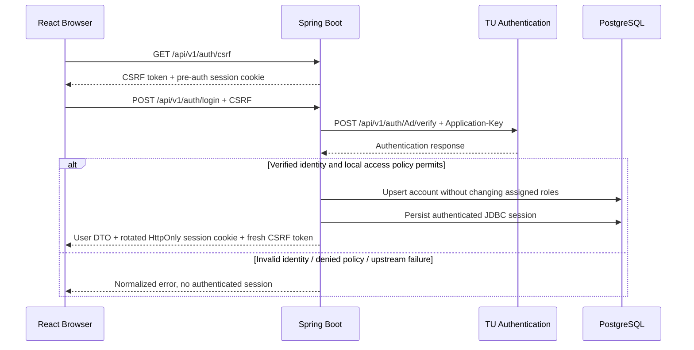

# TU API — Reference & Integration Guide

โครงการ: TU-ClubHub
ตำแหน่งใน Repository: `docs/api/TU_API.md`
วันที่จัดทำ: 12 ตุลาคม 2026
สถานะ: เรียบเรียงจากเอกสาร API ที่ผู้ใช้ส่งมา ยังไม่ได้ทดสอบกับบริการจริง

## 1. วัตถุประสงค์และแหล่งข้อมูล

เอกสารนี้รวบรวม TU API สำหรับ Authentication, Authentication Logs, Student Profile, Department และ Faculty เพื่อให้ Backend/Full-Stack ใช้เป็น Reference และสร้าง Mock สำหรับทดสอบ

ส่วนที่ 2–7 เป็นข้อมูลอ้างอิง Contract ของต้นทาง ณ วันที่จัดทำ ส่วนที่ 8–10 เป็นแนวทาง Integration และสถานะงานฝั่ง TU-ClubHub ไม่ใช่ข้อกำหนดเพิ่มเติมจากผู้ให้บริการ

- Authentication documentation: <https://restapi.tu.ac.th/tuapi/docs/GettingAuth>
- Application-Key: <https://restapi.tu.ac.th/tuapi/Authkey>
- Base URL: `https://restapi.tu.ac.th`

URL ข้างต้นเป็นแหล่งอ้างอิงที่มากับข้อมูลผู้ใช้ ไม่มีการยืนยันว่า Rate Limit หรือพฤติกรรม API ปัจจุบันตรงกับเอกสารทุกกรณี ตัวอย่าง JSON ด้านล่างรักษาชื่อและชนิด Field แต่แทนข้อมูลบุคคลด้วยข้อมูลสมมติ ไม่ใช่บัญชีที่ใช้ Login ได้จริง

## 2. ข้อกำหนดร่วม

### 2.1 Headers

| Header | Value | หมายเหตุ |
|---|---|---|
| `Content-Type` | `application/json` | ตามตัวอย่างต้นทาง |
| `Application-Key` | `<ACCESS_TOKEN>` | Key ของ Application; ตั้งฝั่ง Backend เท่านั้น |

รูปแบบ Header:

```http
Application-Key: <ACCESS_TOKEN>
```

ไม่เติม `Bearer` หน้า Token หากไม่มี Contract อื่นยืนยัน และไม่เปลี่ยนชื่อเป็น `Authorization` แม้ข้อความ Error บางอันกล่าวถึง authorization header

### 2.2 รูปแบบข้อมูล

- ชื่อ JSON Field ต่างกันตาม Endpoint เช่น `UserName`, `PassWord`, `username`, `userName`, `StatusWork` และ `Status` ต้อง Map ให้ตรงตัวพิมพ์
- `status` ของ Authentication/Profile/Catalog เป็น boolean ตามตัวอย่าง ส่วน `Status` ใน Log เป็น string
- รหัสนักศึกษา รหัสคณะ รหัสสาขา และ status codes ใน JSON เก็บเป็น string เพื่อรักษาเลขศูนย์นำหน้า
- GET endpoints ไม่มี Request Body ใช้ Query Parameters; ไม่ต้องคัดลอก `--data ""` จากตัวอย่างเดิม
- Query ที่มีภาษาไทยหรือช่องว่างต้อง URL-encode ผ่าน HTTP client/URI builder
- ต้นทางไม่ได้ระบุ nullability/requiredness ของทุก Response Field จึงต้องทดสอบกรณี Field หายหรือเป็น null

### 2.3 Endpoint summary

Rate Limit ตามข้อมูลที่ได้รับ ระบุเป็น requests/hour/user/key ขอบเขตการแชร์โควตาระหว่าง Endpoint ยังไม่ชัดเจน

| API | Method | Path | Limit |
|---|---|---|---:|
| Authentication | POST | `/api/v1/auth/Ad/verify` | 1,000 |
| Authentication alternative | POST | `/api/v1/auth/Ad/verify2` | 1,000 |
| Authentication logs by status | GET | `/api/v1/auth/Log/auth/` | 1,000 |
| Authentication logs by date | GET | `/api/v1/auth/Log/find/` | 1,000 |
| Student profile | GET | `/api/v2/profile/std/info/` | 3,000 |
| All departments | GET | `/api/v2/std/dep/all` | 1,000 |
| Department search | GET | `/api/v2/std/dep/find` | 1,000 |
| All faculties | GET | `/api/v2/std/fac/all` | 1,000 |
| Faculty search | GET | `/api/v2/std/fac/find` | 1,000 |

ไม่ถือว่าแต่ละแถวมีโควตาแยกอิสระจนกว่าผู้ให้บริการจะยืนยัน

## 3. Authentication

### 3.1 HTTP request

```http
POST https://restapi.tu.ac.th/api/v1/auth/Ad/verify
POST https://restapi.tu.ac.th/api/v1/auth/Ad/verify2
Content-Type: application/json
Application-Key: <ACCESS_TOKEN>
```

ต้นทางแสดงทั้งสอง URL แต่ไม่ได้อธิบายความต่าง เอกสารนี้ใช้ `verify` เป็นตัวอย่าง ห้ามสรุปว่า `verify2` เป็น Version ใหม่กว่า หรือใช้เป็น Fallback อัตโนมัติ

### 3.2 Request body

| Field | Type | ความหมาย |
|---|---|---|
| `UserName` | string | Username ของบัญชีมหาวิทยาลัย |
| `PassWord` | string | Password ของบัญชีมหาวิทยาลัย |

```json
{
  "UserName": "<TU_USERNAME>",
  "PassWord": "<TU_PASSWORD>"
}
```

ห้าม Trim หรือเปลี่ยนตัวอักษรของ Password โดยพลการ

### 3.3 Student response

| Field | Type | ความหมาย |
|---|---|---|
| `status` | boolean | ผลการยืนยันตัวตน |
| `message` | string | ข้อความผลการทำงาน |
| `type` | string | `student` หรือ `employee` ตามประเภทบัญชี |
| `username` | string | บัญชีมหาวิทยาลัย; ในตัวอย่างนักศึกษาเป็นรหัสนักศึกษา |
| `tu_status` | string | สถานะนักศึกษา เช่น ปกติ พักการศึกษา ลาออก สำเร็จการศึกษา |
| `statusid` | string | รหัสสถานะ; ยังไม่มีรายการรหัสทั้งหมด |
| `displayname_th` | string | ชื่อภาษาไทย |
| `displayname_en` | string | ชื่อภาษาอังกฤษ |
| `email` | string | อีเมลมหาวิทยาลัย |
| `department` | string | สาขา/หน่วยงานตามข้อมูล API |
| `faculty` | string | คณะ/หน่วยงานระดับคณะ |

```json
{
  "status": true,
  "message": "Success",
  "type": "student",
  "username": "5701010101",
  "tu_status": "สำเร็จการศึกษา",
  "statusid": "40",
  "displayname_th": "นักศึกษา ทดสอบ",
  "displayname_en": "Test Student",
  "email": "student@example.invalid",
  "department": "สาขาตัวอย่าง",
  "faculty": "คณะตัวอย่าง"
}
```

ตัวอย่างต้นทางยืนยันตัวตนสำเร็จแม้มีสถานะสำเร็จการศึกษา จึงต้องแยก Authentication Success ออกจากสิทธิ์สมัครชมรม ห้ามตีความ `status=true` ว่าเป็นนักศึกษาที่กำลังศึกษาอยู่

### 3.4 Employee response

| Field | Type | ความหมาย |
|---|---|---|
| `status` | boolean | ผลการยืนยันตัวตน |
| `message` | string | ข้อความผลการทำงาน |
| `type` | string | `employee` |
| `username` | string | บัญชีมหาวิทยาลัย |
| `displayname_th`, `displayname_en` | string | ชื่อภาษาไทย/อังกฤษ |
| `StatusWork` | string | `0` ลาออก, `1` ปฏิบัติงาน, `2` ไม่ปฏิบัติงาน |
| `StatusEmp` | string | สถานะพนักงาน |
| `email` | string | อีเมลมหาวิทยาลัย |
| `department` | string | หน่วยงาน |
| `organization` | string | องค์กร |

```json
{
  "status": true,
  "message": "Success",
  "type": "employee",
  "username": "test_employee",
  "displayname_th": "บุคลากร ทดสอบ",
  "displayname_en": "Test Employee",
  "StatusWork": "1",
  "StatusEmp": "ปกติ",
  "email": "employee@example.invalid",
  "department": "หน่วยงานตัวอย่าง",
  "organization": "องค์กรตัวอย่าง"
}
```

### 3.5 Status / messages

| HTTP | Body status | Message / ความหมาย |
|---:|---|---|
| 200 | true | `Success` |
| 400 | false | `User or Password Invalid!` |
| 400 | false | `Could not read the request body!` |
| 400 | false | `The request body has error! (UserName or PassWord Invalid!)` |
| 401 | false | `Application-Key header required` |
| 403 | false | Application-Key invalid token หรือไม่มีสิทธิ์เข้าถึง Resource |

ตัวอย่างข้อความ 403 ในต้นทาง:

```text
Application-Key failed due to the following reason: invalid token.
Confirm that the access token in the authorization header is valid.
```

HTTP 401/403 จาก TU ในบริบทนี้เกี่ยวข้องกับ Application-Key/สิทธิ์ของระบบ ไม่ควรแสดงให้ผู้ใช้ว่า “รหัสผ่านผิด” ส่วน 400 ต้องแยก invalid credentials ออกจาก request ที่ Backend สร้างผิด

### 3.6 cURL example

ตัวอย่างเป็น Template สำหรับเครื่องพัฒนาที่ได้รับอนุญาต ตั้ง `TU_APPLICATION_KEY` ผ่าน Environment และใช้ไฟล์ `tu-auth-request.json` ที่มี Body ตามข้อ 3.2 ไม่ Commit ไฟล์ที่ใส่รหัสผ่านจริง และลบเมื่อทดสอบเสร็จ

```bash
curl --request POST \
  'https://restapi.tu.ac.th/api/v1/auth/Ad/verify' \
  --header 'Content-Type: application/json' \
  --header "Application-Key: ${TU_APPLICATION_KEY}" \
  --data-binary @tu-auth-request.json
```

## 4. Authentication Logs

เป็น API อ่านบันทึกของผู้ให้บริการ ไม่ใช่ Endpoint สำหรับทำ Login หรืออ่านประวัติใบสมัคร TU-ClubHub

### 4.1 Requests and parameters

```http
GET /api/v1/auth/Log/auth/?status=true
GET /api/v1/auth/Log/auth/?status=false
GET /api/v1/auth/Log/find/?date=2019-05-22
```

| Parameter | Type | ใช้กับ | รายละเอียด |
|---|---|---|---|
| `status` | boolean text | `/Log/auth/` | `true` หรือ `false` |
| `date` | string | `/Log/find/` | `YYYY-MM-DD` เช่น `2019-05-22` |
| `record` | integer | ทั้งสอง Endpoint | Optional; 1–10000; ไม่ระบุค่า Default ในต้นทาง |
| `username` | string | ทั้งสอง Endpoint | Optional; ค้นตามบัญชีหรือรหัสนักศึกษา |

ตัวอย่าง:

```text
/api/v1/auth/Log/auth/?status=false&record=10&username=test_student
/api/v1/auth/Log/find/?date=2019-05-22&record=10&username=test_student
```

### 4.2 Response

```json
[
  {
    "Description": "Login Success : test_student",
    "Status": "TRUE : 200 Method:POST/Authentication",
    "CreateDate": "2019-08-23 08:36:43.000"
  },
  {
    "Description": "Login Success : test_student",
    "Status": "TRUE : 200 Method:POST/Authentication",
    "CreateDate": "2019-08-22 18:03:18.000"
  }
]
```

| Field | Type | หมายเหตุ |
|---|---|---|
| `Description` | string | คำอธิบายเหตุการณ์ |
| `Status` | string | ข้อความรวมสถานะ/HTTP/method ไม่ใช่ boolean |
| `CreateDate` | string | วันเวลาในตัวอย่างไม่มี Timezone |

### 4.3 Status / messages

| HTTP | ข้อมูลต้นทาง |
|---:|---|
| 200 | `Data Response`; ตาราง Status Message ระบุ FALSE แต่ตัวอย่างเป็น Array ของ Log |
| 400 | `Record Value Invalid!, please enter length 1-10000` |
| 400 | ค่า status ไม่ถูกต้อง; ต้องเป็น true/false |
| 400 | ค่า date ไม่ถูกต้อง; ต้องเป็น YYYY-MM-DD |
| 401 | Application-Key header required |
| 403 | Application-Key invalid token / ไม่มีสิทธิ์ |

**จุดไม่สอดคล้อง:** ห้ามสร้าง Response wrapper `{status:false,data:...}` จากตารางดังกล่าวเอง เพราะตัวอย่างที่ให้เป็น Array ตรง ๆ ต้องยืนยันรูปแบบจริงก่อน Implement Log adapter รวมถึง Timezone และขอบเขตข้อมูลที่ Key มีสิทธิ์อ่าน

### 4.4 cURL example

```bash
curl --get 'https://restapi.tu.ac.th/api/v1/auth/Log/auth/' \
  --header 'Content-Type: application/json' \
  --header "Application-Key: ${TU_APPLICATION_KEY}" \
  --data-urlencode 'status=false' \
  --data-urlencode 'record=10'
```

## 5. Student Profile

### 5.1 Request

```http
GET https://restapi.tu.ac.th/api/v2/profile/std/info/?id=<STUDENT_ID>
```

| Parameter | Type | รายละเอียด |
|---|---|---|
| `id` | string | รหัสนักศึกษา; ไม่ส่ง Request Body |

Rate Limit ตามต้นทาง: 3,000 requests/hour/user/key

### 5.2 Response

```json
{
  "timestamp": 1582094550321,
  "status": true,
  "message": "Success",
  "data": {
    "type": "student",
    "statusname": "ปกติ",
    "userName": "4900557555",
    "prefixname": "Mr",
    "displayname_th": "นักศึกษา ทดสอบ",
    "displayname_en": "Test Student",
    "email": "student@example.invalid",
    "faculty": "คณะตัวอย่าง",
    "department": "สาขาตัวอย่าง"
  }
}
```

| Field | Type | ความหมาย |
|---|---|---|
| `timestamp` | number | เวลาจาก API; ต้นทางไม่ได้ระบุหน่วยชัดเจน |
| `status` | boolean | ผลคำขอ |
| `message` | string | ข้อความผลคำขอ |
| `data` | object | ข้อมูลนักศึกษา |
| `data.type` | string | ประเภทบัญชี |
| `data.statusname` | string | สถานะนักศึกษา |
| `data.userName` | string | บัญชี/รหัสนักศึกษา; ชื่อต่างจาก Authentication `username` |
| `data.prefixname` | string | คำนำหน้าชื่อ |
| `data.displayname_th`, `data.displayname_en` | string | ชื่อไทย/อังกฤษ |
| `data.email` | string | อีเมล |
| `data.faculty`, `data.department` | string | คณะ/สาขา |

### 5.3 Status / messages

| HTTP | Body status | Message / ความหมาย |
|---:|---|---|
| 200 | true | `Get Profile Student Success` ในตาราง; ตัวอย่าง JSON ใช้ `Success` |
| 400 | false | `Student ID Invalid!` |
| 400 | false | ไม่อนุญาต Request Body ใน GET; ใช้ Query `id` |
| 401 | false | Application-Key header required |
| 403 | false | Application-Key invalid token / ไม่มีสิทธิ์ |

อย่าใช้ข้อความ Success แบบเดียวเป็นเงื่อนไขเดียวในการรับ Response เพราะต้นทางเองมีสองรูปแบบ

### 5.4 cURL example

```bash
curl --get 'https://restapi.tu.ac.th/api/v2/profile/std/info/' \
  --header 'Content-Type: application/json' \
  --header "Application-Key: ${TU_APPLICATION_KEY}" \
  --data-urlencode 'id=<STUDENT_ID>'
```

## 6. Student Departments

### 6.1 Requests and filters

```http
GET https://restapi.tu.ac.th/api/v2/std/dep/all
GET https://restapi.tu.ac.th/api/v2/std/dep/find?<FILTER>=<VALUE>
```

| Filter | ตัวอย่าง Value |
|---|---|
| `faculty_id` | `1` |
| `faculty_th` | `คณะนิติศาสตร์` |
| `faculty_en` | `Faculty of Law` |
| `department_code` | `11010100154` |
| `department_name_th` | `โครงการบัณฑิตศึกษา` |
| `department_name_en` | `Graduate Study Program` |

ตัวอย่างแสดงการค้นทีละ Filter ยังไม่ระบุว่ารองรับหลาย Filter พร้อมกันหรือใช้ AND/OR และไม่ระบุ exact/partial/case-sensitive matching

### 6.2 Response

```json
{
  "timestamp": 1608275763,
  "status": true,
  "message": "Success",
  "data": [
    {
      "faculty_id": "1",
      "faculty_th": "คณะนิติศาสตร์",
      "faculty_en": "Faculty of Law",
      "department_code": "11010100154",
      "department_name_th": "สาขาวิชานิติศาสตร์",
      "department_name_en": "Laws"
    }
  ]
}
```

| Field ใน `data[]` | Type | ความหมาย |
|---|---|---|
| `faculty_id` | string | รหัสคณะ |
| `faculty_th`, `faculty_en` | string | ชื่อคณะไทย/อังกฤษ |
| `department_code` | string | รหัสสาขา |
| `department_name_th`, `department_name_en` | string | ชื่อสาขาไทย/อังกฤษ |

Wrapper ใช้ `timestamp` number, `status` boolean, `message` string และ `data` array

### 6.3 Status / messages

| HTTP | Body status | Message / ความหมาย |
|---:|---|---|
| 200 | true | `Get Data Department Student All Success!` |
| 200 | true | `Get Data Department Student by filter Success!` |
| 400 | false | `Faculty ID or Department ID is Invalid!` พร้อมคำแนะนำ filter |
| 401 | false | Application-Key header required |
| 403 | false | Application-Key invalid token / ไม่มีสิทธิ์ |

### 6.4 cURL example

```bash
curl --get 'https://restapi.tu.ac.th/api/v2/std/dep/find' \
  --header 'Content-Type: application/json' \
  --header "Application-Key: ${TU_APPLICATION_KEY}" \
  --data-urlencode 'faculty_th=คณะนิติศาสตร์'
```

## 7. Student Faculties

### 7.1 Requests and filters

```http
GET https://restapi.tu.ac.th/api/v2/std/fac/all
GET https://restapi.tu.ac.th/api/v2/std/fac/find?<FILTER>=<VALUE>
```

| Filter | ตัวอย่าง Value |
|---|---|
| `faculty_id` | `1` |
| `faculty_th` | `คณะนิติศาสตร์` |
| `faculty_en` | `Faculty of Law` |

ใช้ทีละ Filter ตามตัวอย่างต้นทางจนกว่าจะยืนยันการค้นหลายเงื่อนไข

### 7.2 Response

```json
{
  "timestamp": 1608265793,
  "status": true,
  "message": "Success",
  "data": [
    {
      "faculty_id": "1",
      "faculty_th": "คณะนิติศาสตร์",
      "faculty_en": "Faculty of Law"
    }
  ]
}
```

| Field ใน `data[]` | Type | ความหมาย |
|---|---|---|
| `faculty_id` | string | รหัสคณะ |
| `faculty_th` | string | ชื่อคณะภาษาไทย |
| `faculty_en` | string | ชื่อคณะภาษาอังกฤษ |

Wrapper ใช้ `timestamp` number, `status` boolean, `message` string และ `data` array

### 7.3 Status / messages

| HTTP | Body status | Message / ความหมาย |
|---:|---|---|
| 200 | true | `Get Data Faculty Student All Success!` |
| 200 | true | `Get Data Faculty Student by filter Success!` |
| 400 | false | `Faculty ID is Invalid!` พร้อมคำแนะนำ filter |
| 401 | false | Application-Key header required |
| 403 | false | Application-Key invalid token / ไม่มีสิทธิ์ |

### 7.4 cURL example

```bash
curl --request GET 'https://restapi.tu.ac.th/api/v2/std/fac/all' \
  --header 'Content-Type: application/json' \
  --header "Application-Key: ${TU_APPLICATION_KEY}"
```

## 8. การเชื่อมต่อ TU-ClubHub

ส่วนนี้เป็นการออกแบบฝั่ง TU-ClubHub ไม่ใช่ TU API Contract ปรับปรุงสถานะ 19 ต.ค. 2026: มี Real/Mock authentication adapters และ Session endpoints แล้ว แต่การเข้าถึง TU จริงและการ Sync student profile/status ยังต้องทำตาม [API Contract](API_v1.md) และ [Permission Matrix](../security/permission-matrix.md)

### 8.1 API ที่ใช้ใน MVP

| API | แนวทางใช้งาน |
|---|---|
| Authentication verify | เส้นทางหลักสำหรับตรวจบัญชีก่อนสร้าง Session |
| Authentication verify2 | ยังไม่ใช้จนทราบความต่าง |
| Student profile | Optional enrichment เมื่อข้อมูล Login ไม่เพียงพอและ Key มีสิทธิ์; ไม่จำเป็นต้องเรียกทุก Login |
| Faculty/Department | Optional reference data สำหรับตัวเลือกหรือการ Normalize; Cache/Sync ตามนโยบาย |
| Authentication logs | ไม่เป็น dependency ของ Login ปกติ; ใช้เฉพาะงานตรวจสอบที่ได้รับสิทธิ์ |

การมี Application-Key สำหรับ Login ไม่ยืนยันว่าใช้ Profile/Catalog/Logs ได้ทุก Endpoint ต้องตรวจสิทธิ์เป็นรายบริการ

### 8.2 Request flow



TU-ClubHub รับ `{username,password}` จาก Frontend และ TU adapter แปลงเป็น `{UserName,PassWord}` ตาม Contract ของต้นทาง

Authentication response ไม่มี Token สำหรับใช้เป็น Session ของ TU-ClubHub; Application-Key เป็น Credential ของระบบเราในการเรียก TU ไม่ใช่ Token ของนักศึกษา ระบบสร้าง Session ของตนเองผ่าน Spring Security/JDBC

### 8.3 Data mapping

| TU field | TU-ClubHub target | กติกา |
|---|---|---|
| Auth `username` | `users.tu_username` | ใช้ identity จาก Response ที่ผ่านการตรวจ ไม่ใช้ email เป็น primary identity |
| Auth `displayname_th` | `users.display_name` | Fallback เป็นชื่ออังกฤษ/username เมื่อไม่มีชื่อไทย |
| Auth `email` | `users.email` | ไม่ถือว่ามี email verification flag เพราะ API ไม่ได้ส่งมา |
| Auth student `username` | `student_profiles.student_code` | ตัวอย่างใช้รหัสนักศึกษา; ต้องยืนยัน guarantee ก่อนใช้กับทุกบัญชี |
| Auth `faculty` / profile `data.faculty` | `student_profiles.faculty_name` | ชื่อคณะ ไม่ใช่ faculty_id |
| Auth `department` / profile `data.department` | `student_profiles.department_name` | ห้าม Map เป็น program_name โดยไม่มีหลักฐาน |
| `tu_status` + `statusid` / `data.statusname` | `student_profiles.student_status` | Normalize ผ่าน Policy ที่ทีมตกลง; unknown ต้องไม่กลายเป็น ACTIVE |
| เวลาที่ระบบ Sync สำเร็จ | `student_profiles.synced_at` | เวลาฝั่งระบบเรา ไม่ใช้ timestamp ที่ยังไม่ทราบหน่วย |
| Profile `data.userName` | Cross-check identity | ต้องตรงกับบัญชีที่ได้รับอนุญาตให้ค้น |
| `type=employee` | ประเภท Identity สำหรับตรวจ Policy | ไม่ให้ ADMIN อัตโนมัติ |

ข้อมูลที่ยังไม่มีในตัวอย่าง: หลักสูตรที่ยืนยันแยกจากสาขา, ชั้นปี, สิทธิ์กรรมการชมรม, Global ADMIN และตารางรหัสสถานะนักศึกษาทั้งหมด ห้ามอนุมานหรือสร้างข้อมูลเติมเอง

ปัจจุบัน `UserAccountService` บันทึกเฉพาะ `users` แถว mapping ของ `student_profiles` ด้านบนยังเป็นเป้าหมาย ต้องยืนยันสถานะเป็น ACTIVE ก่อนใช้สิทธิ์นักศึกษาตาม Matrix; Login สำเร็จไม่ได้เติม student profile อัตโนมัติ

ตัวอย่าง `statusid="40"` จับคู่กับ `tu_status="สำเร็จการศึกษา"` ได้เฉพาะตามตัวอย่างที่มี แต่ยังไม่ใช่ Status Code Catalog ฉบับเต็ม

การ Login สำเร็จของบุคลากร/ผู้สำเร็จการศึกษาอาจแยกจากสิทธิ์สมัครชมรมได้ ต้องตกลงว่ากลุ่มใดเข้า Portal ได้และเห็นอะไร อย่าเพิ่มสิทธิ์สมัครหรือ Admin จาก `type`/โดเมนอีเมลเพียงอย่างเดียว และอย่า Reset Role ที่มอบหมายไว้เมื่อ Sync Profile

### 8.4 Backend adapters ปัจจุบันและส่วนที่ยังไม่มี

| ส่วน | สถานะ / หน้าที่ |
|---|---|
| `auth/integration/tu/TuAuthClient`, `RealTuAuthClient`, `MockTuAuthClient` | มีแล้ว; เรียก authentication และแปลง upstream failures หรือใช้บัญชี demo ใน dev/test |
| `auth/integration/tu/TuAuthUser` | มีแล้ว; identity ที่ส่งเข้า LoginService แยกจาก API DTO ของเรา |
| `auth/service/`, `auth/controller/` | มีแล้ว; ประเมิน local account policy และสร้าง Authentication/session |
| Student profile adapter | ยังไม่มี; ต้องกำหนดและยืนยัน mapping/status ก่อน Sync |
| Faculty/department adapter | ยังไม่มี; เพิ่มเมื่อ workflow ต้องใช้ reference data จริง |

ใช้ JSON mapping แบบ explicit เช่น `@JsonProperty("UserName")`, `@JsonProperty("PassWord")`, `@JsonProperty("StatusWork")` เมื่อชื่อ Java field เป็น camelCase และแยก DTO ของ Authentication/Profile/Log ไม่รวมทุก Endpoint เป็น DTO เดียว

Response DTO ควรรับ unknown fields ได้ แต่ตรวจ required identity fields และ `status` ก่อนใช้ ห้ามให้ Response ที่ผิดรูปแบบหรือขาด Field สำคัญกลายเป็น Login สำเร็จ

### 8.5 Error mapping สำหรับ API ของ TU-ClubHub

รหัสข้อผิดพลาดภายในยึด [Authentication errors ใน API Contract](API_v1.md#authentication-errors); พฤติกรรมต้นทางที่ยังไม่มีข้อมูลยืนยันต้องตรวจเมื่อเชื่อมบริการจริง

| TU / Network condition | ผลใน TU-ClubHub | Retry |
|---|---|---|
| 200 + true + identity ถูกต้อง | ประเมิน local policy แล้วสร้าง Session | ไม่ต้อง |
| 400 + invalid credentials ที่ระบุได้ | 401 + `AUTHENTICATION_FAILED` | ไม่ retry อัตโนมัติ |
| 400 จาก Body ที่ Backend สร้างผิด | 500 + `INTERNAL_ERROR`; log เป็น integration defect โดยไม่เผยรายละเอียดภายใน | แก้ implementation |
| 401/403 จาก Application-Key | 503 + `AUTH_PROVIDER_UNAVAILABLE`; log เหตุผลที่ผ่านการปิดบัง Secret | ไม่ retry key เดิมซ้ำ |
| Timeout / TU 5xx | 503 + `AUTH_PROVIDER_UNAVAILABLE`; ไม่มี Session สำเร็จ | Login ไม่ retry อัตโนมัติเป็น default |
| 200 แต่ผิด Schema/identity ไม่สมบูรณ์ | 503 + `AUTH_PROVIDER_UNAVAILABLE` | ไม่ยอมรับเป็นสำเร็จ |
| 200 + false ที่ไม่รู้จัก | จัดประเภท upstream rejection ก่อนเลือก code; ถ้าจำแนกไม่ได้ให้ใช้ 503 + `AUTH_PROVIDER_UNAVAILABLE` | ไม่เดาว่า password ผิดทุกกรณี |
| บัญชีในระบบเราถูกระงับ/Policy ไม่อนุญาต | 403 + `ACCOUNT_NOT_ALLOWED` | ไม่ retry |

กรณีต้นทางไม่ส่ง machine-readable error code อาจต้องจำแนกจาก Message ที่ยืนยันแล้ว ให้จำกัด logic นี้ไว้ใน Adapter และทดสอบกรณีข้อความเปลี่ยน ไม่กระจายการเทียบ string ไปทั่ว Service/UI

ต้นทางที่ส่งมาไม่ได้ระบุ HTTP 429 หรือ Retry-After เมื่อเกินโควตา ถ้าพบจริงให้รองรับอย่างจำกัดตาม Header/Contract ที่ตรวจสอบได้ ห้ามระบุว่า TU รับประกัน behavior นี้

### 8.6 Security and operational rules

- Application-Key อยู่ใน Environment/Secret ฝั่ง Backend เท่านั้น ไม่ใส่ใน `VITE_*`, Browser หรือ Repository
- รักษา HTTPS certificate verification และไม่ Follow redirect พร้อม Credential ไปปลายทางที่ไม่ได้รับรอง
- TU password ใช้ชั่วคราวสำหรับ verify ไม่ Persist ใน DB, Session, Log หรือ Error DTO
- ไม่ log Request/Response ทั้งก้อนโดยอัตโนมัติ เพราะมี Credential และข้อมูลส่วนบุคคล
- เปิด CSRF สำหรับ Session-based Login/Logout และ state-changing APIs; เปลี่ยน Session ID หลัง Login และ invalidate เมื่อ Logout
- Session ฝั่งเราใช้ idle timeout 30 นาทีและ absolute timeout 8 ชั่วโมงนับจาก Login สำเร็จ แล้วแต่อย่างใดถึงก่อน; หลัง Login คืน CSRF token ใหม่ใน Response Body และเมื่อหมดอายุให้บังคับ Login ใหม่
- ตั้ง Connect/Read timeout ให้มีขอบเขต; งด automatic retry ของ Login เป็นค่าเริ่มต้นเพื่อไม่เพิ่มคำขอยืนยันตัวตนซ้ำ
- ตรวจ Session ของเราใน Request ปกติ ไม่เรียก TU verify ใหม่ทุก API และไม่เก็บ Password เพื่อ re-verify
- Profile endpoint ภายในของเราต้องผูก Student ID กับสิทธิ์ผู้ร้องขอ ไม่เปิด Proxy ให้ผู้ใช้กรอก ID ใดก็ได้แล้วอ่านข้อมูล
- Reference catalogs Cache ได้ตามนโยบาย แต่ไม่ Cache ผลยืนยัน Password เป็นทางลัด Authentication
- Status/eligibility ที่ Sync ไว้มีโอกาสเก่า ต้องตกลง Refresh Policy สำหรับการสมัคร/ยืนยันสิทธิ์

## 9. Test Cases สำหรับ Integration

CI ใช้ Mock/Stub; แยกการตรวจ TU API จริงก่อนส่งมอบด้วยบัญชีและ Key ที่ได้รับอนุญาต ห้ามใช้ข้อมูลบุคคลจริงเป็น Fixture ใน Git

| ID | Scenario | Expected result |
|---|---|---|
| TU-01 | Student verify สำเร็จ และผ่าน Local Policy | Map identity ถูกต้อง สร้าง/อัปเดตบัญชีและ Session |
| TU-02 | verify true แต่สถานะสำเร็จการศึกษา | ไม่ได้รับสิทธิ์สมัครอัตโนมัติ; ตรวจ Policy แยกจาก Auth |
| TU-03 | Employee verify สำเร็จ | ไม่สร้าง Student eligibility หรือ ADMIN อัตโนมัติ |
| TU-04 | 400 invalid credentials | ไม่มี authenticated session; แสดงข้อผิดพลาดมาตรฐาน |
| TU-05 | 400 malformed request | จัดเป็น Integration Error ไม่โทษรหัสผ่านผู้ใช้ |
| TU-06 | 401 ไม่มี Application-Key | fail closed และไม่เผย Key |
| TU-07 | 403 Key ผิด/สิทธิ์ไม่พอ | แจ้งบริการยืนยันตัวตนไม่พร้อม ไม่ fallback เป็น Mock |
| TU-08 | Timeout / 5xx | ไม่มี Session สำเร็จและไม่เกิด Retry ไม่จำกัด |
| TU-09 | 200 + malformed JSON/identity field หาย | ไม่ยอมรับ Authentication |
| TU-10 | Unknown student status/type | ไม่ให้สิทธิ์เพิ่มด้วย Default ACTIVE |
| TU-11 | ตัวพิมพ์ Field ต่างกันตาม Endpoint | DTO ของ Auth/Profile/Employee/Log Map ถูกต้อง |
| TU-12 | Profile ID ไม่ตรงผู้ร้องขอที่ไม่มีสิทธิ์ | ปฏิเสธก่อนเรียกหรือก่อนเปิดเผยข้อมูล |
| TU-13 | Filter ภาษาไทย/ช่องว่าง | URL encoding ถูกต้อง; GET ไม่มี Body |
| TU-14 | Faculty/department มีรหัสขึ้นต้นด้วยศูนย์ | เก็บค่า string ครบ ไม่แปลงเป็นเลข |
| TU-15 | Logs คืน Array และ Status เป็น string | Parse ตาม Schema ของ Log ไม่ใช้ Auth DTO |
| TU-16 | Login ซ้ำของบัญชีที่มี Role อยู่แล้ว | ไม่ทับ Role/Assignment ที่ระบบมอบหมายไว้ |
| TU-17 | เข้า API หลัง Login และหลัง Logout | Cookie ใช้งานข้าม Request ได้; Session เดิมใช้ไม่ได้หลัง Logout |
| TU-18 | ตรวจ Log/Error output | ไม่มี Password, Application-Key หรือ Session ID หลุด |

Optional APIs ที่ยังไม่ได้เปิดใช้ไม่จำเป็นต้อง Implement เพียงเพื่อให้ครบทุก Test ในตาราง ให้ผูกกรณีทดสอบกับ Scope ที่พัฒนาจริง

## 10. สิ่งที่ต้องยืนยันก่อนเชื่อมบริการจริง

| ประเด็น | เหตุผล |
|---|---|
| verify กับ verify2 ต่างกันอย่างไร | ต้นทางระบุสอง URL โดยไม่อธิบาย |
| สิทธิ์ของ Application-Key | Auth, Profile, Catalog และ Logs อาจได้รับสิทธิ์ต่างกัน |
| statusid catalog และ tu_status/statusname mapping | มีเพียงตัวอย่างบางสถานะ ไม่ควรเดาสถานะที่เหลือ |
| username เป็น student ID เสมอหรือไม่ | มีผลต่อ student_code และ profile lookup |
| Response เมื่อไม่พบข้อมูล/Field เป็น null | ตัวอย่างยังไม่ครอบคลุม |
| หน่วย timestamp | Profile ตัวอย่าง 13 หลัก แต่ Catalog 10 หลัก ห้ามใช้ Parser หน่วยเดียวโดยเดา |
| Timezone ของ CreateDate | ตัวอย่างไม่มี offset |
| Logs HTTP 200 กับตาราง FALSE | รูปแบบต้นทางไม่สอดคล้องกับ Array example |
| Search exact/partial และหลาย filters | ไม่ได้ระบุไว้ |
| Rate limit scope/reset/response headers | ป้องกันคำนวณโควตาต่อ Endpoint ผิด |
| Policy การเข้าระบบของ Alumni/Employees | ยึด Permission Matrix ของ TU-ClubHub; Authentication สำเร็จไม่ทำให้ได้สิทธิ์นักศึกษาหรือ Admin |
| Refresh status และ conflict ระหว่าง Auth/Profile | ต้องกำหนดแหล่งข้อมูลที่ใช้ตัดสิน eligibility |

ข้อมูลชุดนี้ทำให้เริ่มเขียน TU adapter และ Mock จาก Contract ที่มีหลักฐานได้แล้ว ส่วนพฤติกรรมในตารางนี้ยังต้องยืนยันเพิ่ม เอกสารนี้ไม่ใช่ผลตรวจรับการเชื่อมต่อจริง
