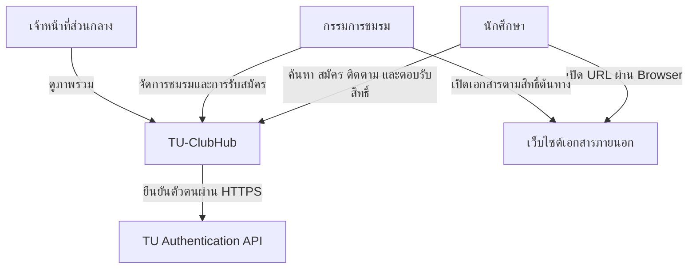
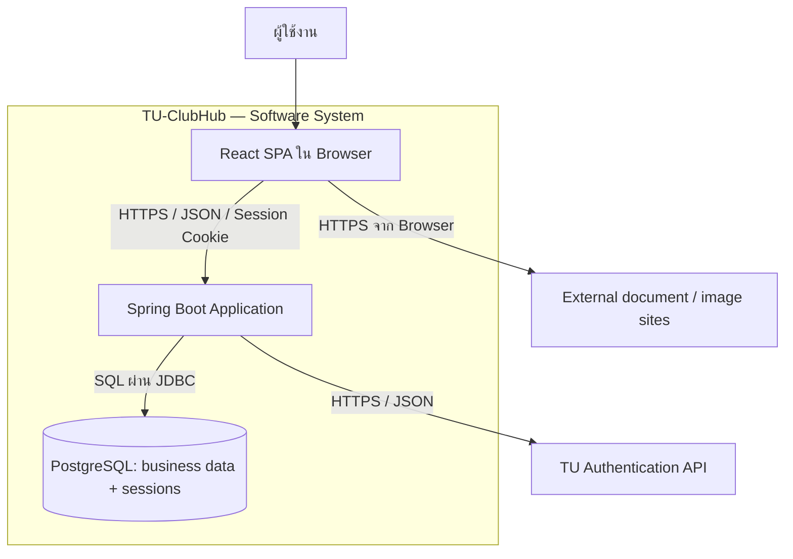
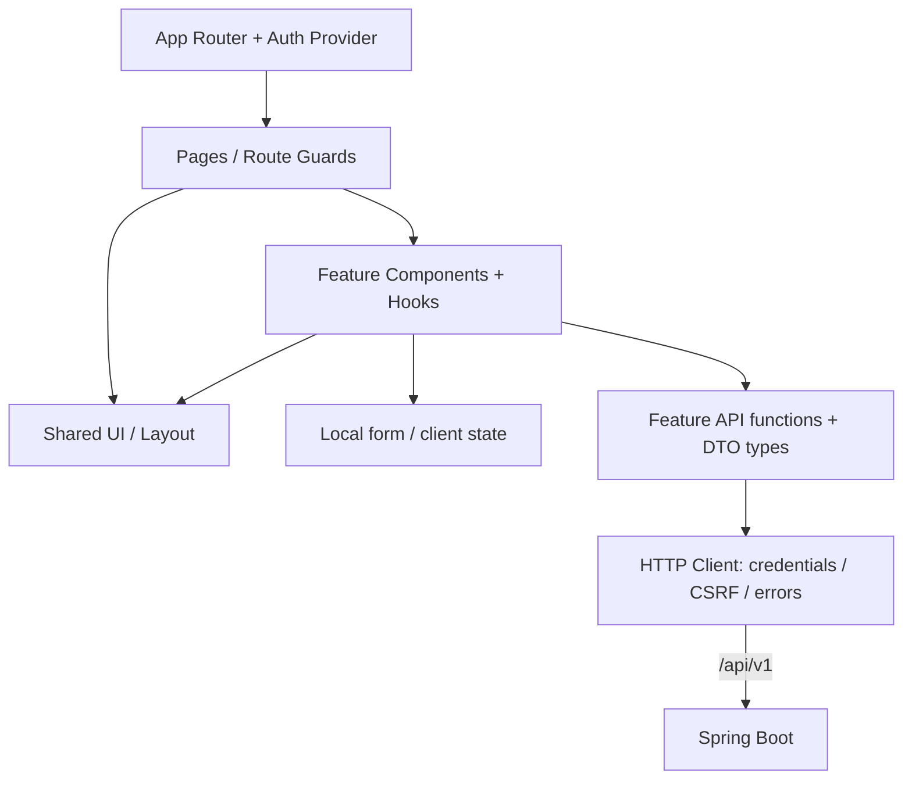
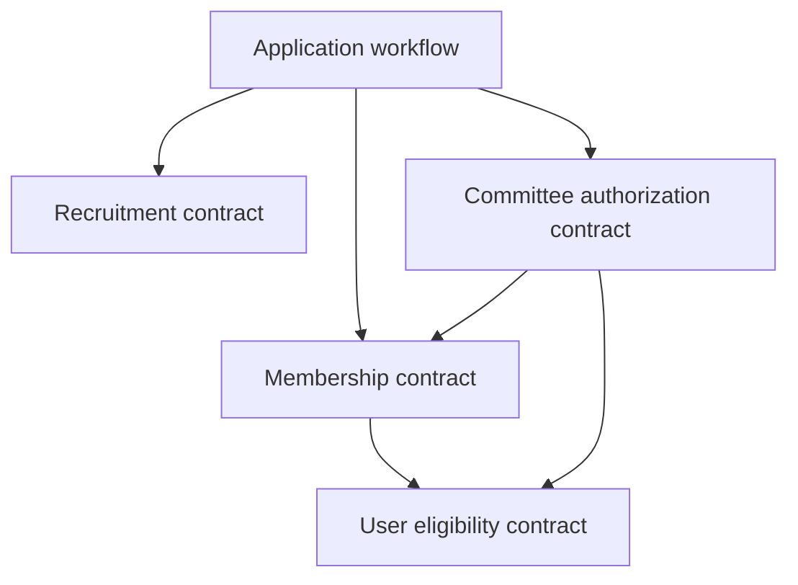
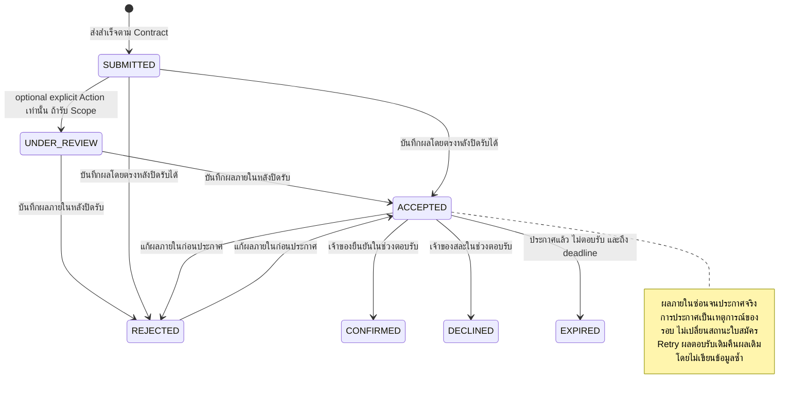
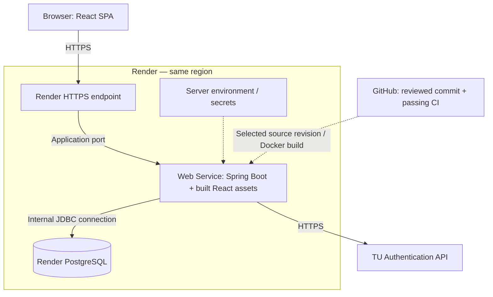

# TU-ClubHub — System Architecture

วันที่: 11 ตุลาคม 2026 · ปรับปรุง Context: 27 ตุลาคม 2026 · Version: 1.3 · สถานะ: Target Architecture; ส่วนเพิ่มเติม Sprint 2 / Task74 เป็น **Draft / Pending Review**

เอกสารนี้อธิบายแบบเป้าหมาย ใช้ [README](../../README.md) และ [Repository context](scaffold-context.md) สำหรับสถานะและโครงสร้างปัจจุบัน มี Auth, Public Club APIs, Profile PUT และ Round/Question writes แล้ว Frontend มี [routes ของ Login/ชมรม/แก้โปรไฟล์/คำถาม](../../frontend/src/app/AppRoutes.tsx) แต่ [submission service ยังเป็น mock](../../frontend/src/features/applications/services/applicationService.ts) และยังไม่มี Submission API เอกสารนี้ไม่ใช่หลักฐาน Deploy หรือผลรันทดสอบ

Contract อ้างอิง [API_v1.md](../api/API_v1.md), [Main OpenAPI](../api/openapi.yaml), [Recruitment OpenAPI](../api/rounds.openapi.yaml) และ [ERD](../database/TU-ClubHub-ERD-Updated.dbml); Schema ที่รันจริงอยู่ใน [Flyway migrations](../../backend/src/main/resources/db/migration)

เริ่มทบทวน Sprint 2 ที่ [Task74 review/handoff artefact](task74-sprint2-analysis.md) ส่วนเพิ่มเติมครั้งนี้รวบรวมหลักฐานและข้อเสนอ ไม่ใช่การอนุมัติ Requirements หรือหลักฐานว่า Application workflow ถูก Implement แล้ว นโยบายที่เอกสารเดิมระบุว่ากำหนดแล้วคงสถานะเดิม; ข้อเสนอใหม่ต้องผ่าน PO/Reviewer ตาม [Decision Log](#s2-decision-log)

## 1. วัตถุประสงค์และผู้ใช้งานเอกสาร

TU-ClubHub สนับสนุนการค้นหาชมรม การรับสมัคร การคัดเลือก และการยืนยันสมาชิกภาพของมหาวิทยาลัยธรรมศาสตร์ ออกแบบสำหรับทีม 7 คนและการส่งมอบตามรายวิชา โดยลดภาระ Infrastructure และทำให้สมาชิกที่ยังมีประสบการณ์น้อยเข้าใจขอบเขตงานได้

| Audience | ใช้ส่วนใด |
|---|---|
| PO / ผู้ตรวจรับ | System Context, Scope, Business Rules และข้อที่ยังต้องตกลง |
| SA / Developers | Container, Module Boundaries, API, Database และ Runtime Flows |
| QA / DevOps | Configuration, Deployment, CI, Security และ Verification |

ชื่อ Diagram ทั้งหมดใช้ตาม C4 เป็นแนวทาง: Context, Container, Component ส่วน Deployment เป็นภาพเสริม ไม่ใช่ C4 Level 4; Class Diagram เป็นตัวอย่างระดับ Code และ Sequence Diagram ใช้อธิบายพฤติกรรมตามเวลา

## 2. ขอบเขตและสถานะการตัดสินใจ

### 2.1 ข้อตัดสินใจของโครงการ

- Monorepo เก็บ React Frontend, Spring Boot Backend และเอกสารร่วมกัน
- Frontend เป็น React SPA แบบ CSR และแบ่งโค้ดตาม Feature
- Backend เป็น Modular Monolith ใน Spring Boot process เดียวและใช้ PostgreSQL ร่วมกัน
- REST JSON ภายใต้ `/api/v1`; Frontend กับ API ใช้ Origin เดียวเมื่อส่งมอบ
- Login ผ่าน TU API, เก็บสถานะด้วย Spring Session JDBC และ Cookie
- Session หมดอายุเมื่อไม่มี activity 30 นาที หรือครบ 8 ชั่วโมงหลัง Login สำเร็จ แล้วแต่อย่างใดถึงก่อน
- ใช้ Flyway จัดการ Schema และใช้ PostgreSQL สำหรับข้อมูลธุรกิจและ Session
- ส่งมอบบน Render Web Service และ Render PostgreSQL; Build React รวมกับ Spring Boot
- เก็บ URL เอกสารและรูปภาพ ไม่อัปโหลดไฟล์หรือดึงไฟล์อัตโนมัติจาก Backend

### 2.2 Conventions และงานโครงสร้างที่ยังเหลือ

AuthContext, SameSite=Lax, CSRF bootstrap endpoint และ JSON ID แบบ string ใช้อยู่ใน implementation/contract แล้ว [Router หลัก](../../frontend/src/app/AppRoutes.tsx) มีแล้ว ส่วน HTTP client กลางยังเป็นเป้าหมาย Frontend ยังเรียก fetch แยกตามฟีเจอร์ Source-based Docker build บน Render และ Manual Deploy หลัง CI เป็นแผนส่งมอบที่ยังต้องตั้งค่าในบริการจริง

หาก Repository หรือ Contract ที่มีอยู่เลือกแนวทางอื่นแล้ว ให้เปรียบเทียบและบันทึก ADR ก่อนเปลี่ยน ไม่สร้าง Convention สองชุดควบคู่กัน

### 2.3 สิ่งที่อยู่นอก Scope ปัจจุบัน

ไม่มี Microservices, Message Broker, Redis, CDN แยกที่ทีมต้องดูแล, BFF, File Storage, JWT auth, Micro-frontends หรือ UI จัดการบัญชีทุกชนิด การมี Admin ไม่ได้แปลว่ามี User Management CRUD โดยอัตโนมัติ

## 3. System Context



TU-ClubHub เก็บและแสดง URL ให้ผู้ใช้เปิดเอง การตรวจว่า URL เป็น HTTPS ไม่รับประกันว่าเอกสารมีอยู่ เปิดได้ หรือไม่ถูกแก้ไขภายหลัง การอนุญาตเข้าถึงเอกสารที่ Google Drive/OneDrive อยู่ภายใต้ระบบต้นทาง

## 4. Container Architecture



| Container | หน้าที่ | Technology |
|---|---|---|
| Web Application | Routing, UI, form state, client validation และแสดงผล API | React, TypeScript, Vite, Tailwind |
| Backend Application | เสิร์ฟ Static Assets, REST, Auth, Authorization, Business Rules และ Transactions | Java 21, Spring Boot, Spring Security |
| Database | ข้อมูลธุรกิจ ประวัติ และ Session | PostgreSQL, Flyway, Spring Session JDBC |

React เป็น Logical Container เพราะเป็น Application ที่รันใน Browser แม้ไฟล์ Build จะถูกแจกจาก Spring Boot และบรรจุใน Docker Image เดียวกัน คำว่า C4 Container ไม่ได้หมายถึง Docker Container เสมอไป

Spring Boot เป็นผู้เรียก TU API; Browser ไม่ได้รับ Application-Key และไม่เชื่อมฐานข้อมูลโดยตรง

## 5. Frontend Component Architecture



### 5.1 โครงสร้างและ Dependency Rules

โครงสร้างเป้าหมาย: `src/app/` ประกอบ Router/Providers; `src/pages/` ประกอบหน้าจอ; `src/features/<feature>/` เก็บ components/hooks/api/types/utils ของฟีเจอร์นั้น; ส่วนกลางอยู่ใน `components/`, `lib/`, `hooks/`, `types/`

ปัจจุบันใช้ `src/main.tsx` และ `src/App.tsx` ประกอบ AuthProvider/Login โดยยังไม่มี Router; มี `features/auth`, `clubs`, `recruitment`, `applications` และฟอร์ม/preview ที่ root ของ `src` สถานะการเชื่อม API ของแต่ละส่วนอยู่ใน [Frontend README](../../frontend/README.md)

Shared UI ต้องไม่ Import Feature เฉพาะ เช่น Button กลางไม่รู้จัก ApplicationService ส่วน Feature API ต้องเรียก HTTP Client กลาง ไม่สร้าง Fetch/Cookie/CSRF logic ซ้ำในแต่ละหน้า

Client State เช่น Modal และคำตอบระหว่างกรอกอยู่ใกล้ผู้ใช้ข้อมูลนั้น Server State เช่น Club Detail เป็นข้อมูลที่โหลดจาก API; ไม่คัดลอกทุก response ลง AuthContext หรือ Global Store

ไม่มีหน้าที่เก็บความลับใน Frontend Configuration ค่าที่ Build ด้วย Vite และส่งไป Browser ถือว่าผู้ใช้ตรวจดูได้ [Vite Environment Variables](https://vite.dev/guide/env-and-mode)

### 5.2 Routing และการแสดงผล

- Route Guard ใช้ควบคุม UX และรอโหลด Auth State ก่อน redirect แต่ไม่ใช่ Security Boundary
- Public club detail และประกาศเผยแพร่แล้วเข้าถึงได้โดยไม่ Login
- หน้าแก้ไขชมรม/ใบสมัครต้องมี API authorization ที่ Backend ประกอบเสมอ
- แยก Loading, Empty, Not Found, Forbidden และ Network Error เพื่อไม่แสดงข้อผิดพลาดทุกชนิดเป็น “ไม่มีข้อมูล”
- ใช้ Code Splitting ระดับหน้าเมื่อเหมาะสม ไม่เพิ่ม SSR หรือ Framework ใหม่ใน Scaffold
- URL รูปภาพภายนอกที่เสียแสดง Default Image; External links ใช้ HTTPS และป้องกันการควบคุม opener เมื่อเปิดแท็บใหม่

## 6. Backend Component Architecture

### 6.1 รูปแบบภายใน

แต่ละ Feature มี Controller → Service → Repository/Entity ของตนเอง ข้อมูลเข้าออกผ่าน DTO Backend ทั้งหมดอยู่ใน Process เดียว เรียกข้ามโมดูลด้วย Java method calls ไม่ส่ง HTTP วนเข้าหาตนเอง

| Module | เจ้าของข้อมูล / ความรับผิดชอบ |
|---|---|
| `auth` | TU adapter, Authentication workflow, session login/logout/me |
| `user` | users, student_profiles |
| `club` | clubs, club_categories, tags, club_tags |
| `committee` | club_committee_assignments และ Club Authorization Policy |
| `recruitment` | recruitment_rounds, application_questions |
| `application` | applications, application_answers, application_links, application_reviews, application_status_history; orchestration การตอบรับผล |
| `membership` | club_memberships, membership_history |
| `notification` | notifications |
| `dashboard` | Read-only aggregations; ไม่มีตาราง Dashboard โดยจำเป็น |
| `config` / `common` | Framework wiring / รูปแบบ Error และ utility ที่ใช้ร่วมกันจริง |

ERD Reference มี 17 ตารางธุรกิจ ตาราง Session เป็น Infrastructure แยกจาก ERD ธุรกิจ ไม่สร้างตารางสำหรับ Open Call Board หรือ Dashboard เพียงเพราะมีหน้าจอนี้

ตาราง Module ด้านบนเป็นขอบเขตเป้าหมาย ปัจจุบันมี `auth`, `user`, `club`, `committee`, `recruitment`, `membership`, `config`; ยังไม่มี application/notification/dashboard services ส่วน `user` provision บัญชีและ Sync student profile ใน Transaction แล้วตาม UserAccountService โดยไม่ให้ membership/Assignment/global role อัตโนมัติ การยืนยัน mapping กับ TU จริงยัง Pending

### 6.2 Allowed dependency direction



ภาพนี้แสดง Dependency สำคัญสำหรับป้องกันวงจร ไม่ใช่รายการทุก Method ในระบบ `auth` เรียก `user`; `application` เรียก `user` และ `notification` ตาม Workflow ได้ ส่วน `dashboard` อ่านผ่าน Query Contracts ของเจ้าของข้อมูล

Membership module ไม่ย้อนเรียก Application เพื่อยืนยันสิทธิ์ ให้ Application workflow เป็นผู้ตรวจใบสมัครและเรียก Membership contract ใน Transaction เดียวกัน Notification module รับ recipient/reference IDs โดยไม่ย้อนเรียก Workflow ต้นทาง

กติกา Cross-module:

- ใช้ Public Service Contract/DTO หรือ IDs; ไม่ Import Entity/Repository ภายในโมดูลอื่น
- ความสัมพันธ์ในฐานข้อมูลใช้ Foreign Key ได้ แม้ Java จะเก็บอีกโมดูลเป็น ID
- ควบคุมด้วย Architecture Test/Review; Package ตาม Feature อย่างเดียวไม่ป้องกันการเรียกข้ามขอบเขต
- Dashboard ที่ต้อง Join ข้ามตารางจำนวนมากสามารถมี Read Model SQL ที่ SA/Lead BE ทบทวนและบันทึกข้อยกเว้นได้ ต้อง Read-only และไม่ใช้เป็นทางลัดเขียนข้อมูลข้ามเจ้าของ

## 7. Authentication และ Authorization

### 7.1 Session-based authentication

```mermaid
sequenceDiagram
  participant W as Browser
  participant B as Spring Boot
  participant T as TU API
  participant D as PostgreSQL
  W->>B: GET /api/v1/auth/csrf
  B-->>W: CSRF token + session cookie
  W->>B: POST login + credentials + CSRF
  B->>T: Verify identity over HTTPS
  T-->>B: Verified identity or failure
  alt Success and eligible account
    B->>D: Create/update local account
    B->>D: Persist authenticated JDBC session
    B-->>W: User + rotated session cookie + fresh CSRF token
  else Failure / timeout / suspended account
    B-->>W: JSON error, no authenticated session
  end
  alt User logs out before expiry
    W->>B: POST /api/v1/auth/logout + current CSRF token
    B->>D: Invalidate session
    B-->>W: 204 + cleared session cookie
  else Idle or absolute timeout is reached
    W->>B: GET /api/v1/auth/me or protected API
    B->>D: Validate session and expiry; invalidate expired session
    B-->>W: 401 AUTHENTICATION_REQUIRED
    W->>W: Clear frontend auth state
    W->>B: GET /api/v1/auth/csrf before next login
  end
  Note over B,D: Expire after 30m idle or 8h from successful login, whichever comes first
```

Session Cookie มีเพียงตัวระบุ Session; รายละเอียด Authentication อยู่ฝั่ง Server เปลี่ยน Session ID เมื่อ Login สำเร็จ บันทึก SecurityContext ใน JDBC session และ invalidate เมื่อ Logout หมดอายุ หรือบัญชีถูกระงับ การเปลี่ยน global role ต้อง refresh หรือยกเลิก session ที่มี authorities เก่า; การถอนหรือหมดวาระเฉพาะชมรมตรวจจากฐานข้อมูลทุก request โดยไม่จำเป็นต้อง logout ทั้งระบบ ไม่เก็บ TU password หลังการตรวจ และไม่เก็บไว้ใน Session/Logs

Session ใช้ idle timeout 30 นาทีและ absolute timeout 8 ชั่วโมงนับจาก Login สำเร็จ แล้วแต่อย่างใดถึงก่อน; activity ไม่เลื่อน absolute deadline เมื่อหมดอายุ Backend ปฏิเสธ Request ที่ต้องยืนยันตัวตนด้วย `401 AUTHENTICATION_REQUIRED` และ Frontend ล้าง Auth State ก่อนเริ่ม Login ใหม่

CSRF ใช้ Spring Security Token โดยรับ token เริ่มต้นจาก bootstrap endpoint และส่งผ่าน Header ใน unsafe requests หลัง Login ที่หมุน Session ID แล้ว Backend คืน CSRF token ใหม่ใน Login response body เพื่อให้ Frontend ใช้ต่อได้ทันที หลัง Logout หรือ Session หมดอายุ ให้ขอ token ใหม่ก่อน Login ครั้งถัดไป การตั้งค่า SPA ต้องเข้ากับ deferred token / token handler ของ Spring Security รุ่นที่ใช้ ไม่ใช้การปิด CSRF เป็นวิธีแก้ปัญหา [Spring Security CSRF](https://docs.spring.io/spring-security/reference/servlet/exploits/csrf.html)

### 7.2 Authorization Rules

ใช้ [Permission Matrix](../security/permission-matrix.md) เป็นนโยบายที่กำหนดแล้ว ณ 19 ตุลาคม 2026 สำหรับสิทธิ์ Active, Term Date, self-review และ Admin override รวมถึงตัวอย่าง boundary และรายการ implementation ที่ยังขาด

| Resource / Action | กฎหลัก |
|---|---|
| Public club/round | ชมรม Active และข้อมูลที่เปิดเผยตาม public endpoint; ไม่ต้อง Login |
| Submit application | บัญชีและ student profile Active, ชมรม Active, รอบเปิดจริง และผ่านกฎสมัคร |
| Read own application | บัญชี Active และเป็นเจ้าของ; ซ่อนผลที่ยังไม่ประกาศและบันทึกภายใน |
| Committee read/write | บัญชี นักศึกษา ชมรม สมาชิกภาพ และ assignment ต้อง Active; membership เริ่มแล้วและยังไม่สิ้นสุด; assignment ไม่ถูกถอนและ `starts_at <= now < ends_at` |
| Internal decisions | COMMITTEE/PRESIDENT ของชมรม หลังปิดรับและก่อนประกาศผล; ห้ามจัดการรอบที่ตนมีใบสมัครไม่ว่าสถานะใด |
| Result publication / round cancellation | เฉพาะ PRESIDENT ที่มีผลและไม่มีใบสมัครในรอบนั้น; ตรวจ state/deadline ตาม matrix |
| Confirm/decline | เจ้าของใบสมัคร ผลผ่านที่ประกาศแล้ว รอบไม่ยกเลิก และก่อน Deadline; การยืนยันต้อง student/club Active ส่วนการสละสิทธิ์ต้อง account Active |
| Central dashboard / committee appointments | Global ADMIN ที่ account Active; สถิติรวมและแต่งตั้ง/ถอนตาม matrix โดยไม่แต่งตั้งตนเอง |

ADMIN ไม่มีสิทธิ์แก้ชมรม อ่านคำตอบผู้สมัคร หรือประกาศผลจาก global role ต้องมี assignment ของชมรมและผ่านกฎเดียวกับกรรมการ ไม่มีสิทธิ์ override Active, Term Date, ownership, self-review หรือผลที่ประกาศแล้ว การตรวจใน transaction ที่เขียนข้อมูลสำคัญต้องใช้สถานะและเวลา Backend ล่าสุดตาม matrix

Account role ใน ERD คือ USER/ADMIN ส่วน Student eligibility มาจาก Student Profile และ Committee privileges มาจาก Assignment ที่ยังมีผล สถานะนักศึกษา UNKNOWN/INACTIVE/GRADUATED ไม่ให้สมัครใหม่ ยืนยัน หรือใช้สิทธิ์กรรมการ แต่ยังอ่านข้อมูลส่วนตัวเดิมได้เมื่อบัญชี Active การหมดวาระไม่เปลี่ยนสมาชิกภาพและไม่ต้องรอ job เปลี่ยน assignment.status

## 8. Data และ Business Workflow

### 8.1 Source of truth

Flyway SQL ที่ Merge แล้วเป็นแหล่งความจริงของ Schema ที่ใช้งาน; DBML/Data Dictionary ต้องปรับให้ตรงกัน API Spec เป็น Contract ระหว่างทีม DTO และ Frontend Types ต้องสอดคล้องกัน

ใช้ Transaction ใน Service Layer และ DB constraints เป็นด่านสุดท้าย เช่น unique `(round_id, applicant_id)` ป้องกันใบสมัครซ้ำ Backend เวลาเป็นตัวตัดสิน ไม่ใช้เวลาจาก Browser

<a id="s2-business-flow"></a>

### 8.2 Sprint 2 Business Flow และ Submit Application — Draft / Pending Review

ขอบเขตที่นำมาทบทวนคือ US-03 งานส่งใบสมัครที่ยกยอดจาก Sprint 1, US-04 ประวัติ/สถานะของตนเอง, US-09 การเปิดอ่านโดยกรรมการ, US-05 การตอบรับ/หมดเวลา และ US-10 ภาพรวมส่วนกลาง โดยมี US-01 และงานรอบ/คำถาม/โปรไฟล์จาก Sprint 1 เป็นบริบทและ Dependency ไม่เพิ่มงานสัมภาษณ์ นัดหมาย คะแนน การแต่งตั้งกรรมการ หรือแก้ผลหลังประกาศเข้า Sprint 2 เอง

1. กรรมการเผยแพร่ **ประกาศรับสมัคร** และเปิดรับตามช่วงเวลา → นักศึกษาส่งใบสมัคร → ระบบเริ่มที่ `SUBMITTED`
2. เจ้าของติดตามใบสมัครผ่าน US-04; กรรมการที่มีสิทธิ์เปิดอ่านผ่าน US-09 โดยการอ่านไม่เปลี่ยนสถานะ
3. เมื่อปิดรับจริง COMMITTEE/PRESIDENT ที่ไม่มี self-review จึงบันทึกผลภายในตาม Permission Matrix; ไม่บังคับผ่าน `UNDER_REVIEW` ตาม T74-D02 และ GET ไม่เปลี่ยนสถานะ
4. PRESIDENT ประกาศ **ผลคัดเลือก** เมื่อผลครบและยังไม่ถึง deadline → นักศึกษาจึงเห็นผลที่เปิดเผยได้
5. ผู้ผ่านเลือกยืนยันหรือสละสิทธิ์ก่อน deadline; การยืนยันที่สำเร็จบันทึกสมาชิกพร้อมสถานะ/ประวัติ ส่วนผู้ยังไม่ตอบรับเมื่อหมดเวลาเป็น `EXPIRED`
6. Dashboard ใช้ข้อมูลจริงตามนิยาม Metric ที่ยังรอ T74-D08 ไม่ใช้ยอด accepted ที่ยังไม่ยืนยันแทนสมาชิกที่ลงทะเบียนแล้ว

ขั้นบันทึกผลและประกาศผลแยกจาก US-09 ที่เป็น read-only มี [2 Draft Stories](../stories/sprint2/selection-results-draft.md) พร้อม AC และ Scope Owner ชนิตว์นันท์ตามคำยืนยันของผู้ใช้แล้ว; ยังรอ FE/BE/QA Review การรับเข้า Sprint/เลข Story จริง/API Design และการมอบหมาย FE/BE ตาม T74-D03 ไม่เพิ่ม email/push หรือ notification สัมภาษณ์

**รายละเอียดการส่งใบสมัครตาม Contract เดิม**

1. ตรวจ Session, account/student eligibility และ Round ที่เผยแพร่
2. ตรวจ `opens_at <= now < closes_at` และ `closed_at IS NULL` ตาม ERD
3. ตรวจใบสมัครซ้ำ สมาชิกภาพของชมรมเป้าหมาย และเพดาน 5 ชมรมที่มีผลอยู่ตาม Contract โดยออกแบบ lock/constraint ให้รองรับคำขอพร้อมกัน
4. ตรวจ required questions, question ownership และ HTTPS URLs
5. บันทึกใบสมัคร คำตอบ ลิงก์ และประวัติเริ่มต้นใน Transaction เดียว
6. Commit แล้วคืนเลขใบสมัคร/สถานะ; Rollback เมื่อส่วนใดล้มเหลว

[API Contract §11](../api/API_v1.md#11-application-submission) กำหนด Request/Response, validation และการบันทึก 4 ตารางแล้ว แต่ยังไม่มี Backend implementation ใช้ตาราง `application_links` เดิมเก็บลิงก์ ไม่ต้องเพิ่มคอลัมน์ นับสมาชิกภาพทุกประเภทชมรมที่มีผลอยู่ในระบบ ไม่กำหนดโควตาใบสมัครค้าง การยืนยันสิทธิ์ต้องตรวจเพดานสมาชิกภาพซ้ำและป้องกันการยืนยันพร้อมกันข้ามรอบ; Unique ใบสมัครไม่ได้ป้องกันปัญหานี้

<a id="s2-application-state-machine"></a>

### 8.3 Application State Machine, result publication และ membership — Decisions recorded / Pending Team Review

ข้อสรุปของผู้ใช้วันที่ 27 ตุลาคม 2026 ถูกบันทึกใน [T74-D01/02/05/06/07](#s2-decision-log) แล้ว ไม่ใช่หลักฐาน Review/Approval ร่วมของ FE/BE/QA หรือการมี Implementation ใหม่ SQL ปัจจุบันยังมี 8 สถานะ: `SUBMITTED`, `UNDER_REVIEW`, `ACCEPTED`, `REJECTED`, `CONFIRMED`, `DECLINED`, `WITHDRAWN`, `EXPIRED`

**MVP ไม่รวม INTERVIEW.** พิจารณาจาก `SUBMITTED` ไป `ACCEPTED/REJECTED` ได้หลังปิดรับจริง ไม่บังคับผ่าน `UNDER_REVIEW` ถ้าจะเปิดใช้การเริ่ม `UNDER_REVIEW` ต้องเป็น Action ที่ชัดเจนและมี AC ของงานเขียนแยก ไม่เกิดจากการเปิดอ่านตาม US-09 และไม่รับคำสั่งนี้เข้า Sprint โดยอัตโนมัติจากการมี enum เดิม “Pending” เป็นข้อความแสดงผล ไม่ใช่สถานะใหม่



`WITHDRAWN` ใช้อ่านข้อมูลเดิม แต่การเพิ่มคำสั่งถอน/สมัครใหม่ยังต้องรับ Scope แยก `CANCELLED` เป็นสถานะของรอบ ไม่ใช่สถานะใบสมัคร เส้นทางในภาพต้องผ่าน Preconditions ด้านล่าง และไม่ได้หมายความว่ามี API แล้ว

#### Transition Table

**กรรมการ** ต้องผ่าน account/student/club/membership/assignment/term และ actual resource scope ตาม [Permission Matrix](../security/permission-matrix.md#s2-permission-matrix) ครบ รวมห้าม self-review ทั้งรอบทุกสถานะ PRESIDENT ต้องมี `permission_role=PRESIDENT` ที่มีผล ไม่ใช้ชื่อตำแหน่งหรือ global ADMIN แทน Assignment

| From State | Action | To State | ผู้มีสิทธิ์ดำเนินการ | Preconditions / เงื่อนไขเวลา | ข้อมูลและประวัติที่ต้องบันทึก | สิ่งที่นักศึกษาเห็น | กรณีที่ต้องปฏิเสธ |
|---|---|---|---|---|---|---|---|
| ยังไม่มีใบสมัคร | ส่งใบสมัคร | `SUBMITTED` | นักศึกษาเจ้าของ Session | รอบเผยแพร่ ชมรม/นักศึกษา Active; `opens_at <= now < closes_at`; `closed_at IS NULL`; ผ่านคำถาม/ลิงก์/duplicate/quota/สมาชิกภาพตาม API §11 | applications, answers, links และ `NULL → SUBMITTED` ใน Transaction เดียว; สำเร็จหลัง Commit | เลขใบสมัครและรอพิจารณา | ตาม submission Contract; ส่งซ้ำ `409` ไม่ใช้กฎ Replay ของการตอบรับ |
| ทุกสถานะ | อ่านของตน หรืออ่านในฐานะกรรมการ | เดิม | เจ้าของบัญชี Active หรือกรรมการของรอบ | เจ้าของอ่านได้แม้ student/club ไม่ Active; กรรมการอ่าน published ไม่ cancelled ไม่มี self-review | ไม่สร้าง status history/decision จาก GET | DTO ตามการประกาศจริงและสิทธิ์; internal notes ไม่เปิดเผย | private resource มีอยู่แต่ไม่มีสิทธิ์ `403`; ไม่พบ `404` ตาม T74-D01 |
| `SUBMITTED` | เริ่มพิจารณาด้วยคำสั่งชัดเจน หากรับ optional Action | `UNDER_REVIEW` | กรรมการ | ไม่ใช่ GET; ต้องรับ Action และระบุเงื่อนไขเวลาใน [Draft Story AC-08](../stories/sprint2/selection-results-draft.md#s2-decision-draft) ก่อน Implement; ไม่บังคับทุกใบสมัคร | actor/time/version/status history ถ้า Action ถูกทำสำเร็จ | Mapping ก่อนประกาศตาม T74-D04 | ไม่มีสิทธิ์/ไม่อยู่ Scope/ไม่ผ่าน preconditions; ไม่เริ่ม Review เพียงเพราะเปิดอ่าน |
| `SUBMITTED` หรือ `UNDER_REVIEW` | บันทึกผลภายใน | `ACCEPTED` / `REJECTED` | COMMITTEE/PRESIDENT | รอบ published ไม่ cancelled; `now >= effectiveCloseAt`; ยังไม่ประกาศ; ไม่บังคับผ่าน UNDER_REVIEW | decided_by/decided_at, result_message ที่อนุญาต, version และ status history | ไม่เผยผลผ่าน/ไม่ผ่านล่วงหน้า | ก่อนปิดรับ, self-review, ไม่มีสิทธิ์, ประกาศแล้ว หรือ state/version conflict |
| `ACCEPTED` / `REJECTED` ก่อนประกาศ | แก้ผลภายใน | อีกสถานะหนึ่ง | COMMITTEE/PRESIDENT | เงื่อนไขบันทึกผลเดิมและ `results_published_at IS NULL` | ผลก่อน–หลัง ผู้แก้ เวลา version/history; ไม่ปลอม same-state history | ยังไม่เปิดเผยผล | ประกาศแล้ว/ไม่มีสิทธิ์/version ไม่ตรง |
| ผลภายในครบ | ประกาศผลของรอบ | สถานะใบสมัครเดิม | PRESIDENT ที่มีผลของชมรม | ปิดรับจริง; ทุกใบสมัครที่ยังคัดเลือกเป็น ACCEPTED/REJECTED; ไม่ยกเลิก ยังไม่ประกาศและก่อน deadline | results_published_at, publication audit และ notification ตามนโยบายเดิมใน Transaction เดียว; audit representation ต้อง Design | ผ่านและรอยืนยันพร้อม deadline หรือไม่ผ่าน; ไม่เปิด notes | ผลไม่ครบ/ขาด PRESIDENT/self-review/หมดเวลา/state conflict |
| `ACCEPTED` ที่ยังไม่ตอบรับ | ยืนยันครั้งใหม่ | `CONFIRMED` | เจ้าของบัญชี/นักศึกษา Active | ชมรม Active; ประกาศแล้ว ไม่ cancelled; `results_published_at <= เวลา Server < confirmation_deadline` ณจุดตัดสินใน Transaction หลังได้สิทธิ์เขียน; ไม่มีแถวสมาชิกเดิมทุกสถานะและไม่เกินเพดาน | status/responded_at/history และสมาชิกภาพ/history สำเร็จพร้อมกัน | ยืนยันแล้ว | สมาชิกเดิมทุกสถานะที่ไม่ใช่ Retry ของการยืนยันเดิม, เพดานเต็ม, หมดเวลา, ไม่มีสิทธิ์ หรือคำขออื่นเปลี่ยนผล |
| `ACCEPTED` ที่ยังไม่ตอบรับ | สละสิทธิ์ครั้งใหม่ | `DECLINED` | เจ้าของบัญชี Active | ประกาศแล้ว ไม่ cancelled และช่วงเวลาเดียวกับการยืนยัน ตรวจใน Transaction; ไม่บังคับ student/club Active | status/responded_at/history; ไม่สร้าง/ลบสมาชิกจากเหตุอื่น | สละสิทธิ์โดยผู้ใช้ | ไม่มีสิทธิ์/ยังไม่ประกาศ/หมดเวลา/ผลจบแล้ว |
| `ACCEPTED` ที่ประกาศแล้วและยังไม่ตอบรับ | หมดเวลาอัตโนมัติ | `EXPIRED` | ระบบ ไม่ใช่ System Role ใหม่ | ตรวจ latest state หลังได้สิทธิ์เขียนใน Transaction; รอบไม่ cancelled; `เวลา Server >= confirmation_deadline` | รักษาผลตัดสินเดิม; history เหตุผลหมดเวลา, actor_id NULL และ responded_at NULL; ไม่สร้างสมาชิก | “สละสิทธิ์ (หมดเวลาตอบรับ)” แยกเหตุจากสละเอง | ข้ามรายการที่เปลี่ยนไปแล้ว ไม่ทับผลสุดท้าย |
| `CONFIRMED` / `DECLINED` | Retry การตอบรับเดิมของใบสมัครเดียวกัน | เดิม | เจ้าของบัญชี Active ที่ผ่าน Session/ownership | เป็นผลเดิมที่สำเร็จแล้ว ผ่าน CSRF ตาม Contract หากเป็น unsafe request แล้วตรวจ Replay ก่อนใช้ gate ของการทำรายการใหม่ ไม่ทำ Transition ย้อนหลังแม้นอกช่วงเวลา | ไม่เขียนสมาชิก/สถานะ/history ซ้ำ และไม่คืนสถานะสมาชิกที่สิ้นสุดแล้ว | ผลตอบรับเดิมที่เกิดจริง | ไม่มีสิทธิ์อ่าน หรือไม่ใช่ผลของ Action เดิม; HTTP/DTO รายละเอียดยังเป็นงาน Contract |
| `CONFIRMED` / `DECLINED` | ส่ง Action สวนทาง/เปลี่ยนใจ | เดิม | เจ้าของ | MVP ไม่อนุญาตเปลี่ยนผ่าน Flow นี้ | ไม่มีการเปลี่ยนข้อมูล | แจ้งปฏิเสธพร้อมผลเดิมตาม Contract | `409 RESOURCE_CONFLICT` หลังผ่านสิทธิ์ |
| `EXPIRED` | ขอทำรายการตอบรับใหม่ | เดิม | เจ้าของ | ไม่มีผลยืนยัน/สละเดิมให้ Replay; ช่วงเวลาสิ้นสุดแล้ว | ไม่เขียนข้อมูล/สร้างสมาชิก | หมดเวลาตอบรับ | state/time conflict `409` หลังผ่านสิทธิ์ |
| `WITHDRAWN` เดิม | อ่านประวัติ | เดิม | ตามสิทธิ์อ่าน | ไม่เปิดคำสั่งถอนใหม่หรือสมัครรอบเดิมซ้ำจากตารางนี้ | รักษาประวัติเดิม | Mapping ตาม T74-D04 | ใช้ unique คน/รอบเดิม ไม่ตีความว่าถอนแล้วสมัครใหม่ได้ |

**เวลา:** `effectiveCloseAt = closed_at` เมื่อมี มิฉะนั้นใช้ `closes_at`; การปิดก่อนกำหนดไม่เขียนทับกำหนดเดิม การเปิดเผยและเริ่มตอบรับใช้ `results_published_at` จริง ไม่ใช้ `results_scheduled_at` การทำรายการตอบรับใหม่ใช้ช่วงเริ่มรวม/สิ้นสุดไม่รวมและอ่านเวลา Server ณจุดตัดสินผลใน Transaction หลังได้สิทธิ์เขียนข้อมูล ไม่ใช้เวลาที่เปิดฟอร์ม exact Replay คืนผลเดิม ไม่ใช่การอนุญาต Transition ใหม่หลัง deadline

**สมาชิกเดิม:** ตรวจ Session/account/ownership และ CSRF ของ unsafe request ตาม Contract ก่อนอ่านผลเดิม หากเป็น Retry ของการยืนยันเดียวกันให้คืนผลเดิมโดยไม่เขียนข้อมูล; มิฉะนั้นการมีแถว club_memberships เดิมไม่ว่า ACTIVE/INACTIVE/LEFT/REMOVED ให้ปฏิเสธการยืนยันใหม่ใน MVP เก็บทุกช่วง/แหล่งที่มา/ประวัติเดิม ไม่มี reactivation หรือ insert แถวซ้ำผ่าน Flow นี้ตาม T74-D07

**Atomicity / concurrency:** ยืนยันต้องคุมคำขอของผู้สมัครเดียวกันข้ามชมรม ตรวจเพดานซ้ำ และบันทึกสถานะ/สมาชิกภาพ/ประวัติครบใน Transaction เดียว unique ใบสมัครหรือสมาชิกไม่คุมเพดานข้ามชมรมโดยตัวมันเอง ต้องระบุลำดับ lock/สิทธิ์เขียน/จุดตัดสินเวลาให้กรณี submit–close, decision–publication, confirm–decline–expiry และ assignment revocation ได้ผลสอดคล้อง ไม่อ้างว่า assignment-row lock ปัจจุบันครอบคลุมสถานะทุกตารางแล้ว

**หมดเวลา:** US-05 กำหนดให้ทำอัตโนมัติแม้ไม่เปิดหน้า `EXPIRED` แยก `DECLINED` และมีเหตุผลแยก; scheduled sweep/catch-up เป็นแบบที่ยังต้อง Review ความถี่ ความหน่วงและขอบเขต recovery ไม่กำหนดตัวเลขเอง API ต้องปฏิเสธรายการใหม่เกินเวลาทันทีแม้ worker ตามไม่ทัน และ GET ไม่แก้สถานะ

**Publication audit:** การประกาศเป็นเหตุการณ์ของรอบ SQL ห้าม same-state application history จึงไม่ใช้ `ACCEPTED → ACCEPTED` แทน audit รูปแบบเก็บ audit เป็นงาน Design ของ [Draft Publication Story](../stories/sprint2/selection-results-draft.md#s2-publication-draft) ไม่ใช่การอนุมัติ Migration ใหม่

### 8.4 Read-only review และ notification

US-09 ปัจจุบันครอบคลุมการเปิดอ่านใบสมัคร การเปิดอ่านต้องไม่เปลี่ยนสถานะหรือบันทึกผลคัดเลือกโดยอัตโนมัติ งานบันทึกผล/ประกาศผลและ Notification ตามนโยบายเดิมผูกกับ [2 Draft Stories](../stories/sprint2/selection-results-draft.md) แยกแล้ว โดยชนิตว์นันท์ดูแล Scope และ FE/BE ยังรอมอบหมาย/Review

Notifications เป็นข้อมูลภายในฐานข้อมูล ไม่ต้องมี Queue/Broker สำหรับ MVP หากผลสำเร็จของ Workflow ต้องมาพร้อม Notification ให้สร้างผ่าน Notification contract ภายใต้ Transaction เดียวกันตามนโยบายที่ตกลง

<a id="s2-business-rules"></a>

#### Business Rule reference index — Draft / Pending Review

ตารางนี้เป็นดัชนี ไม่ใช่กฎหลักฉบับที่สอง ใช้รหัสแบบ `US-03.BR-03` เพื่อไม่ให้ BR เลขเดียวกันต่าง Story ปะปนกัน เมื่อตัดสินข้อขัดแย้งให้แก้เอกสารเจ้าของกฎและ Contract ที่เกี่ยวข้อง แล้วอัปเดตลิงก์/Traceability ที่นี่

| รหัสอ้างอิง | เอกสารเจ้าของกฎ / เรื่องที่ใช้ร่วมกัน | ข้อที่ยังต้องตัดสิน |
|---|---|---|
| US-07.BR-03/05/06/07/08 | [US-07 Business Rules](../stories/sprint1/US-07.md#business-rules): opens < closes, ช่วงรับ `[opens,closes)`, เวลาปิดจริง, กำหนดประกาศไม่เท่ากับประกาศจริง | T74-D06 บันทึกจุดตรวจเวลาแล้ว; frequency/lag/recovery ของงานหมดเวลายังต้อง Design |
| US-03.BR-01–04/07/08/11 | [US-03 Business Rules](../stories/sprint1/US-03.md#business-rules): session identity/Active, visibility, เวลา, หนึ่งคนต่อรอบ, 5 สมาชิกภาพที่มีผลทุกประเภท, ไม่จำกัดใบสมัครค้าง | T74-D07 ปฏิเสธทุกแถวสมาชิกเดิมยกเว้น exact Retry; Design ป้องกันเพดานเกินข้ามชมรม |
| US-03.BR-05/06/09/10 | [US-03](../stories/sprint1/US-03.md#business-rules) และ [API §11](../api/API_v1.md#11-application-submission): required/owned questions, HTTPS links ไม่ fetch, atomic 4 ตาราง, SUBMITTED/Pending | T74-D09 เฉพาะ baseline/form GET ที่ยัง Pending Review; ไม่เพิ่ม formVersion/ETag หรือแก้คำถามหลังเผยแพร่เอง |
| PM §2–4/§7–8 | [Permission Matrix](../security/permission-matrix.md): USER/ADMIN แยก Assignment, term/Active, resource scope/self-review, ผู้บันทึก/ผู้ประกาศ, Error Contract | T74-D01 มีอยู่แต่ไม่มีสิทธิ์ 403/ไม่มีอยู่ 404; T74-D03 สอง Draft Stories แยกจาก US-09 และ API ยังต้อง Design |
| US-04.BR-01–09 และ US-09.BR-01–09 | [US-04](../stories/sprint2/US-04.md#6-business-rules), [US-09](../stories/sprint2/US-09.md#6-business-rules): own/scoped reads, hidden results/history/notes, GET ไม่มีผลเปลี่ยนสถานะ | T74-D01/02 บันทึกข้อสรุปแล้ว; INTERVIEW ออก MVP; T74-D04 รายละเอียด DTO/Mapping รอ Review |
| US-05.BR-01–10 | [US-05](../stories/sprint2/US-05.md#6-business-rules): owner/time, atomic membership, Retry, ไม่ลบสมาชิกอื่น, expiry ไม่ทับสถานะสุดท้าย, worker/catch-up/concurrency | T74-D05/06/07 บันทึก Replay/เวลา/สมาชิกเดิมแล้ว; worker frequency/lag ยังเปิด; EXPIRED แยก DECLINED |
| US-10.AC-02/04 และ BR ใน Story | [US-10](../stories/sprint2/US-10.md#6-business-rules): สมาชิกยืนยันลงทะเบียนจริง, aggregate ไม่ซ้ำ, ปี/ภาคจากข้อมูลรอบ | T74-D08 หน่วยนับ/ช่วงข้อมูล และ T74-D09 baseline |

การแต่งตั้ง/ถอนกรรมการมีผลต่อสิทธิ์ ณ เวลาทำรายการ แต่เป็น Dependency ตาม Permission Matrix ไม่ใช่งานเพิ่มเข้า Sprint 2 จาก Task74 กรณีไม่มี PRESIDENT ที่มีผลหรือทุกคนติด self-review ต้องใช้กระบวนการปกติ ไม่สร้าง ADMIN override

## 9. API Contract และ Error Handling

| เรื่อง | Convention ตาม API Contract |
|---|---|
| Base path | `/api/v1` |
| Field names | JSON camelCase; DB snake_case |
| Identifier | JSON decimal string สำหรับ bigint; Java Long ภายใน Backend |
| Time | ISO 8601 UTC; UI แสดง Asia/Bangkok |
| Errors | Problem Details + code/fieldErrors/traceId; ไม่เผย Stack Trace |
| Pagination | ระบุ page/size/sort และ maximum size ใน OpenAPI; ไม่คืนรายการไม่จำกัด |
| Concurrent edits | ใช้ version/optimistic locking ในข้อมูลที่ ERD กำหนด; ตอบ conflict เมื่อแก้ทับ |
| Unauthenticated | JSON 401 |
| Unauthorized / CSRF | JSON 403 พร้อม error code ที่ Client แยกได้ |
| Duplicate / state conflict | JSON 409 |

API รายการประกาศต้องกรองสิทธิ์ก่อน pagination/count เพื่อไม่เปิดเผยจำนวนข้อมูลลับ Mock responses ใน Frontend ใช้สำหรับงาน UI แยกชัดเจนและไม่ถูก Build เปิดใช้งานใน Production โดยไม่ได้ตั้งใจ

## 10. Deployment Architecture



เส้นทึบคือ Runtime communication; เส้นประคือ Configuration หรือ Delivery ไม่ได้แทนการเรียก API ของผู้ใช้

### 10.1 Build and run

Root Dockerfile สร้าง React dist ด้วย Node → นำเข้า Static Resources ของ Backend → Maven package JAR → Java runtime image รันแอปเดียว Local Compose มี split profile เพิ่มสำหรับ Nginx + Backend แยก ดู [Local demo](../deployment/local-demo.md); Render ยังเป็นแบบเป้าหมาย

Render รองรับ Docker Web Service และกำหนด Environment/Health Check ผ่าน Platform ให้ Bind `0.0.0.0` และ Port ตาม `PORT`; เชื่อม PostgreSQL ผ่าน internal connection ใน Region เดียวกันตามการตั้งค่าบริการจริง [Render Web Services](https://render.com/docs/web-services)

### 10.2 Environments

| Environment | รูปแบบ | Auth / Data |
|---|---|---|
| Development | Vite proxy ไป Spring Boot + PostgreSQL | Mock TU; migrations สร้าง Schema แต่ไม่มี Seed ชมรม/กรรมการ |
| CI/Test | Build/tests ใช้ H2 และ isolated PostgreSQL สำหรับ seedtest/recruitment integration | Mock TU API เท่านั้น |
| Local demo | Compose: app + db | ระบุชัดว่า Mock หรือ Real TU API |
| Render delivery | Web Service + managed PostgreSQL | Real TU adapter เมื่อผ่าน integration check; mock prohibited in prod |

ไม่มี Credential จริงใน Git และ Vite variables Session tables จัดการผ่าน Flyway ด้วย Schema ที่ตรงกับ Spring Session JDBC รุ่นที่ใช้ ปิด Auto Schema Initialization อีกทางเพื่อไม่ให้มีสองระบบสร้างตารางแข่งกัน [Spring Session JDBC](https://docs.spring.io/spring-session/reference/configuration/jdbc.html)

### 10.3 Routing, trust and persistence

- Same-origin ทำให้ Browser ใช้ Relative API URL; ยังต้องมี CSRF, authorization และ secure cookie
- Trust proxy headers เฉพาะขอบเขต Platform ที่เชื่อถือได้ ตรวจ URL/scheme และ Cookie หลังผ่าน Render ingress จริง
- SPA fallback รองรับ Client routes โดยไม่ครอบ `/api/**`, `/actuator/**` หรือ missing static assets
- PostgreSQL เก็บข้อมูลคงทน ส่วน App filesystem ไม่ใช้เก็บไฟล์ผู้ใช้
- จำกัดการเข้าถึง DB ตามที่ Platform รองรับ ไม่เปิด Credential/Connection URL ให้ Browser

### 10.4 Availability and recovery

บริการแอปเดียวและฐานข้อมูลหนึ่งชุดเหมาะกับ Scope MVP แต่ยังไม่ใช่ HA design ความพร้อมใช้งานขึ้นกับแผน Render และ TU API ต้องตรวจข้อจำกัดการพักบริการ/อายุฐานข้อมูล/การสำรองข้อมูลของแผนที่ใช้งานก่อนแต่ละรอบสาธิต

สำรองข้อมูลก่อน Migration ที่มีผลต่อข้อมูล ทดสอบ restore ในสภาพแวดล้อมแยก และเก็บคู่มือ การ Rollback Docker version ไม่ได้ย้อน Schema โดยอัตโนมัติ ต้องตรวจความเข้ากันได้หรือใช้แผน Roll-forward/Restore ที่ทดสอบแล้ว

เตรียม Compose demo เป็นแผนสำรอง พร้อมระบุการใช้ Mock TU API อย่างชัดเจน ไม่กล่าวว่า Mock พิสูจน์การเชื่อมบริการจริงได้

## 11. CI, Review และ Quality Gates

1. Feature branch ส่ง PR โดยแนบ Story/Task และวิธีตรวจ
2. GitHub Actions ปัจจุบันตรวจ Frontend lint, unit tests (`npm test`), build (`build` รวม `tsc -b`) และ Backend `mvnw clean verify` พร้อม PostgreSQL service; ข้ามการเปลี่ยนเฉพาะ docs/Markdown
3. Auth integration tests ใน CI ใช้ Mock TU API ไม่มีการส่ง Credential ไปบริการจริง
4. สมาชิกอื่น Review อย่างน้อย 1 คน; การเปลี่ยน Auth/Schema/Transaction ให้ Lead BE หรือ SA ที่ไม่ได้เป็นผู้เขียนตรวจ
5. Merge เมื่อ CI และ Review ผ่าน ไม่บังคับให้ทุก PR ต้องผ่านคนเดียวเป็นคอขวด
6. เลือก commit ที่ผ่านเกณฑ์ให้ Render Build/Deploy ด้วย root Dockerfile แล้วทำ Smoke Test

ค่าเริ่มต้นที่เสนอคือ Manual Deploy หลังผ่าน CI หากใช้ Auto Deploy ภายหลังต้องผูกกับผลตรวจให้ชัด ไม่ให้ PR Build สำเร็จเพียงบางส่วนกลายเป็นหลักฐานว่าทั้งระบบผ่าน [Render Deploys](https://render.com/docs/deploys)

Logs มี request/trace ID, error code และเวลา; ไม่บันทึก credential, session ID, full application answers หรือ private document URLs เป็นค่าเริ่มต้น Health endpoint เผยข้อมูลขั้นต่ำ ส่วนรายละเอียดตรวจระบบใช้สิทธิ์เฉพาะ

ไม่กำหนด SLA หรือ Response time ตัวเลขที่ยังไม่มี Workload รองรับ ให้ทีมตกลงจำนวนข้อมูล ผู้ใช้พร้อมกันและสภาพแวดล้อมทดสอบก่อนตั้ง Acceptance Threshold

## 12. Traceability กับ User Stories

| Story | Sprint | Modules หลัก |
|---|---|---|
| US-01 ค้นหาและกรองชมรม | 2 | club |
| US-02 ดูรายละเอียดชมรมและประกาศ | 1 | club, recruitment |
| [US-03 กรอกและส่งใบสมัคร](../stories/sprint1/US-03.md) | 1 → วิเคราะห์เป็นงานยกยอด/Dependency ของ Sprint 2; baseline รอ T74-D09 | auth, user, recruitment, application |
| US-04 ติดตามสถานะและประวัติ | 2 | application |
| US-05 ยืนยัน/สละสิทธิ์ | 2 | application, membership |
| US-06 จัดการโปรไฟล์ชมรม | 1 | club, committee |
| US-07 จัดการรอบรับสมัคร | 1 | recruitment, committee |
| US-08 จัดการคำถามคัดเลือก | 1 | recruitment, committee |
| US-09 เปิดอ่านรายละเอียดใบสมัคร | 2 | application, committee |
| US-10 ภาพรวมส่วนกลาง | 2 | dashboard, club, application, membership |
| [S2-DECISION-DRAFT บันทึกผลภายใน](../stories/sprint2/selection-results-draft.md#s2-decision-draft) | Dependency รอ Review/เลข Story/Estimate จริง; Scope Owner ชนิตว์นันท์ | application, committee, recruitment |
| [S2-PUBLICATION-DRAFT ประกาศผล](../stories/sprint2/selection-results-draft.md#s2-publication-draft) | Dependency รอ Review/เลข Story/Estimate จริง; Scope Owner ชนิตว์นันท์ | application, committee, recruitment, notification |

Sprint 1 รวม 20 SP และ Sprint 2 รวม 21 SP เป็น Estimate ของสิบ Stories เดิม ยังไม่รวมสอง Draft Stories สำหรับ Decision/Publication ที่ยังไม่ได้ Estimate ไม่เปลี่ยนตัวเลขเดิมหรือรับงานเข้า Sprint โดยอัตโนมัติ

Traceability ระดับ Action → Story/AC → Transition/Permission/Rule → QA Scenario อยู่ใน [Task74 Sprint 2 artefact](task74-sprint2-analysis.md) ตำแหน่งไฟล์ไม่ใช่หลักฐานเปลี่ยน Sprint/Estimate งานบันทึกผลและประกาศผลมี Scope Owner/สอง Draft Stories ตาม T74-D03 แล้ว แต่การ Review AC ผูกเลข Story และรับเข้า Sprint ต้องมีหลักฐานจริงก่อนนับเป็น Scope ที่ยืนยัน

## 13. Open Decisions / Risks

| ID | เรื่องที่ยังต้องตกลง | ผลกระทบ |
|---|---|---|
| OD-01 (กำหนดแล้ว 19 ต.ค. 2026) | เพดานสมาชิกภาพ 5 ชมรมทุกประเภทที่มีผลในระบบ; ไม่มีโควตาใบสมัครค้าง | ใช้ API Contract §11; ยังต้องทำ submission และตรวจเพดานซ้ำแบบรองรับ concurrency ตอนยืนยัน |
| OD-02 | สอง Draft Stories พร้อม AC/Scope Owner มีแล้ว; API และ publication audit ยังต้อง Design | ดู T74-D03; ชนิตว์นันท์ดูแล Scope และ FE/BE รอมอบหมาย; Review/เลข Story/รับเข้า Sprint ยัง Pending และ workflow ต้นทาง US-05 ยังไม่มี Implementation |
| OD-03 | การออกแบบ version คำถามหากจะรองรับการแก้หลังเผยแพร่ | นโยบายปัจจุบันอนุญาตแก้เฉพาะ draft ที่ไม่มีใบสมัคร |
| OD-04 | การเข้าถึง TU จริงและ mapping ของ student status ที่ยืนยันได้ | [UserAccountService.syncStudentProfile](../../backend/src/main/java/com/tu/clubhub/user/service/UserAccountService.java) บันทึก account/profile ใน Transaction แล้ว; [TuAuthUser.studentStatus](../../backend/src/main/java/com/tu/clubhub/auth/integration/tu/TuAuthUser.java) normalize ค่าที่ระบุและ fallback UNKNOWN แล้ว แต่การตรวจบริการ TU จริงยัง Pending; Login ไม่ให้ membership/Assignment/ADMIN อัตโนมัติ |
| OD-05 (ตัดสินใจแล้ว 19 ต.ค. 2026) | ห้ามใช้สิทธิ์กรรมการกับรอบที่ตนมีใบสมัคร; Admin ไม่มี override | ยึด [Permission Matrix](../security/permission-matrix.md); เหลืองาน implementation ตามช่องว่างที่บันทึกไว้ |
| OD-06 | การนับคน/ใบสมัคร/สมาชิกตามปีการศึกษาและภาคเรียน | ดู T74-D08; Schema ของรอบมี academic_year/semester แล้ว ไม่ถือว่าฟิลด์มีอยู่เท่ากับ Metric/Query รองรับแล้ว |
| OD-07 | Timeline Sprint/Release ในรายงานและเกณฑ์รายวิชา | วันที่ส่งมอบและชื่อ Release; ไม่อนุมานจาก Sprint number |
| OD-08 | บริการ Render และการตรวจ compatibility ในสภาพแวดล้อมส่งมอบ | Dependency versions อยู่ใน manifests/lockfile แล้ว; ยังต้องยืนยัน deployment configuration และผลรันจริง |

งานต่อให้ใช้ Contract และนโยบายที่กำหนดแล้ว พร้อมอัปเดตช่องว่างใน README/Permission Matrix แยกจากผลการตรวจรับของแต่ละ workflow

<a id="s2-decision-log"></a>

### Task74 / Sprint 2 Decision Log — User decisions recorded / Pending Team Review

แหล่งข้อสรุปคือคำสั่งผู้ใช้วันที่ 27 ตุลาคม 2026 และคำตอบยืนยันเรื่อง Scope Owner/สมาชิกเดิมในบทสนทนาเดียวกัน บันทึกเหตุผลและผลกระทบไว้ด้านล่าง; ไม่ใช่การลงชื่ออนุมัติแทนชนิตว์นันท์/สิรวิชญ์หรือหลักฐาน FE/BE/QA เห็นชอบแล้ว ดู [บันทึกคำสั่งและ Review](task74-sprint2-analysis.md#task74-user-decisions) นโยบายที่เปลี่ยนต้องใช้กับ Contract/Scenarios โดยยังแยก Implementation gap ตามจริง

| ID / สถานะ | ข้อสรุปและเหตุผล | เอกสาร / ผลกระทบ | Owner / สิ่งที่ยังต้องทำ |
|---|---|---|---|
| <a id="t74-d01"></a>T74-D01 — Recorded / Pending Team Review | private application/resource มีอยู่แต่ไม่มีสิทธิ์เป็น `403 ACCESS_DENIED` ตาม US-04/09; ไม่มีทรัพยากรเป็น `404 RESOURCE_NOT_FOUND` แทนนโยบายซ่อนใบสมัครผู้อื่นด้วย 404 เดิม; public visibility และกรณี relationship ภายใน authorized parent ยังยึด Contract เฉพาะ | Matrix §7, API §7/8.1, OpenAPI notes, US-04/09, SD-07/08/10 และ T74-QA06/09 ต้องตรงกัน; เป็น Contract policy revision ไม่ใช่โค้ดที่เปลี่ยนแล้ว | PO/SA ดูแล Scope; FE/BE/QA ตรวจ no-access/nonexistent walkthrough และ error ordering |
| <a id="t74-d02"></a>T74-D02 — Recorded / Pending Team Review | INTERVIEW ออกจาก MVP เพราะ Stories ยังไม่มีจัดการสัมภาษณ์; UNDER_REVIEW ไม่บังคับ สามารถตัดสินจาก SUBMITTED หลังปิดรับได้ ถ้าจะใช้การเริ่ม UNDER_REVIEW ต้อง explicit Action; US-09 อ่านไม่เปลี่ยนสถานะ | Task74 Scope, State Diagram/Table, US-04/09, DBML notes และ SD-07/08/09; ไม่เพิ่มสถานะ/นัดหมาย/คะแนน/แจ้งเตือน | ชนิตว์นันท์ดูแล Scope; optional write Action ต้องมี AC/เวลาใน Draft Decision Story ก่อน Implement |
| <a id="t74-d03"></a>T74-D03 — Owner recorded / Draft Stories pending review | ผู้ใช้ยืนยันแยก 2 Draft Stories โดยชนิตว์นันท์ (PO/SA) ดูแล Scope และ FE/BE รอมอบหมาย; [S2-DECISION-DRAFT](../stories/sprint2/selection-results-draft.md#s2-decision-draft) กับ [S2-PUBLICATION-DRAFT](../stories/sprint2/selection-results-draft.md#s2-publication-draft) มี AC แยก ไม่รวมงานเขียนใน US-09 | ต้นทางผลของ US-04/05/10 และ SD-09 ผูก Draft IDs เหล่านี้; API/DTO/publication audit ยังต้อง Design; SQL history ห้าม same-state | Owner: ชนิตว์นันท์; Reviewer: สิรวิชญ์; FE/BE implementers รอมอบหมาย เลข Story/Estimate/รับเข้า Sprint และการเห็นชอบ AC ยังต้อง Review จริง |
| <a id="t74-d04"></a>T74-D04 — Pending Design / Team Review | คงกฎซ่อนผล/status/history/message/notification ก่อนประกาศจริงและไม่เปิด internal notes แม้ประกาศ; รายละเอียด DTO, allowlist และข้อความสถานะแต่ละกรณียังต้องทบทวน ไม่ส่ง Entity ให้ FE ซ่อนเอง | US-04/09, applicant DTO/UI, SD-07/08 และ T74-QA07; EXPIRED ใช้ข้อความที่ผู้ใช้ยืนยันใน D06 | PO/SA กับ FE/BE/QA ทบทวนตัวอย่างก่อน–หลังประกาศ; ไม่เปลี่ยนข้อเสนอ field mapping เป็น Approved เงียบ ๆ |
| <a id="t74-d05"></a>T74-D05 — Recorded / Pending Team Review | Retry confirm/decline Action เดิมของใบสมัครเดียวกันคืนผลเดิม ไม่เพิ่มสมาชิก/status history และไม่ทำ Transition ใหม่; หลัง CONFIRMED/DECLINED ไม่เปลี่ยนใจใน MVP คำขอสวนทางปฏิเสธด้วย conflict ตาม Contract | US-05.BR-04/09, Matrix, API handoff, SD-10 และ T74-QA20; ตรวจ Session/account/ownership และ CSRF ของ unsafe request ทุกครั้ง แล้วแยก Replay ก่อน fresh-action business gates; ไม่เปลี่ยน duplicate submission `409` หรือกำหนด Retry ของ publication แทน Story นั้น | FE/BE กำหนด HTTP/DTO สำหรับผลเดิมตามกฎนี้; QA ทวน Retry หลัง deadline/ผลหายและ opposite action `409` |
| <a id="t74-d06"></a>T74-D06 — Timing/expiry recorded; worker details open | fresh response อนุญาต `results_published_at <= เวลา Server < confirmation_deadline` ตรวจ ณจุดตัดสินผลใน Transaction หลังได้สิทธิ์เขียนข้อมูล ไม่ใช้เวลาเปิดฟอร์ม; ถึง deadline ห้ามรายการใหม่และต้องหมดเวลาอัตโนมัติเป็น EXPIRED พร้อมเหตุผลแยก UI “สละสิทธิ์ (หมดเวลาตอบรับ)” ไม่ใช้ DECLINED แทน | US-05, State/Table, Matrix/API, SD-10/11 และ T74-QA14/18/19; Replay ไม่ใช่การทำรายการใหม่เกินเวลา; ไม่ใช้ results_scheduled_at เผยผลหรือขยาย deadline | BE Design กลไกเขียน/clock/catch-up; PO/Reviewer ยังต้องกำหนดความถี่/ความหน่วงที่ยอมรับได้และ recovery ไม่ใส่ตัวเลขเอง |
| <a id="t74-d07"></a>T74-D07 — Recorded / Pending Team Review | ผู้ใช้ยืนยัน MVP ปฏิเสธการยืนยันใหม่หากมีแถวสมาชิกเดิมทุกสถานะ ACTIVE/INACTIVE/LEFT/REMOVED ยกเว้น Retry ของการยืนยันเดิมให้คืนผลเดิม; ไม่คืนสถานะ/สร้างแถวซ้ำ/เปลี่ยนข้อมูลหรือประวัติเดิม | US-05, State/Table, Matrix/API, DBML notes, SD-10, T74-QA17 และ quota/concurrency design; ปิดคำถาม rejoin ของ MVP แล้ว | PO/SA ดูแล Scope; FE/BE/QA ตรวจทุกสถานะและ source/application เดิม; การกลับเข้าร่วมอนาคตต้อง Scope แยก |
| <a id="t74-d08"></a>T74-D08 — Pending business definition | US-10 ยังต้องเลือกคนไม่ซ้ำหรือใบสมัคร, ผลรวมรายชมรมหรือคนทั้งระบบ, สมาชิกยืนยันตาม cohort หรือ Active ปัจจุบัน รวมผู้สิ้นสุด/สมาชิก bootstrap และหลายรอบ; round มี academic_year/semester แล้ว | Block นิยาม Query/API/UI/QA ของ US-10; ไม่เดาจากปฏิทินหรือเพิ่ม Metric ใหม่เอง | ชนิตว์นันท์ตัดสินนิยามร่วม BE/Reviewer; FE ทบทวน label/filter; แยกจากข้อสรุป Application Flow ที่บันทึกแล้ว |
| <a id="t74-d09"></a>T74-D09 — Pending baseline / form review | US-03 ต้นกำเนิด/ไฟล์อยู่ Sprint 1 และเชื่อมการยกยอดของ Sprint 2; Task42 form GET Defined/Pending Review; คง canonical round-only URL, POST duplicate/member/quota checks และคำถามแก้เฉพาะ draft ไม่มีใบสมัครตาม Contract เดิม | Story/AC traceability และ form GET handoff; ตำแหน่งไฟล์ไม่เปลี่ยน Estimate/Scope และไม่เพิ่ม formVersion/ETag เอง | PO/SA ยืนยัน baseline/form policy กับ Reviewer/FE/BE; การจัดทำเอกสารไม่แทนการ Review Contract |

การบันทึกข้อสรุปผู้ใช้และ Scope Owner ช่วยปิดข้อขัดแย้งที่ระบุแล้ว แต่ยังไม่มีหลักฐาน Review/Approval ร่วมที่ทำให้ Task74 ปิดได้เอง เอกสารที่ยังเป็น Draft และรายการเปิดต้องคงสถานะตามจริงจนมีผู้ตรวจ วันที่ revision และลิงก์หลักฐาน

## 14. Architecture decision record สรุป

| Decision | เหตุผล | Trade-off |
|---|---|---|
| Monorepo | Frontend/Backend/API docs เปลี่ยนพร้อมกันและทบทวนใน PR เดียว | ต้องกำหนดเจ้าของและขอบเขตไฟล์ร่วม |
| Modular Monolith | ลด Network/Deployment complexity และทำ Transaction ง่าย | ต้องคุม Module dependencies ไม่ให้ผูกกันหมด |
| Session JDBC | เข้ากับ TU auth และ Single-origin web; Session อยู่ข้าม app restart | มี Database I/O และต้องทำ CSRF ให้ถูกต้อง |
| React assets ใน Spring Boot | Deploy หนึ่งแอปและใช้ Origin เดียว | Frontend update ต้อง Build/Deploy image ใหม่ |
| External URLs | ลดการจัดการ File Storage | เอกสารอาจเข้าถึงไม่ได้หรือถูกแก้ไขภายนอก |
| PostgreSQL + Flyway | Schema versioned และทดสอบ SQL/constraints ได้ | ต้องวาง Migration และ recovery อย่างรอบคอบ |
| Permission Matrix 2026-10-19 | แยก Student, กรรมการตามชมรม/วาระ และ Admin; ใช้ Active ปัจจุบันและห้าม self-review | ต้องตรวจสิทธิ์จากฐานข้อมูลทุก request และเพิ่ม guards/workflows ตามนโยบาย |

## 15. เอกสารประกอบและการดูแล

วางเอกสารนี้ที่ `docs/architecture/system-architecture.md`; Context ที่ `docs/architecture/scaffold-context.md`; Draw.io ที่ `docs/architecture/TU-ClubHub-Architecture.drawio`; API ที่ `docs/api/openapi.yaml`; ERD ที่ `docs/database/`

Draw.io ที่สร้างก่อนหน้านี้มี Context, Container, Backend Components และ Deployment ทั้งสี่หน้า เอกสารฉบับนี้เพิ่ม Frontend Component View และรายละเอียด Scaffold โดยไม่ได้อ้างว่าได้แก้ไฟล์ Draw.io เพิ่มหน้าที่ห้าแล้ว

SA ดูแลภาพรวม/ADR/API Contract; Lead BE ดูแล Security/Module boundaries; Full-Stack ดูแล Feature integration และ Schema ร่วม; Frontend ดูแล UI/state/routing; QA/DevOps ดูแล Verification/CI/Delivery ทุกคนปรับเอกสารที่ได้รับผลกระทบใน PR เดียวกับโค้ด

### References

- [C4 Container Diagram](https://c4model.com/diagrams/container)
- [C4 Deployment Diagram](https://c4model.com/diagrams/deployment)
- [Spring Boot 4.x — Structuring Code](https://docs.spring.io/spring-boot/reference/using/structuring-your-code.html)
- [Spring Security — CSRF](https://docs.spring.io/spring-security/reference/servlet/exploits/csrf.html)
- [Spring Session — JDBC](https://docs.spring.io/spring-session/reference/configuration/jdbc.html)
- [Vite — Environment Variables](https://vite.dev/guide/env-and-mode)
- [Render — Web Services](https://render.com/docs/web-services)
- [Render — Deploys](https://render.com/docs/deploys)

References ใช้อธิบายแนวคิดและข้อจำกัดทางเทคนิค เวอร์ชันของโค้ดจริงต้องตรวจจาก Dependency ที่ทีมตรึง ไม่คัดลอก Configuration ของ Framework คนละ Major Version โดยตรง
