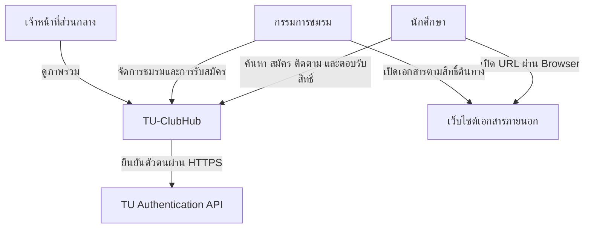
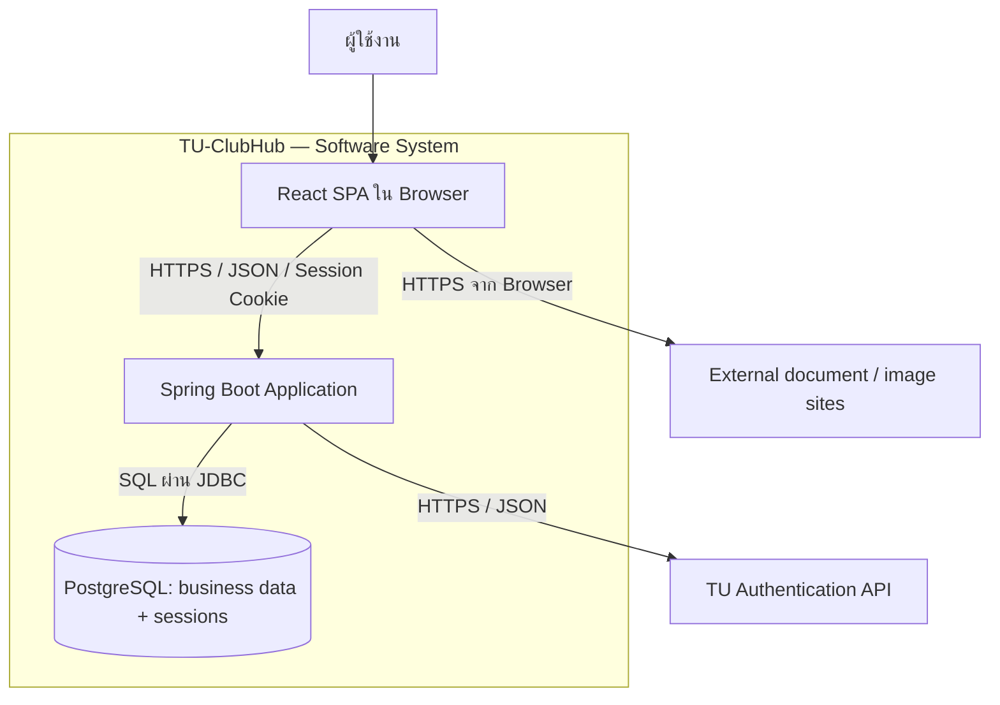
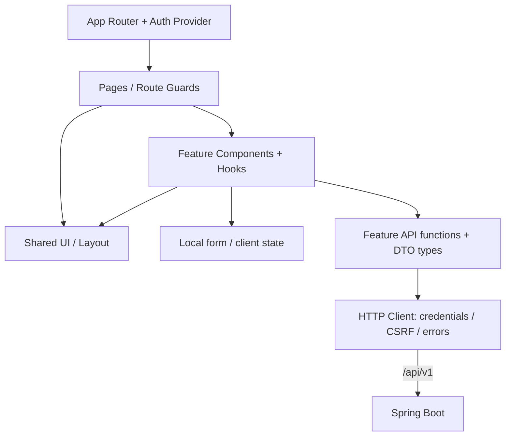
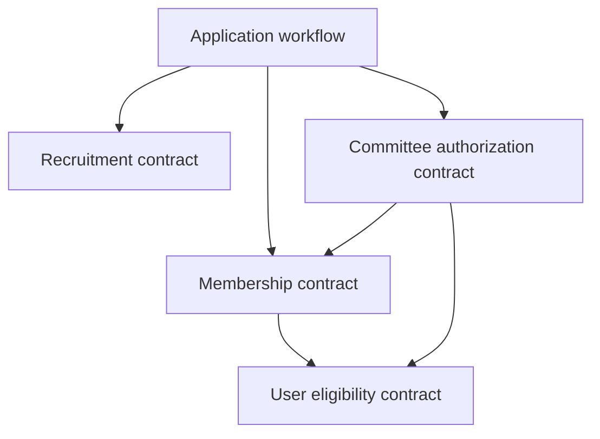
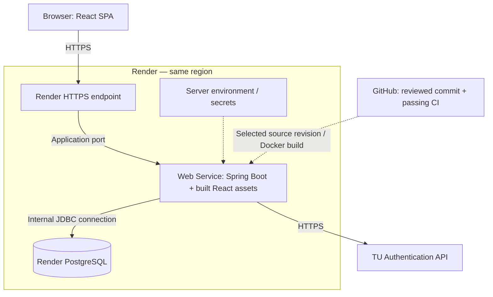

# TU-ClubHub — System Architecture

วันที่: 11 ตุลาคม 2026 · ปรับปรุงนโยบายสิทธิ์: 19 ตุลาคม 2026 · Version: 1.1 · สถานะ: Target Architecture สำหรับทีมพัฒนา

เอกสารนี้อธิบายระบบที่ตั้งใจสร้าง ไม่ใช่หลักฐานว่าระบบ Deploy แล้วหรือทุก Feature เสร็จแล้ว ใช้ร่วมกับ [Scaffold context](scaffold-context.md), [API contract](../api/API_v1.md), [OpenAPI specification](../api/openapi.yaml) และ [ERD ที่เสนอ](../database/TU-ClubHub-ERD-Updated.dbml)

## 1. วัตถุประสงค์และผู้ใช้งานเอกสาร

TU-ClubHub สนับสนุนการค้นหาชมรม การรับสมัคร การคัดเลือก และการยืนยันสมาชิกภาพของมหาวิทยาลัยธรรมศาสตร์ ออกแบบสำหรับทีม 7 คนและการส่งมอบตามรายวิชา โดยลดภาระ Infrastructure และทำให้สมาชิกที่ยังมีประสบการณ์น้อยเข้าใจขอบเขตงานได้

| Audience | ใช้ส่วนใด |
|---|---|
| PO / ผู้ตรวจรับ | System Context, Scope, Business Rules และข้อที่ยังต้องตกลง |
| SA / Developers | Container, Module Boundaries, API, Database และ Runtime Flows |
| QA / DevOps | Configuration, Deployment, CI, Security และ Verification |

ชื่อ Diagram ทั้งหมดใช้ตาม C4 เป็นแนวทาง: Context, Container, Component ส่วน Deployment เป็นภาพเสริม ไม่ใช่ C4 Level 4; Class Diagram เป็นตัวอย่างระดับ Code และ Sequence Diagram ใช้อธิบายพฤติกรรมตามเวลา

## 2. ขอบเขตและสถานะการตัดสินใจ

### 2.1 ข้อตัดสินใจของโครงการ

- Monorepo เก็บ React Frontend, Spring Boot Backend และเอกสารร่วมกัน
- Frontend เป็น React SPA แบบ CSR และแบ่งโค้ดตาม Feature
- Backend เป็น Modular Monolith ใน Spring Boot process เดียวและใช้ PostgreSQL ร่วมกัน
- REST JSON ภายใต้ `/api/v1`; Frontend กับ API ใช้ Origin เดียวเมื่อส่งมอบ
- Login ผ่าน TU API, เก็บสถานะด้วย Spring Session JDBC และ Cookie
- Session หมดอายุเมื่อไม่มี activity 30 นาที หรือครบ 8 ชั่วโมงหลัง Login สำเร็จ แล้วแต่อย่างใดถึงก่อน
- ใช้ Flyway จัดการ Schema และใช้ PostgreSQL สำหรับข้อมูลธุรกิจและ Session
- ส่งมอบบน Render Web Service และ Render PostgreSQL; Build React รวมกับ Spring Boot
- เก็บ URL เอกสารและรูปภาพ ไม่อัปโหลดไฟล์หรือดึงไฟล์อัตโนมัติจาก Backend

### 2.2 Technical Defaults ที่เสนอในเอกสารชุดนี้

ค่าเหล่านี้เป็นทางเลือกสำหรับ Scaffold ยังไม่ใช่กฎธุรกิจที่ผู้ใช้ยืนยัน: Fetch wrapper, React Context สำหรับ Auth, SameSite=Lax, CSRF bootstrap endpoint, JSON ID เป็น string, source-based Docker build บน Render และ Manual Deploy หลัง CI

หาก Repository หรือ Contract ที่มีอยู่เลือกแนวทางอื่นแล้ว ให้เปรียบเทียบและบันทึก ADR ก่อนเปลี่ยน ไม่สร้าง Convention สองชุดควบคู่กัน

### 2.3 สิ่งที่อยู่นอก Scope ปัจจุบัน

ไม่มี Microservices, Message Broker, Redis, CDN แยกที่ทีมต้องดูแล, BFF, File Storage, JWT auth, Micro-frontends หรือ UI จัดการบัญชีทุกชนิด การมี Admin ไม่ได้แปลว่ามี User Management CRUD โดยอัตโนมัติ

## 3. System Context



TU-ClubHub เก็บและแสดง URL ให้ผู้ใช้เปิดเอง การตรวจว่า URL เป็น HTTPS ไม่รับประกันว่าเอกสารมีอยู่ เปิดได้ หรือไม่ถูกแก้ไขภายหลัง การอนุญาตเข้าถึงเอกสารที่ Google Drive/OneDrive อยู่ภายใต้ระบบต้นทาง

## 4. Container Architecture



| Container | หน้าที่ | Technology |
|---|---|---|
| Web Application | Routing, UI, form state, client validation และแสดงผล API | React, TypeScript, Vite, Tailwind |
| Backend Application | เสิร์ฟ Static Assets, REST, Auth, Authorization, Business Rules และ Transactions | Java 21, Spring Boot, Spring Security |
| Database | ข้อมูลธุรกิจ ประวัติ และ Session | PostgreSQL, Flyway, Spring Session JDBC |

React เป็น Logical Container เพราะเป็น Application ที่รันใน Browser แม้ไฟล์ Build จะถูกแจกจาก Spring Boot และบรรจุใน Docker Image เดียวกัน คำว่า C4 Container ไม่ได้หมายถึง Docker Container เสมอไป

Spring Boot เป็นผู้เรียก TU API; Browser ไม่ได้รับ Application-Key และไม่เชื่อมฐานข้อมูลโดยตรง

## 5. Frontend Component Architecture



### 5.1 โครงสร้างและ Dependency Rules

`src/app/` ประกอบ Router/Providers; `src/pages/` ประกอบหน้าจอ; `src/features/<feature>/` เก็บ components/hooks/api/types/utils ของฟีเจอร์นั้น; ส่วนกลางอยู่ใน `components/`, `lib/`, `hooks/`, `types/`

Shared UI ต้องไม่ Import Feature เฉพาะ เช่น Button กลางไม่รู้จัก ApplicationService ส่วน Feature API ต้องเรียก HTTP Client กลาง ไม่สร้าง Fetch/Cookie/CSRF logic ซ้ำในแต่ละหน้า

Client State เช่น Modal และคำตอบระหว่างกรอกอยู่ใกล้ผู้ใช้ข้อมูลนั้น Server State เช่น Club Detail เป็นข้อมูลที่โหลดจาก API; ไม่คัดลอกทุก response ลง AuthContext หรือ Global Store

ไม่มีหน้าที่เก็บความลับใน Frontend Configuration ค่าที่ Build ด้วย Vite และส่งไป Browser ถือว่าผู้ใช้ตรวจดูได้ [Vite Environment Variables](https://vite.dev/guide/env-and-mode)

### 5.2 Routing และการแสดงผล

- Route Guard ใช้ควบคุม UX และรอโหลด Auth State ก่อน redirect แต่ไม่ใช่ Security Boundary
- Public club detail และประกาศเผยแพร่แล้วเข้าถึงได้โดยไม่ Login
- หน้าแก้ไขชมรม/ใบสมัครต้องมี API authorization ที่ Backend ประกอบเสมอ
- แยก Loading, Empty, Not Found, Forbidden และ Network Error เพื่อไม่แสดงข้อผิดพลาดทุกชนิดเป็น “ไม่มีข้อมูล”
- ใช้ Code Splitting ระดับหน้าเมื่อเหมาะสม ไม่เพิ่ม SSR หรือ Framework ใหม่ใน Scaffold
- URL รูปภาพภายนอกที่เสียแสดง Default Image; External links ใช้ HTTPS และป้องกันการควบคุม opener เมื่อเปิดแท็บใหม่

## 6. Backend Component Architecture

### 6.1 รูปแบบภายใน

แต่ละ Feature มี Controller → Service → Repository/Entity ของตนเอง ข้อมูลเข้าออกผ่าน DTO Backend ทั้งหมดอยู่ใน Process เดียว เรียกข้ามโมดูลด้วย Java method calls ไม่ส่ง HTTP วนเข้าหาตนเอง

| Module | เจ้าของข้อมูล / ความรับผิดชอบ |
|---|---|
| `auth` | TU adapter, Authentication workflow, session login/logout/me |
| `user` | users, student_profiles |
| `club` | clubs, club_categories, tags, club_tags |
| `committee` | club_committee_assignments และ Club Authorization Policy |
| `recruitment` | recruitment_rounds, application_questions |
| `application` | applications, application_answers, application_links, application_reviews, application_status_history; orchestration การตอบรับผล |
| `membership` | club_memberships, membership_history |
| `notification` | notifications |
| `dashboard` | Read-only aggregations; ไม่มีตาราง Dashboard โดยจำเป็น |
| `config` / `common` | Framework wiring / รูปแบบ Error และ utility ที่ใช้ร่วมกันจริง |

ERD Reference มี 17 ตารางธุรกิจ ตาราง Session เป็น Infrastructure แยกจาก ERD ธุรกิจ ไม่สร้างตารางสำหรับ Open Call Board หรือ Dashboard เพียงเพราะมีหน้าจอนี้

### 6.2 Allowed dependency direction



ภาพนี้แสดง Dependency สำคัญสำหรับป้องกันวงจร ไม่ใช่รายการทุก Method ในระบบ `auth` เรียก `user`; `application` เรียก `user` และ `notification` ตาม Workflow ได้ ส่วน `dashboard` อ่านผ่าน Query Contracts ของเจ้าของข้อมูล

Membership module ไม่ย้อนเรียก Application เพื่อยืนยันสิทธิ์ ให้ Application workflow เป็นผู้ตรวจใบสมัครและเรียก Membership contract ใน Transaction เดียวกัน Notification module รับ recipient/reference IDs โดยไม่ย้อนเรียก Workflow ต้นทาง

กติกา Cross-module:

- ใช้ Public Service Contract/DTO หรือ IDs; ไม่ Import Entity/Repository ภายในโมดูลอื่น
- ความสัมพันธ์ในฐานข้อมูลใช้ Foreign Key ได้ แม้ Java จะเก็บอีกโมดูลเป็น ID
- ควบคุมด้วย Architecture Test/Review; Package ตาม Feature อย่างเดียวไม่ป้องกันการเรียกข้ามขอบเขต
- Dashboard ที่ต้อง Join ข้ามตารางจำนวนมากสามารถมี Read Model SQL ที่ SA/Lead BE ทบทวนและบันทึกข้อยกเว้นได้ ต้อง Read-only และไม่ใช้เป็นทางลัดเขียนข้อมูลข้ามเจ้าของ

## 7. Authentication และ Authorization

### 7.1 Session-based authentication

```mermaid
sequenceDiagram
  participant W as Browser
  participant B as Spring Boot
  participant T as TU API
  participant D as PostgreSQL
  W->>B: GET /api/v1/auth/csrf
  B-->>W: CSRF token + session cookie
  W->>B: POST login + credentials + CSRF
  B->>T: Verify identity over HTTPS
  T-->>B: Verified identity or failure
  alt Success and eligible account
    B->>D: Create/update local account
    B->>D: Persist authenticated JDBC session
    B-->>W: User + rotated session cookie + fresh CSRF token
  else Failure / timeout / suspended account
    B-->>W: JSON error, no authenticated session
  end
  alt User logs out before expiry
    W->>B: POST /api/v1/auth/logout + current CSRF token
    B->>D: Invalidate session
    B-->>W: 204 + cleared session cookie
  else Idle or absolute timeout is reached
    W->>B: GET /api/v1/auth/me or protected API
    B->>D: Validate session and expiry; invalidate expired session
    B-->>W: 401 AUTHENTICATION_REQUIRED
    W->>W: Clear frontend auth state
    W->>B: GET /api/v1/auth/csrf before next login
  end
  Note over B,D: Expire after 30m idle or 8h from successful login, whichever comes first
```

Session Cookie มีเพียงตัวระบุ Session; รายละเอียด Authentication อยู่ฝั่ง Server เปลี่ยน Session ID เมื่อ Login สำเร็จ บันทึก SecurityContext ใน JDBC session และ invalidate เมื่อ Logout หมดอายุ หรือบัญชีถูกระงับ การเปลี่ยน global role ต้อง refresh หรือยกเลิก session ที่มี authorities เก่า; การถอนหรือหมดวาระเฉพาะชมรมตรวจจากฐานข้อมูลทุก request โดยไม่จำเป็นต้อง logout ทั้งระบบ ไม่เก็บ TU password หลังการตรวจ และไม่เก็บไว้ใน Session/Logs

Session ใช้ idle timeout 30 นาทีและ absolute timeout 8 ชั่วโมงนับจาก Login สำเร็จ แล้วแต่อย่างใดถึงก่อน; activity ไม่เลื่อน absolute deadline เมื่อหมดอายุ Backend ปฏิเสธ Request ที่ต้องยืนยันตัวตนด้วย `401 AUTHENTICATION_REQUIRED` และ Frontend ล้าง Auth State ก่อนเริ่ม Login ใหม่

CSRF ใช้ Spring Security Token โดยรับ token เริ่มต้นจาก bootstrap endpoint และส่งผ่าน Header ใน unsafe requests หลัง Login ที่หมุน Session ID แล้ว Backend คืน CSRF token ใหม่ใน Login response body เพื่อให้ Frontend ใช้ต่อได้ทันที หลัง Logout หรือ Session หมดอายุ ให้ขอ token ใหม่ก่อน Login ครั้งถัดไป การตั้งค่า SPA ต้องเข้ากับ deferred token / token handler ของ Spring Security รุ่นที่ใช้ ไม่ใช้การปิด CSRF เป็นวิธีแก้ปัญหา [Spring Security CSRF](https://docs.spring.io/spring-security/reference/servlet/exploits/csrf.html)

### 7.2 Authorization Rules

ใช้ [Permission Matrix](../security/permission-matrix.md) เป็นนโยบายที่กำหนดแล้ว ณ 19 ตุลาคม 2026 สำหรับสิทธิ์ Active, Term Date, self-review และ Admin override รวมถึงตัวอย่าง boundary และรายการ implementation ที่ยังขาด

| Resource / Action | กฎหลัก |
|---|---|
| Public club/round | ชมรม Active และข้อมูลที่เปิดเผยตาม public endpoint; ไม่ต้อง Login |
| Submit application | บัญชีและ student profile Active, ชมรม Active, รอบเปิดจริง และผ่านกฎสมัคร |
| Read own application | บัญชี Active และเป็นเจ้าของ; ซ่อนผลที่ยังไม่ประกาศและบันทึกภายใน |
| Committee read/write | บัญชี นักศึกษา ชมรม สมาชิกภาพ และ assignment ต้อง Active; membership เริ่มแล้วและยังไม่สิ้นสุด; assignment ไม่ถูกถอนและ `starts_at <= now < ends_at` |
| Internal decisions | COMMITTEE/PRESIDENT ของชมรม หลังปิดรับและก่อนประกาศผล; ห้ามจัดการรอบที่ตนมีใบสมัครไม่ว่าสถานะใด |
| Result publication / round cancellation | เฉพาะ PRESIDENT ที่มีผลและไม่มีใบสมัครในรอบนั้น; ตรวจ state/deadline ตาม matrix |
| Confirm/decline | เจ้าของใบสมัคร ผลผ่านที่ประกาศแล้ว รอบไม่ยกเลิก และก่อน Deadline; การยืนยันต้อง student/club Active ส่วนการสละสิทธิ์ต้อง account Active |
| Central dashboard / committee appointments | Global ADMIN ที่ account Active; สถิติรวมและแต่งตั้ง/ถอนตาม matrix โดยไม่แต่งตั้งตนเอง |

ADMIN ไม่มีสิทธิ์แก้ชมรม อ่านคำตอบผู้สมัคร หรือประกาศผลจาก global role ต้องมี assignment ของชมรมและผ่านกฎเดียวกับกรรมการ ไม่มีสิทธิ์ override Active, Term Date, ownership, self-review หรือผลที่ประกาศแล้ว การตรวจใน transaction ที่เขียนข้อมูลสำคัญต้องใช้สถานะและเวลา Backend ล่าสุดตาม matrix

Account role ใน ERD คือ USER/ADMIN ส่วน Student eligibility มาจาก Student Profile และ Committee privileges มาจาก Assignment ที่ยังมีผล สถานะนักศึกษา UNKNOWN/INACTIVE/GRADUATED ไม่ให้สมัครใหม่ ยืนยัน หรือใช้สิทธิ์กรรมการ แต่ยังอ่านข้อมูลส่วนตัวเดิมได้เมื่อบัญชี Active การหมดวาระไม่เปลี่ยนสมาชิกภาพและไม่ต้องรอ job เปลี่ยน assignment.status

## 8. Data และ Business Workflow

### 8.1 Source of truth

Flyway SQL ที่ Merge แล้วเป็นแหล่งความจริงของ Schema ที่ใช้งาน; DBML/Data Dictionary ต้องปรับให้ตรงกัน API Spec เป็น Contract ระหว่างทีม DTO และ Frontend Types ต้องสอดคล้องกัน

ใช้ Transaction ใน Service Layer และ DB constraints เป็นด่านสุดท้าย เช่น unique `(student_id, round_id)` ป้องกันใบสมัครซ้ำ Backend เวลาเป็นตัวตัดสิน ไม่ใช้เวลาจาก Browser

### 8.2 Submit Application

1. ตรวจ Session, account/student eligibility และ Round ที่เผยแพร่
2. ตรวจ `opens_at <= now < closes_at` และ `closed_at IS NULL` ตาม ERD
3. ตรวจ duplicate/quota ตามนโยบายที่ตกลง โดยออกแบบ lock/constraint ให้รองรับคำขอพร้อมกัน
4. ตรวจ required questions, question ownership และ HTTPS URLs
5. บันทึกใบสมัคร คำตอบ ลิงก์ และประวัติเริ่มต้นใน Transaction เดียว
6. Commit แล้วคืนเลขใบสมัคร/สถานะ; Rollback เมื่อส่วนใดล้มเหลว

Scaffold ยังไม่ต้อง Implement workflow นี้ครบ และห้ามให้ Unique constraint ของใบสมัครซ้ำถูกอ้างว่าป้องกัน Quota ข้ามหลายรอบได้ ต้องออกแบบ Concurrency ของ Quota เพิ่มต่างหากเมื่อมีนิยามแล้ว

### 8.3 Status, result publication และ membership

ERD ใช้ `SUBMITTED`, `UNDER_REVIEW`, `ACCEPTED`, `REJECTED`, `CONFIRMED`, `DECLINED`, `WITHDRAWN`, `EXPIRED`; การมี Enum ใน ERD ไม่ใช่การยืนยันว่ามีทุก Transition ใน Scope

Task เก่าบางส่วนเรียกสถานะเริ่มต้น PENDING ให้ปรับ Contract ให้ตรงกันก่อน Implement โดยเอกสารชุดนี้ยึด SUBMITTED ตาม ERD เป็นฐาน

ผลภายในและประวัติที่เปิดเผยผลต้องไม่รั่วก่อน `results_published_at`; Applicant response mapping ต้องพิจารณาทั้งสถานะและเวลาประกาศ ไม่ส่ง Entity/history ทั้งหมดตรง ๆ

การยืนยัน: Lock/ตรวจสถานะใบสมัครล่าสุด → ตรวจ deadline/ownership/eligibility → สร้างหรือปรับสมาชิกภาพตามนโยบาย → บันทึกประวัติ/การตอบรับ → Commit Transaction เดียว คำขอซ้ำต้องไม่สร้างสมาชิกซ้ำ ใช้ application workflow orchestrate membership contract

EXPIRED หมายถึงไม่ตอบรับทันเวลา แยกจาก DECLINED ที่ผู้ใช้กดเอง งานหมดเวลาต้องทำงานได้แม้ผู้ใช้ไม่เปิดหน้าเว็บ แผนสำหรับระบบขนาดนี้คือ scheduled sweep แบบทำซ้ำได้ในแอปพร้อม catch-up หลัง restart; ทุก API ยังต้องตรวจ Deadline เอง แผนนี้ต้องลง Backlog ก่อน Implement

Membership Confirmation ใช้ฟิลด์การตอบรับและประวัติใน Application ตาม ERD ปัจจุบัน ไม่จำเป็นต้องมีตารางแยกหนึ่งตารางต่อหนึ่ง Domain Object

### 8.4 Read-only review และ notification

US-09 ปัจจุบันครอบคลุมการเปิดอ่านใบสมัคร การเปิดอ่านต้องไม่เปลี่ยนสถานะหรือบันทึกผลคัดเลือกโดยอัตโนมัติ งานบันทึกผล/ประกาศผลและ Notification ที่เกี่ยวข้องยังต้องลง Story ให้ครบ

Notifications เป็นข้อมูลภายในฐานข้อมูล ไม่ต้องมี Queue/Broker สำหรับ MVP หากผลสำเร็จของ Workflow ต้องมาพร้อม Notification ให้สร้างผ่าน Notification contract ภายใต้ Transaction เดียวกันตามนโยบายที่ตกลง

## 9. API Contract และ Error Handling

| เรื่อง | Convention ที่เสนอ |
|---|---|
| Base path | `/api/v1` |
| Field names | JSON camelCase; DB snake_case |
| Identifier | JSON decimal string สำหรับ bigint; Java Long ภายใน Backend |
| Time | ISO 8601 UTC; UI แสดง Asia/Bangkok |
| Errors | Problem Details + code/fieldErrors/traceId; ไม่เผย Stack Trace |
| Pagination | ระบุ page/size/sort และ maximum size ใน OpenAPI; ไม่คืนรายการไม่จำกัด |
| Concurrent edits | ใช้ version/optimistic locking ในข้อมูลที่ ERD กำหนด; ตอบ conflict เมื่อแก้ทับ |
| Unauthenticated | JSON 401 |
| Unauthorized / CSRF | JSON 403 พร้อม error code ที่ Client แยกได้ |
| Duplicate / state conflict | JSON 409 |

API รายการประกาศต้องกรองสิทธิ์ก่อน pagination/count เพื่อไม่เปิดเผยจำนวนข้อมูลลับ Mock responses ใน Frontend ใช้สำหรับงาน UI แยกชัดเจนและไม่ถูก Build เปิดใช้งานใน Production โดยไม่ได้ตั้งใจ

## 10. Deployment Architecture



เส้นทึบคือ Runtime communication; เส้นประคือ Configuration หรือ Delivery ไม่ได้แทนการเรียก API ของผู้ใช้

### 10.1 Build and run

Root Dockerfile สร้าง React dist ด้วย Node → นำเข้า Static Resources ของ Backend → Maven package JAR → Java runtime image รันแอปเดียว ไม่แยก Nginx

Render รองรับ Docker Web Service และกำหนด Environment/Health Check ผ่าน Platform ให้ Bind `0.0.0.0` และ Port ตาม `PORT`; เชื่อม PostgreSQL ผ่าน internal connection ใน Region เดียวกันตามการตั้งค่าบริการจริง [Render Web Services](https://render.com/docs/web-services)

### 10.2 Environments

| Environment | รูปแบบ | Auth / Data |
|---|---|---|
| Development | Vite proxy ไป Spring Boot + PostgreSQL | Explicit mock mode และ dev fixtures |
| CI/Test | Build/tests + isolated PostgreSQL | Mock TU API เท่านั้น |
| Local demo | Compose: app + db | ระบุชัดว่า Mock หรือ Real TU API |
| Render delivery | Web Service + managed PostgreSQL | Real TU adapter เมื่อผ่าน integration check; mock prohibited in prod |

ไม่มี Credential จริงใน Git และ Vite variables Session tables จัดการผ่าน Flyway ด้วย Schema ที่ตรงกับ Spring Session JDBC รุ่นที่ใช้ ปิด Auto Schema Initialization อีกทางเพื่อไม่ให้มีสองระบบสร้างตารางแข่งกัน [Spring Session JDBC](https://docs.spring.io/spring-session/reference/configuration/jdbc.html)

### 10.3 Routing, trust and persistence

- Same-origin ทำให้ Browser ใช้ Relative API URL; ยังต้องมี CSRF, authorization และ secure cookie
- Trust proxy headers เฉพาะขอบเขต Platform ที่เชื่อถือได้ ตรวจ URL/scheme และ Cookie หลังผ่าน Render ingress จริง
- SPA fallback รองรับ Client routes โดยไม่ครอบ `/api/**`, `/actuator/**` หรือ missing static assets
- PostgreSQL เก็บข้อมูลคงทน ส่วน App filesystem ไม่ใช้เก็บไฟล์ผู้ใช้
- จำกัดการเข้าถึง DB ตามที่ Platform รองรับ ไม่เปิด Credential/Connection URL ให้ Browser

### 10.4 Availability and recovery

บริการแอปเดียวและฐานข้อมูลหนึ่งชุดเหมาะกับ Scope MVP แต่ยังไม่ใช่ HA design ความพร้อมใช้งานขึ้นกับแผน Render และ TU API ต้องตรวจข้อจำกัดการพักบริการ/อายุฐานข้อมูล/การสำรองข้อมูลของแผนที่ใช้งานก่อนแต่ละรอบสาธิต

สำรองข้อมูลก่อน Migration ที่มีผลต่อข้อมูล ทดสอบ restore ในสภาพแวดล้อมแยก และเก็บคู่มือ การ Rollback Docker version ไม่ได้ย้อน Schema โดยอัตโนมัติ ต้องตรวจความเข้ากันได้หรือใช้แผน Roll-forward/Restore ที่ทดสอบแล้ว

เตรียม Compose demo เป็นแผนสำรอง พร้อมระบุการใช้ Mock TU API อย่างชัดเจน ไม่กล่าวว่า Mock พิสูจน์การเชื่อมบริการจริงได้

## 11. CI, Review และ Quality Gates

1. Feature branch ส่ง PR โดยแนบ Story/Task และวิธีตรวจ
2. GitHub Actions ตรวจ Frontend lint/typecheck/tests/build และ Backend `mvnw verify` กับ PostgreSQL แยก
3. Auth integration tests ใน CI ใช้ Mock TU API ไม่มีการส่ง Credential ไปบริการจริง
4. สมาชิกอื่น Review อย่างน้อย 1 คน; การเปลี่ยน Auth/Schema/Transaction ให้ Lead BE หรือ SA ที่ไม่ได้เป็นผู้เขียนตรวจ
5. Merge เมื่อ CI และ Review ผ่าน ไม่บังคับให้ทุก PR ต้องผ่านคนเดียวเป็นคอขวด
6. เลือก commit ที่ผ่านเกณฑ์ให้ Render Build/Deploy ด้วย root Dockerfile แล้วทำ Smoke Test

ค่าเริ่มต้นที่เสนอคือ Manual Deploy หลังผ่าน CI หากใช้ Auto Deploy ภายหลังต้องผูกกับผลตรวจให้ชัด ไม่ให้ PR Build สำเร็จเพียงบางส่วนกลายเป็นหลักฐานว่าทั้งระบบผ่าน [Render Deploys](https://render.com/docs/deploys)

Logs มี request/trace ID, error code และเวลา; ไม่บันทึก credential, session ID, full application answers หรือ private document URLs เป็นค่าเริ่มต้น Health endpoint เผยข้อมูลขั้นต่ำ ส่วนรายละเอียดตรวจระบบใช้สิทธิ์เฉพาะ

ไม่กำหนด SLA หรือ Response time ตัวเลขที่ยังไม่มี Workload รองรับ ให้ทีมตกลงจำนวนข้อมูล ผู้ใช้พร้อมกันและสภาพแวดล้อมทดสอบก่อนตั้ง Acceptance Threshold

## 12. Traceability กับ User Stories

| Story | Sprint | Modules หลัก |
|---|---|---|
| US-01 ค้นหาและกรองชมรม | 2 | club |
| US-02 ดูรายละเอียดชมรมและประกาศ | 1 | club, recruitment |
| US-03 กรอกและส่งใบสมัคร | 1 | auth, user, recruitment, application |
| US-04 ติดตามสถานะและประวัติ | 2 | application |
| US-05 ยืนยัน/สละสิทธิ์ | 2 | application, membership |
| US-06 จัดการโปรไฟล์ชมรม | 1 | club, committee |
| US-07 จัดการรอบรับสมัคร | 1 | recruitment, committee |
| US-08 จัดการคำถามคัดเลือก | 1 | recruitment, committee |
| US-09 เปิดอ่านรายละเอียดใบสมัคร | 2 | application, committee |
| US-10 ภาพรวมส่วนกลาง | 2 | dashboard, club, application, membership |

Sprint 1 รวม 20 SP และ Sprint 2 รวม 21 SP เป็น Estimate ของสิบ Stories เดิม ยังไม่รวมงานที่ขาด เช่น Decision/Publication และไม่ได้หมายความว่า Foundation ไม่มีต้นทุน

## 13. Open Decisions / Risks

| ID | เรื่องที่ยังต้องตกลง | ผลกระทบ |
|---|---|---|
| OD-01 | Quota จำนวนเท่าไร นับต่อรอบ/ภาคเรียน/สมาชิกที่ Active และนับสถานะใด | Submit, confirmation, locking, Test Cases |
| OD-02 | Story/API สำหรับบันทึกผลและประกาศผล; สิทธิ์กำหนดแล้วใน matrix | COMMITTEE/PRESIDENT บันทึกผล และ PRESIDENT ประกาศ; ยังต้องพัฒนา workflow ต้นทางของ US-05 |
| OD-03 | การออกแบบ version คำถามหากจะรองรับการแก้หลังเผยแพร่ | นโยบายปัจจุบันอนุญาตแก้เฉพาะ draft ที่ไม่มีใบสมัคร |
| OD-04 | TU API Contract และ mapping ของ student status ที่ยืนยันได้ | สิทธิ์ใช้ ACTIVE เท่านั้นตาม matrix; ยังต้องทำ integration/normalization |
| OD-05 (ตัดสินใจแล้ว 19 ต.ค. 2026) | ห้ามใช้สิทธิ์กรรมการกับรอบที่ตนมีใบสมัคร; Admin ไม่มี override | ยึด [Permission Matrix](../security/permission-matrix.md); เหลืองาน implementation ตามช่องว่างที่บันทึกไว้ |
| OD-06 | การนับคน/ใบสมัคร/สมาชิกตามปีการศึกษาและภาคเรียน | Dashboard correctness |
| OD-07 | Timeline Sprint/Release ในรายงานและเกณฑ์รายวิชา | วันที่ส่งมอบและชื่อ Release; ไม่อนุมานจาก Sprint number |
| OD-08 | Dependency versions และบริการ Render ที่ใช้จริง | Compatibility, lifecycle และ deployment guide |

สำหรับ Scaffold ทำส่วนที่ไม่ขึ้นกับ Business Policy ไปก่อนได้และบันทึก TODO ชัดเจน อย่าสร้างนโยบายเงียบ ๆ เพื่อให้โค้ดดูเสร็จ

## 14. Architecture decision record สรุป

| Decision | เหตุผล | Trade-off |
|---|---|---|
| Monorepo | Frontend/Backend/API docs เปลี่ยนพร้อมกันและทบทวนใน PR เดียว | ต้องกำหนดเจ้าของและขอบเขตไฟล์ร่วม |
| Modular Monolith | ลด Network/Deployment complexity และทำ Transaction ง่าย | ต้องคุม Module dependencies ไม่ให้ผูกกันหมด |
| Session JDBC | เข้ากับ TU auth และ Single-origin web; Session อยู่ข้าม app restart | มี Database I/O และต้องทำ CSRF ให้ถูกต้อง |
| React assets ใน Spring Boot | Deploy หนึ่งแอปและใช้ Origin เดียว | Frontend update ต้อง Build/Deploy image ใหม่ |
| External URLs | ลดการจัดการ File Storage | เอกสารอาจเข้าถึงไม่ได้หรือถูกแก้ไขภายนอก |
| PostgreSQL + Flyway | Schema versioned และทดสอบ SQL/constraints ได้ | ต้องวาง Migration และ recovery อย่างรอบคอบ |
| Permission Matrix 2026-10-19 | แยก Student, กรรมการตามชมรม/วาระ และ Admin; ใช้ Active ปัจจุบันและห้าม self-review | ต้องตรวจสิทธิ์จากฐานข้อมูลทุก request และเพิ่ม guards/workflows ตามนโยบาย |

## 15. เอกสารประกอบและการดูแล

วางเอกสารนี้ที่ `docs/architecture/system-architecture.md`; Context ที่ `docs/architecture/scaffold-context.md`; Draw.io ที่ `docs/architecture/TU-ClubHub-Architecture.drawio`; API ที่ `docs/api/openapi.yaml`; ERD ที่ `docs/database/`

Draw.io ที่สร้างก่อนหน้านี้มี Context, Container, Backend Components และ Deployment ทั้งสี่หน้า เอกสารฉบับนี้เพิ่ม Frontend Component View และรายละเอียด Scaffold โดยไม่ได้อ้างว่าได้แก้ไฟล์ Draw.io เพิ่มหน้าที่ห้าแล้ว

SA ดูแลภาพรวม/ADR/API Contract; Lead BE ดูแล Security/Module boundaries; Full-Stack ดูแล Feature integration และ Schema ร่วม; Frontend ดูแล UI/state/routing; QA/DevOps ดูแล Verification/CI/Delivery ทุกคนปรับเอกสารที่ได้รับผลกระทบใน PR เดียวกับโค้ด

### References

- [C4 Container Diagram](https://c4model.com/diagrams/container)
- [C4 Deployment Diagram](https://c4model.com/diagrams/deployment)
- [Spring Boot 4.x — Structuring Code](https://docs.spring.io/spring-boot/reference/using/structuring-your-code.html)
- [Spring Security — CSRF](https://docs.spring.io/spring-security/reference/servlet/exploits/csrf.html)
- [Spring Session — JDBC](https://docs.spring.io/spring-session/reference/configuration/jdbc.html)
- [Vite — Environment Variables](https://vite.dev/guide/env-and-mode)
- [Render — Web Services](https://render.com/docs/web-services)
- [Render — Deploys](https://render.com/docs/deploys)

References ใช้อธิบายแนวคิดและข้อจำกัดทางเทคนิค เวอร์ชันของโค้ดจริงต้องตรวจจาก Dependency ที่ทีมตรึง ไม่คัดลอก Configuration ของ Framework คนละ Major Version โดยตรง
