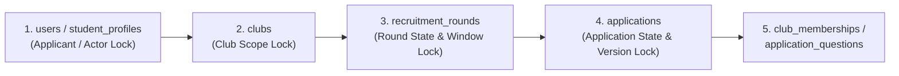

# Task75 — เอกสารออกแบบระบบ สถาปัตยกรรม API Contract, Database Schema และ UI Wireframe สำหรับ Sprint 2

| รายการ | รายละเอียด |
|---|---|
| **Task ID** | [`Task75 [SYS-DESIGN]`](../tasks/sprint2/Task75.md) — ออกแบบ API Contract, Database Schema และหน้าจอร่วมกัน |
| **Trello Card** | [https://trello.com/c/cauHoZZ5](https://trello.com/c/cauHoZZ5) |
| **Owner** | สิรวิชญ์ กฤดาธิการวุฒิ (`@sirkrid10` — SE / System Architect / QA Lead / Scrum Master) |
| **Reviewer** | ชนิตว์นันท์ กิตนันท์ขุน (`@chanitnan0jr` — PO / System Analyst) |
| **Upstream Dependency** | [`Task74 [SYS-ANALYSIS]`](task74-sprint2-analysis.md) (Merged in PR #58) |
| **Downstream Tasks** | `Task51`–`Task81` (Development, Security Hardening & QA Integration ใน Sprint 2) |
| **วันที่จัดทำ** | 28 ตุลาคม 2026 |
| **สถานะเอกสาร** | Ready for PO / Team Review (`docs/task75-sprint2-design`) |

---

## 1. วัตถุประสงค์และตารางเชื่อมโยงการออกแบบ (Design Traceability Matrix)

เอกสารฉบับนี้เป็นผลงานส่งมอบหลักของ **Task75 [SYS-DESIGN]** โดยนำข้อกำหนดและผลการตัดสินใจเชิงธุรกิจจาก [`task74-sprint2-analysis.md`](task74-sprint2-analysis.md) (`T74-D01` ถึง `T74-D09`), [`system-architecture.md`](system-architecture.md), และ [`permission-matrix.md`](../security/permission-matrix.md) มาแปลงเป็นข้อตกลงทางเทคนิค (Technical Contract) ที่ชัดเจน 100% ระหว่างทีม Frontend, Backend และ QA ก่อนเริ่มเขียนโค้ดใน Sprint 2

### 1.1 การแปลงผลการตัดสินใจจาก Task74 (`T74-D01` – `T74-D09`) สู่ Technical Contract

| Decision ID | ข้อสรุปจาก Task74 (`SYS-ANALYSIS`) | ข้อตกลงทางเทคนิคใน Task75 (`SYS-DESIGN`) | เอกสาร OpenAPI / Schema ที่อัปเดต |
|---|---|---|---|
| **T74-D01** | Private resource มีอยู่จริงแต่ไม่มีสิทธิ์ ใช้ `403 ACCESS_DENIED`; ไม่มีอยู่จริงใช้ `404 RESOURCE_NOT_FOUND` (ยกเว้น Public club / Form availability ที่คง `404` ซ่อนทรัพยากรไม่เปิดเผย) | กำหนดลำดับการตรวจสิทธิ์ (Guard Evaluation Order) และ Response Schema ของทุก Protected Endpoint ใน `openapi.yaml` และ `rounds.openapi.yaml` ให้แยก `403` กับ `404` อย่างชัดเจน | [`openapi.yaml`](../api/openapi.yaml), [`rounds.openapi.yaml`](../api/rounds.openapi.yaml), [§3](#3-มาตรฐาน-error-response-ตาม-rfc-7807-และ-reason-codes) |
| **T74-D02** | ตัด `INTERVIEW` ออกจาก MVP; `UNDER_REVIEW` เป็นขั้น Optional ผ่าน Explicit Action เท่านั้น (`GET` ห้ามเปลี่ยนสถานะ); ตัดสิน `SUBMITTED -> ACCEPTED/REJECTED` ได้โดยตรงหลังรอบปิดรับจริง | กำหนด `PUT /api/v1/rounds/{roundId}/applications/{applicationId}/decision` ให้รับการเปลี่ยนสถานะจาก `SUBMITTED` หรือ `UNDER_REVIEW` ไปยัง `ACCEPTED`/`REJECTED` หลัง `serverNow >= COALESCE(closed_at, closes_at)` และเพิ่ม Optional `POST .../start-review` แยกจาก `GET` | [`openapi.yaml`](../api/openapi.yaml), [§2.6](#26-การบันทึกผลคัดเลือกภายในและประกาศผล-s2-decision-draft--s2-publication-draft--task67--task68) |
| **T74-D03** | แยกงานอ่านใบสมัคร (`US-09`) ออกจากงานบันทึกผล (`S2-DECISION-DRAFT`) และงานประกาศผลโดย `PRESIDENT` (`S2-PUBLICATION-DRAFT`); การประกาศผลของรอบห้ามเขียน `ACCEPTED -> ACCEPTED` ลง `application_status_history` | ออกแบบ Endpoint `PUT .../decision` และ `POST /api/v1/rounds/{roundId}/publish-results` แยกจาก `GET`; การประกาศผลอัปเดต `recruitment_rounds.results_published_at`, เพิ่ม `version` และสร้าง `notifications` (`RESULT_PUBLISHED`) ใน Transaction เดียว | [`openapi.yaml`](../api/openapi.yaml), [§2.6](#26-การบันทึกผลคัดเลือกภายในและประกาศผล-s2-decision-draft--s2-publication-draft--task67--task68), [§4.3](#43-การบันทึก-audit-ของการประกาศผลโดยไม่ขัด-chk_app_history_change) |
| **T74-D04** | ก่อน `results_published_at IS NOT NULL` ต้องซ่อนผลภายใน (`UNDER_REVIEW`, `ACCEPTED`, `REJECTED`), ข้อความผล, เวลาตัดสิน, ประวัติหลังส่ง และปุ่มยืนยัน/สละสิทธิ์; ห้ามเปิดเผย `application_reviews` แก่ผู้สมัครทุกกรณี | กำหนด Server-side Projection DTO (`ApplicantApplicationSummary`, `ApplicantApplicationDetail`) พร้อมฟิลด์ `applicantVisibleStatus`, `canConfirm`, `canDecline` และตาราง Mapping การกรอง `statusHistory` | [`openapi.yaml`](../api/openapi.yaml), [§2.4](#24-การติดตามสถานะและประวัติใบสมัครของตนเอง-us-04--task64), [§5.3](#53-ตาราง-mapping-สถานะและปุ่มดำเนินการสำหรับผู้สมัคร-t74-d04--us-04--us-05) |
| **T74-D05** | การเรียกซ้ำ Action เดิมที่สำเร็จแล้ว (`confirm` ซ้ำเมื่อ `CONFIRMED` หรือ `decline` ซ้ำเมื่อ `DECLINED`) คืนผลเดิมโดยไม่เขียนข้อมูลซ้ำ; การเรียก Action สวนทางหรือหลังจบรายการคืน `409 RESOURCE_CONFLICT` | กำหนด `POST /api/v1/me/applications/{applicationId}/confirm` และ `/decline` คืน `200 OK` (`MembershipOfferResponse` พร้อม `idempotentReplay: true`) เมื่อ Action ตรงกับสถานะสุดท้ายเดิม และคืน `409` (`reason: ALREADY_RESPONDED`) เมื่อสวนทาง | [`openapi.yaml`](../api/openapi.yaml), [§2.5](#25-การยืนยันสิทธิ์หรือสละสิทธิ์เข้าชมรม-us-05--task69--task70) |
| **T74-D06** | การตอบรับใหม่ตรวจ `results_published_at <= serverNow < confirmation_deadline` ณ จุดตัดสินหลังได้ DB Lock; เมื่อถึง `confirmation_deadline` งานอัตโนมัติเปลี่ยนเฉพาะ `ACCEPTED` ที่ประกาศแล้วและยังไม่ตอบรับเป็น `EXPIRED` | กำหนดลำดับ Row Lock, การอ่าน `Clock.instant()` หลังได้ Lock, และออกแบบ `ApplicationOfferExpiryWorker` (`@Scheduled` ทุก 60 วินาที + Startup Catch-up) ที่เขียน `EXPIRED` พร้อม `actor_id = NULL` และ `reason = 'CONFIRMATION_DEADLINE_EXPIRED'` | [§4.2](#42-ลำดับการล็อกข้อมูล-deterministic-locking-order-และการป้องกัน-race-condition), [§4.4](#44-การออกแบบ-background-worker-สำหรับตัดสิทธิ์เมื่อหมดเวลา-sd-11--t74-d06) |
| **T74-D07** | การยืนยันสิทธิ์ใหม่ปฏิเสธด้วย `409 RESOURCE_CONFLICT` (`EXISTING_CLUB_MEMBERSHIP`) ทุกกรณีที่มีแถวเดิมใน `club_memberships` ของ `(club_id, user_id)` ไม่ว่าสถานะ `ACTIVE`, `INACTIVE`, `LEFT`, หรือ `REMOVED` (ไม่มี Reactivation ใน MVP) และตรวจเพดาน 5 ชมรม (`MEMBERSHIP_LIMIT_REACHED`) | กำหนด Query ตรวจสอบ `EXISTS (SELECT 1 FROM club_memberships WHERE club_id = :clubId AND user_id = :userId)` และการล็อกแถว `student_profiles` (`FOR UPDATE`) เพื่อป้องกันการกดยืนยันข้ามชมรมพร้อมกันเกิน 5 ชมรม | [`openapi.yaml`](../api/openapi.yaml), [§2.5](#25-การยืนยันสิทธิ์หรือสละสิทธิ์เข้าชมรม-us-05--task69--task70), [§4.2](#42-ลำดับการล็อกข้อมูล-deterministic-locking-order-และการป้องกัน-race-condition) |
| **T74-D08** | แดชบอร์ดส่วนกลาง (`US-10`) สำหรับ `ADMIN` ต้องแยกระหว่างจำนวนใบสมัคร (`totalApplications`), จำนวนผู้สมัครไม่ซ้ำ (`uniqueApplicants`), สมาชิกใหม่ที่ยืนยันจากรอบที่กรอง (`confirmedNewMembersInFilteredRounds`) และสมาชิก Active ปัจจุบัน (`currentActiveMemberships`) โดยไม่เกิดยอดซ้ำจากการ Join | ออกแบบ `GET /api/v1/admin/dashboard/stats` พร้อม Query Parameters (`q`, `categoryId`, `academicYear`, `semester`, `clubStatus`, `page`, `size`) และ Aggregation Schema ที่ใช้ Subquery/CTE แยกมิติชัดเจน | [`openapi.yaml`](../api/openapi.yaml), [§2.7](#27-แดชบอร์ดสถิติภาพรวมส่วนกลางสำหรับ-admin-us-10--task71--task72), [§4.5](#45-แนวทางการเขียน-aggregation-query-สำหรับ-admin-dashboard-us-10--t74-d08) |
| **T74-D09** | ยืนยันกฎการเปิดอ่านฟอร์มใบสมัคร (`Task42` / `US-03`): บังคับ Login (`SESSION`), บัญชี `ACTIVE`, นักศึกษา `ACTIVE`, ชมรม `ACTIVE` และรอบ `PUBLISHED` ที่เปิดอยู่; การตรวจสมัครซ้ำและโควตา 5 ชมรมตรวจที่ `POST` ตอนกดส่ง พร้อมส่งสถานะ Eligibility เบื้องต้นให้ UI | อัปเดตสถานะ `GET /api/v1/rounds/{roundId}/application-form` และ `POST /api/v1/rounds/{roundId}/applications` ใน `openapi.yaml` ให้เชื่อมโยงกับ `Task52` และ `Task53` | [`openapi.yaml`](../api/openapi.yaml), [§2.3](#23-แบบฟอร์มและการส่งใบสมัครออนไลน์-us-03--task42--task52--task53) |

---

## 2. สรุป API Contract ทั้งหมดสำหรับ Sprint 2

ตารางด้านล่างรวบรวมทุก Endpoint ที่เกี่ยวข้องกับงานพัฒนาใน Sprint 2 (`Task51`–`Task81`) ทั้งที่อยู่ใน [`docs/api/openapi.yaml`](../api/openapi.yaml) และ [`docs/api/rounds.openapi.yaml`](../api/rounds.openapi.yaml):

| หมวดฟีเจอร์ | HTTP Method & Path | Operation ID | สิทธิ์การเข้าถึง (Auth & Guard) | ไฟล์ Spec | งานที่เกี่ยวข้อง |
|---|---|---|---|---|---|
| **Auth & Role Sync** | `GET /api/v1/auth/me` | `getCurrentUser` | `SESSION` (`ACTIVE` account); ดึง `role`, `studentStatus`, และ `activeCommitteeAssignments` สดจาก DB | `openapi.yaml` | `Task79`, `Task80`, `Task81` |
| **Public Club Search** | `GET /api/v1/public/clubs` | `searchPublicClubs` | Public (`security: []`); กรองเฉพาะ `clubs.status = 'ACTIVE'` | `openapi.yaml` | `US-01`, `Task62`, `Task63` |
| **Public Club Master** | `GET /api/v1/public/club-categories` | `listPublicClubCategories` | Public (`security: []`); รายการหมวดหมู่ชมรมทั้งหมด | `openapi.yaml` | `US-01`, `Task62`, `Task63` |
| **Public Club Master** | `GET /api/v1/public/interest-tags` | `listPublicInterestTags` | Public (`security: []`); รายการแท็กความสนใจทั้งหมด | `openapi.yaml` | `US-01`, `Task62`, `Task63` |
| **Public Club Detail** | `GET /api/v1/public/clubs/{id}` | `getPublicClubProfile` | Public (`security: []`); เพิ่ม `canEditProfile` เมื่อมี Session ของกรรมการชมรมนั้น | `openapi.yaml` | `US-02`, `Task81` |
| **Club Profile Edit** | `GET /api/v1/clubs/{clubId}`<br/>`PUT /api/v1/clubs/{clubId}` | `getClub`<br/>`updateClub` | `GET`: Public (+ `canEditProfile`)<br/>`PUT`: `SESSION` + `CSRF` + Effective `COMMITTEE`/`PRESIDENT` ของชมรม | `openapi.yaml` | `US-06`, `Task81` |
| **Question Lock** | `PUT /api/v1/rounds/{roundId}/questions/{questionId}`<br/>`DELETE /api/v1/rounds/{roundId}/questions/{questionId}` | `replaceApplicationQuestion`<br/>`deleteApplicationQuestion` | `SESSION` + `CSRF` + Effective `COMMITTEE`/`PRESIDENT` (ห้าม Self-review); คืน `409 QUESTION_HAS_ANSWERS` เมื่อมีคำตอบแล้ว | `rounds.openapi.yaml` | `US-08`, `Task51`, `Task60` |
| **Application Form** | `GET /api/v1/rounds/{roundId}/application-form` | `getRoundApplicationForm` | `SESSION` + `ACTIVE` account + `ACTIVE` student; รอบต้อง `PUBLISHED` และอยู่ในช่วงเปิดรับ | `openapi.yaml` | `US-03`, `Task42`, `Task52`, `Task53` |
| **Submit Application** | `POST /api/v1/rounds/{roundId}/applications` | `submitApplication` | `SESSION` + `CSRF` + `ACTIVE` account + `ACTIVE` student; ตรวจเวลาเปิดรับ, สมัครซ้ำ, สมาชิกเดิม และเพดาน 5 ชมรม | `openapi.yaml` | `US-03`, `Task42`, `Task52`, `Task53` |
| **My Applications** | `GET /api/v1/me/applications` | `listMyApplications` | `SESSION` + `ACTIVE` account; ดึงเฉพาะ `applicant_id = sessionUserId` พร้อม Mask สถานะก่อนประกาศผล | `openapi.yaml` | `US-04`, `Task64` |
| **My Application Detail** | `GET /api/v1/me/applications/{applicationId}` | `getMyApplicationDetail` | `SESSION` + `ACTIVE` account + Ownership (`403` ถ้าเป็นของคนอื่น, `404` ถ้าไม่มีจริง) | `openapi.yaml` | `US-04`, `Task64` |
| **Confirm Membership** | `POST /api/v1/me/applications/{applicationId}/confirm` | `confirmMembershipOffer` | `SESSION` + `CSRF` + `ACTIVE` account + Ownership (`ACTIVE` student & club สำหรับการยืนยันใหม่; Idempotent `200` สำหรับ Retry) | `openapi.yaml` | `US-05`, `Task69`, `Task70` |
| **Decline Membership** | `POST /api/v1/me/applications/{applicationId}/decline` | `declineMembershipOffer` | `SESSION` + `CSRF` + `ACTIVE` account + Ownership (ไม่บังคับ student/club `ACTIVE`; Idempotent `200` สำหรับ Retry) | `openapi.yaml` | `US-05`, `Task69`, `Task70` |
| **Committee Review List** | `GET /api/v1/rounds/{roundId}/applications` | `listRoundApplicationsForCommittee` | `SESSION` + Effective `COMMITTEE`/`PRESIDENT` ของชมรมเจ้าของรอบ + ไม่มีใบสมัครตนเองในรอบนั้น (`Read-only`) | `openapi.yaml` | `US-09`, `Task65`, `Task66` |
| **Committee Review Detail** | `GET /api/v1/rounds/{roundId}/applications/{applicationId}` | `getRoundApplicationDetailForCommittee` | `SESSION` + Effective `COMMITTEE`/`PRESIDENT` ของชมรมเจ้าของรอบ + ไม่มีใบสมัครตนเองในรอบนั้น (`Read-only`) | `openapi.yaml` | `US-09`, `Task65`, `Task66` |
| **Record Internal Decision** | `PUT /api/v1/rounds/{roundId}/applications/{applicationId}/decision` | `recordApplicationDecision` | `SESSION` + `CSRF` + Effective `COMMITTEE`/`PRESIDENT` + ไม่มี Self-review; รอบต้องปิดรับจริงแล้วและยังไม่ประกาศผล | `openapi.yaml` | `S2-DECISION-DRAFT`, `Task67`, `Task68` |
| **Publish Round Results** | `POST /api/v1/rounds/{roundId}/publish-results` | `publishRoundSelectionResults` | `SESSION` + `CSRF` + Effective `PRESIDENT` เท่านั้น + ไม่มี Self-review; ใบสมัครคัดเลือกต้องตัดสินครบทุกใบและก่อน `confirmation_deadline` | `openapi.yaml` | `S2-PUBLICATION-DRAFT`, `Task67`, `Task68` |
| **Admin Dashboard Stats** | `GET /api/v1/admin/dashboard/stats` | `getAdminDashboardStats` | `SESSION` + `ACTIVE` account + Global `users.system_role = 'ADMIN'` จากฐานข้อมูลล่าสุด | `openapi.yaml` | `US-10`, `Task71`, `Task72` |

> [!IMPORTANT]
> **ข้อกำหนดเรื่อง Path Alias เพื่อความเข้ากันได้กับการ์ดงาน (Path Compatibility Note):**
> - ในการ์ดงานบางใบระบุ Path แบบย่อ เช่น `GET /api/v1/clubs` (`Task62`), `GET /api/v1/applications/my` (`Task64`), `POST /api/v1/applications/{id}/confirm` (`Task69`), หรือ `GET /api/v1/clubs/{clubId}/applications` (`Task65`)
> - ให้ยึด Path มาตรฐานในตารางข้างต้นเป็น **Canonical Path** ตามโครงสร้างของ `openapi.yaml` และ `PublicRoutes.java` (`/api/v1/public/clubs`, `/api/v1/me/applications`, `/api/v1/me/applications/{applicationId}/confirm`, `/api/v1/rounds/{roundId}/applications`)
> - ทั้งนี้ Backend Controller สามารถใส่ `@GetMapping({"/api/v1/me/applications", "/api/v1/applications/my"})` หรือ `@PostMapping({"/api/v1/me/applications/{applicationId}/confirm", "/api/v1/applications/{applicationId}/confirm"})` เป็น Alias ชี้ไปยัง Service Method เดียวกันได้โดยต้องใช้ Guard และ DTO เดียวกัน 100%

---

### 2.1 รายละเอียด Contract: `GET /api/v1/auth/me` และการตรวจสอบสิทธิ์แก้ไขโปรไฟล์ชมรม (`Task79`, `Task80`, `Task81`)

#### 1) การซิงค์สิทธิ์แบบเรียลไทม์ใน `GET /api/v1/auth/me` (`Task79`)
Backend ต้องไม่อ่านเฉพาะ Role ที่เก็บใน HTTP Session ตอน Login แต่ต้อง Query ตาราง `users`, `student_profiles`, `club_memberships`, และ `club_committee_assignments` ณ เวลาที่ถูกเรียกด้วย `Clock.instant()` ปัจจุบัน:

```json
{
  "user": {
    "id": "10001",
    "role": "USER",
    "studentStatus": "ACTIVE",
    "activeCommitteeAssignments": [
      {
        "clubId": "20001",
        "clubName": "ชมรมพัฒนาซอฟต์แวร์ มธ.",
        "permissionRole": "PRESIDENT",
        "positionName": "ประธานชมรม",
        "startsAt": "2026-07-31T17:00:00Z",
        "endsAt": "2027-07-31T17:00:00Z"
      }
    ]
  }
}
```

- **`user.id`** (`PositiveBigintId`) และ **`user.role`** (`USER` | `ADMIN`): คงไว้ตามโครงสร้างเดิม 100% เพื่อไม่ให้โค้ด Frontend เดิมพัง
- **`user.studentStatus`** (`ACTIVE` | `INACTIVE` | `GRADUATED` | `UNKNOWN` | `null`): อ่านจาก `student_profiles.student_status` (`null` หากยังไม่มีแถวใน `student_profiles`)
- **`user.activeCommitteeAssignments`**: คืนเฉพาะรายการที่ผ่านเกณฑ์กรรมการที่มีผลครบทุกข้อตาม Permission Matrix §2.2 ณ เวลา `serverNow` (`users.account_status = 'ACTIVE'`, `student_profiles.student_status = 'ACTIVE'`, `clubs.status = 'ACTIVE'`, `club_memberships.status = 'ACTIVE'`, `joined_at <= serverNow`, `ended_at IS NULL`, `club_committee_assignments.status = 'ACTIVE'`, `revoked_at IS NULL`, `starts_at <= serverNow < ends_at`)

#### 2) ฟิลด์ `canEditProfile` ในข้อมูลชมรม (`Task81`)
ใน `PublicClubProfile` (`GET /api/v1/public/clubs/{id}`) และ `ClubDetail` (`GET /api/v1/clubs/{clubId}` / `PUT /api/v1/clubs/{clubId}`):
- เพิ่มฟิลด์ `canEditProfile: boolean`
- หากผู้เรียกไม่ได้ Login หรือไม่มีสิทธิ์กรรมการที่มีผลของชมรมนั้น ณ เวลาที่เรียก ให้คืน `canEditProfile: false`
- หากผู้เรียกมี Session ที่ `ACTIVE` และผ่านเกณฑ์ `COMMITTEE` หรือ `PRESIDENT` ที่มีผลของชมรมนั้น ให้คืน `canEditProfile: true`
- ฝั่ง Frontend ใช้ `canEditProfile` ร่วมกับ `activeCommitteeAssignments` ในการแสดง/ซ่อนปุ่ม **"แก้ไขข้อมูลชมรม"** และทำ Route Guard บน `/clubs/:clubId/edit`

---

### 2.2 รายละเอียด Contract: ค้นหาและกรองชมรมสาธารณะ (`US-01` / `Task62` / `Task63`)

#### 1) `GET /api/v1/public/clubs`
- **การเข้าถึง:** Public (`security: []`), ไม่บังคับ Session; ต้องเพิ่ม `get("/api/v1/public/clubs")`, `get("/api/v1/public/club-categories")`, และ `get("/api/v1/public/interest-tags")` ใน `PublicRoutes.MATCHER`
- **Query Parameters:**
  - `q` (`string`, optional, maxLength `200`): ตัดช่องว่างหัวท้าย (`trim()`); หากว่างเปล่าหลังตัดช่องว่างให้ถือว่าไม่กรองด้วยชื่อ ค้นหาแบบ Case-insensitive substring (`ILIKE`) บน `clubs.name` โดยต้อง Escape อักขระ `%`, `_`, `\` ก่อนค้นหา
  - `categoryId` (`PositiveBigintId`, optional): กรองตาม `clubs.category_id`
  - `tagId` (`PositiveBigintId`, optional): กรองชมรมที่มีแท็กความสนใจตรงกับ `tagId` โดยใช้ `EXISTS (SELECT 1 FROM club_tags ct WHERE ct.club_id = c.id AND ct.tag_id = :tagId)` เพื่อป้องกันไม่ให้ชมรมเดียวแสดงซ้ำเมื่อมีหลายแท็ก (`US-01.BR-08`)
  - `recruitmentStatus` (`string`, optional, enum: `ALL` | `OPEN` | `CLOSED`, default `ALL`): รองรับการกรองสถานะการเปิดรับสมัครตาม `Task62` โดยค่าเริ่มต้นคือ `ALL` เพื่อให้ชมรมสาธารณะที่ไม่ได้เปิดรับสมัครยังคงค้นพบได้ตาม `US-01.BR-08`
  - `page` (`integer`, default `0`, min `0`)
  - `size` (`integer`, default `20`, min `1`, max `100`)
  - `sort` (`string`, enum: `name,asc` | `name,desc`, default `name,asc`; ใช้ `c.id ASC` เป็น Secondary Sort เสมอเพื่อให้ลำดับการแบ่งหน้าคงที่)
- **การรวมเงื่อนไข (`US-01 §10`):** ใช้ `AND` ระหว่าง `clubs.status = 'ACTIVE'` กับทุกตัวกรองที่ระบุ
- **Response (`200 OK` — `PublicClubSearchPage`):**

```json
{
  "items": [
    {
      "id": "20001",
      "name": "ชมรมพัฒนาซอฟต์แวร์ มธ.",
      "description": "พื้นที่เรียนรู้การพัฒนาเว็บแอปพลิเคชันและระบบซอฟต์แวร์สำหรับนักศึกษาธรรมศาสตร์",
      "affiliationLevel": "University",
      "affiliationName": "Thammasat University",
      "imageUrl": "https://images.example.org/clubs/20001.png",
      "category": {
        "id": "30001",
        "name": "วิชาการ"
      },
      "tags": [
        {
          "id": "40001",
          "name": "Programming"
        },
        {
          "id": "40002",
          "name": "Technology"
        }
      ],
      "hasOpenRecruitment": true
    }
  ],
  "page": {
    "number": 0,
    "size": 20,
    "totalElements": 1,
    "totalPages": 1
  }
}
```

#### 2) `GET /api/v1/public/club-categories` และ `GET /api/v1/public/interest-tags`
- คืนรายการหมวดหมู่ชมรม (`{"items": [{"id": "30001", "name": "วิชาการ"}, ...]}`) เรียงตาม `display_order ASC, id ASC` และรายการแท็กความสนใจ (`{"items": [{"id": "40001", "name": "Programming"}, ...]}`) เรียงตาม `name ASC, id ASC` เพื่อให้หน้าค้นหา (`Task63`) สร้างตัวกรองจากฐานข้อมูลจริง

---

### 2.3 แบบฟอร์มและการส่งใบสมัครออนไลน์ (`US-03` / `Task42` / `Task52` / `Task53`)

ใช้ Contract ที่นิยามไว้ใน `openapi.yaml`:
- `GET /api/v1/rounds/{roundId}/application-form` (`RoundApplicationForm`)
- `POST /api/v1/rounds/{roundId}/applications` (`ApplicationSubmissionRequest` -> `201 Created` `ApplicationSubmission` พร้อม Header `Location: /api/v1/me/applications/{id}`)
- **ข้อตกลงเพิ่มเติมสำหรับ `Task52` & `Task53` (`T74-D09`):**
  1. `motivation` บังคับกรอก (1–2,000 ตัวอักษร Unicode ก่อน `trim()`, ห้ามมีแต่ช่องว่าง)
  2. `answers` ส่งเฉพาะคำถามที่ตอบ (คำถามที่ `isRequired: true` ต้องมีคำตอบไม่ว่างและยาวไม่เกิน `maxLength` ของคำถามนั้น; คำถามที่ `isRequired: false` หากไม่ตอบให้ตัดออกจาก Array `answers` หรือถ้าส่งมาต้องไม่เป็นค่าว่าง)
  3. `links` ส่งได้ไม่เกิน 5 รายการ (`maxItems: 5`) โดย `url` ต้องเป็น `https://` ที่ถูกต้องและไม่มี userinfo/whitespace
  4. ลำดับการตรวจ `409 RESOURCE_CONFLICT` บน `POST /api/v1/rounds/{roundId}/applications` หลังผ่าน Auth & Visibility (`404` สำหรับชมรมไม่ Active หรือรอบที่ยังไม่เคย Publish):
     1. `ROUND_CANCELLED` (`publication_status = 'CANCELLED'`)
     2. `ROUND_NOT_OPEN` (`serverNow < opens_at`)
     3. `ROUND_CLOSED` (`closed_at IS NOT NULL OR serverNow >= closes_at`)
     4. `APPLICATION_ALREADY_EXISTS` (มีแถวใน `applications` ของ `(round_id, applicant_id)` แล้วไม่ว่าสถานะใด รวมถึง `WITHDRAWN`)
     5. `ALREADY_MEMBER` (เป็นสมาชิก `ACTIVE` ที่มีผลของชมรมนี้อยู่แล้ว)
     6. `MEMBERSHIP_LIMIT_REACHED` (เป็นสมาชิก `ACTIVE` ที่มีผลครบ 5 ชมรมแล้ว)

---

### 2.4 การติดตามสถานะและประวัติใบสมัครของตนเอง (`US-04` / `Task64`)

#### 1) `GET /api/v1/me/applications`
- **สิทธิ์การเข้าถึง:** `SESSION` ที่ `users.account_status = 'ACTIVE'` (อนุญาตให้อ่านได้แม้ `student_profiles.student_status` หรือ `clubs.status` ไม่เป็น `ACTIVE` ตาม Permission Matrix §3)
- **Query Parameters:** `page` (default `0`), `size` (default `20`, max `100`)
- **การเรียงลำดับ:** `submitted_at DESC, id DESC`
- **Response (`200 OK` — `ApplicantApplicationPage`):**

```json
{
  "items": [
    {
      "id": "90001",
      "club": {
        "id": "20001",
        "name": "ชมรมพัฒนาซอฟต์แวร์ มธ.",
        "imageUrl": "https://images.example.org/clubs/20001.png"
      },
      "round": {
        "id": "70001",
        "title": "รับสมัครสมาชิกใหม่ ปีการศึกษา 2569 ภาคเรียนที่ 1",
        "academicYear": 2569,
        "semester": 1,
        "opensAt": "2026-10-01T00:00:00Z",
        "closesAt": "2026-10-25T16:59:59Z",
        "resultsPublishedAt": "2026-10-26T03:00:00Z",
        "confirmationDeadline": "2026-11-05T16:59:59Z"
      },
      "submittedAt": "2026-10-19T09:30:00Z",
      "applicantVisibleStatus": "ACCEPTED_PENDING_CONFIRMATION",
      "displayStatusLabel": "ผ่านการคัดเลือก (รอยืนยันสิทธิ์)",
      "canConfirm": true,
      "canDecline": true,
      "respondedAt": null
    }
  ],
  "page": {
    "number": 0,
    "size": 20,
    "totalElements": 1,
    "totalPages": 1
  }
}
```

#### 2) `GET /api/v1/me/applications/{applicationId}`
- **การตรวจ Ownership (`T74-D01`):**
  1. ตรวจรูปแบบ `applicationId` (`400 INVALID_RESOURCE_ID` หากไม่ใช่เลขจำนวนเต็มบวก 64-bit)
  2. ค้นหาแถวใบสมัครจาก `applications`
  3. หากไม่พบแถวในฐานข้อมูล -> คืน `404 RESOURCE_NOT_FOUND`
  4. หากพบแถวแต่ `application.applicant_id != sessionUserId` -> คืน `403 ACCESS_DENIED` ทันทีโดยไม่คืนเนื้อหาใบสมัคร
- **การซ่อนข้อมูลก่อนประกาศผล (`T74-D04`):**
  - ตราบใดที่ `recruitment_rounds.results_published_at IS NULL` (แม้ถึงเวลา `results_scheduled_at` แล้วก็ตาม):
    - หากสถานะจริงใน DB คือ `SUBMITTED`, `UNDER_REVIEW`, `ACCEPTED`, หรือ `REJECTED` ให้แปลงเป็น `applicantVisibleStatus: "SUBMITTED"` และ `displayStatusLabel: "รอพิจารณา"`
    - ซ่อน `resultMessage: null`, `decidedAt: null`, `round.resultsPublishedAt: null`, `round.confirmationDeadline: null`
    - ตั้งค่า `canConfirm: false`, `canDecline: false`
    - กรอง `statusHistory` ให้แสดงเฉพาะเหตุการณ์ `null -> SUBMITTED` (และ `WITHDRAWN` หากผู้สมัครถอนเอง); **ห้าม**ส่งแถว `UNDER_REVIEW`, `ACCEPTED`, `REJECTED` ออกไปใน JSON
  - ห้ามส่ง `application_reviews` (หมายเหตุภายในของกรรมการ) หรือ `decided_by` ออกไปใน DTO ของผู้สมัครไม่ว่าก่อนหรือหลังประกาศผล

---

### 2.5 การยืนยันสิทธิ์หรือสละสิทธิ์เข้าชมรม (`US-05` / `Task69` / `Task70`)

#### 1) `POST /api/v1/me/applications/{applicationId}/confirm` และ `POST /api/v1/me/applications/{applicationId}/decline`
- **Headers:** ต้องส่ง `Cookie: SESSION=...` และ `X-CSRF-TOKEN`
- **Request Body:** ไม่ต้องส่ง Body (หรือรับ `{}` เปล่าได้)
- **ลำดับการประมวลผลใน Transaction (`T74-D05`, `T74-D06`, `T74-D07`):**
  1. ตรวจ Session, บัญชี `ACTIVE` (`403 ACCOUNT_NOT_ALLOWED` หากถูกระงับ), CSRF (`403 CSRF_INVALID`) และรูปแบบ `applicationId` (`400 INVALID_RESOURCE_ID`)
  2. อ่านข้อมูลเบื้องต้นของ `applicationId`:
     - ไม่พบใบสมัคร -> `404 RESOURCE_NOT_FOUND`
     - `applicant_id != sessionUserId` -> `403 ACCESS_DENIED`
  3. **ตรวจสอบ Idempotent Same-Action Replay (`T74-D05` / `T74-D07`):**
     - หากเรียก `/confirm` และสถานะใบสมัครเป็น `CONFIRMED` อยู่แล้ว -> คืน `200 OK` (`idempotentReplay: true`) พร้อมข้อมูลการตอบรับเดิมจากใบสมัครทันที โดย **ไม่** ตรวจเวลา Deadline ซ้ำ, **ไม่** ตรวจสถานะนักศึกษา/ชมรมซ้ำ, และ **ไม่** เขียนตาราง `club_memberships` หรือ `application_status_history` เพิ่ม
     - หากเรียก `/decline` และสถานะใบสมัครเป็น `DECLINED` อยู่แล้ว -> คืน `200 OK` (`idempotentReplay: true`) พร้อมข้อมูลการตอบรับเดิมทันที โดย **ไม่** เขียนข้อมูลเพิ่ม
  4. **ตรวจสอบ Opposite Action / สถานะที่ไม่สามารถตอบรับใหม่ได้ (`409 RESOURCE_CONFLICT`):**
     - หากสถานะปัจจุบันเป็น `CONFIRMED` แต่เรียก `/decline` หรือเป็น `DECLINED` แต่เรียก `/confirm` -> คืน `409 RESOURCE_CONFLICT` (`reason: ALREADY_RESPONDED`)
     - หากสถานะปัจจุบันเป็น `EXPIRED` -> คืน `409 RESOURCE_CONFLICT` (`reason: CONFIRMATION_DEADLINE_EXPIRED`)
     - หากรอบมี `publication_status = 'CANCELLED'` -> คืน `409 RESOURCE_CONFLICT` (`reason: ROUND_CANCELLED`)
     - หากรอบมี `results_published_at IS NULL` -> คืน `409 RESOURCE_CONFLICT` (`reason: RESULTS_NOT_PUBLISHED`)
     - หากสถานะใบสมัครไม่ใช่ `ACCEPTED` (เช่น `SUBMITTED`, `UNDER_REVIEW`, `REJECTED`, `WITHDRAWN`) -> คืน `409 RESOURCE_CONFLICT` (`reason: APPLICATION_NOT_ACCEPTED`)
  5. **ตรวจสอบสิทธิ์เฉพาะของ Action สำหรับการตัดสินใหม่:**
     - สำหรับ `/confirm` ใหม่: ผู้สมัครต้องมี `student_profiles.student_status = 'ACTIVE'` และชมรมต้องมี `clubs.status = 'ACTIVE'` มิฉะนั้นคืน `403 ACCESS_DENIED`
     - สำหรับ `/decline` ใหม่: ใช้เพียง `users.account_status = 'ACTIVE'` และความเป็นเจ้าของใบสมัคร (ไม่บังคับ `student_profiles` หรือ `clubs` ต้อง `ACTIVE` ตาม Permission Matrix §3)
  6. **จับ Lock ตามลำดับมาตรฐานและตรวจเวลา Server (`T74-D06`):**
     - ล็อกแถว `users` / `student_profiles` ของผู้สมัคร (`FOR UPDATE`) -> ล็อก `recruitment_rounds` (`FOR SHARE`) -> ล็อก `applications` (`FOR UPDATE`)
     - อ่านเวลา `serverNow = clock.instant()` **หลังจากได้ Lock แล้ว**
     - ตรวจ `round.results_published_at <= serverNow && serverNow < round.confirmation_deadline`
     - หาก `serverNow >= round.confirmation_deadline` -> คืน `409 RESOURCE_CONFLICT` (`reason: CONFIRMATION_DEADLINE_EXPIRED`)
  7. **ตรวจสอบเงื่อนไขสมาชิกภาพสำหรับ `/confirm` ใหม่ (`T74-D07`):**
     - ตรวจว่ามีแถวใน `club_memberships` ของคู่ `(club_id, user_id)` อยู่แล้วหรือไม่ **ในทุกสถานะ** (`ACTIVE`, `INACTIVE`, `LEFT`, `REMOVED`):
       - หากมีอยู่แล้ว -> คืน `409 RESOURCE_CONFLICT` (`reason: EXISTING_CLUB_MEMBERSHIP`) โดยไม่แก้ไขแถวเดิมและไม่ทำ Reactivation
     - นับจำนวนชมรมที่ผู้สมัครเป็นสมาชิกที่มีผล (`status = 'ACTIVE' AND joined_at <= serverNow AND ended_at IS NULL`):
       - หาก `>= 5` -> คืน `409 RESOURCE_CONFLICT` (`reason: MEMBERSHIP_LIMIT_REACHED`)
  8. **บันทึกข้อมูลใน Transaction เดียวกัน:**
     - กรณี `/confirm`:
       - อัปเดต `applications`: `status = 'CONFIRMED'`, `responded_at = serverNow`, `version = version + 1`, `updated_at = serverNow`
       - เพิ่มแถวใน `application_status_history`: `from_status = 'ACCEPTED'`, `to_status = 'CONFIRMED'`, `actor_id = sessionUserId`, `reason = 'APPLICANT_CONFIRMED'`, `created_at = serverNow`
       - เพิ่มแถวใน `club_memberships`: `club_id`, `user_id`, `status = 'ACTIVE'`, `joined_at = serverNow`, `ended_at = NULL`, `source_application_id = application.id`
     - กรณี `/decline`:
       - อัปเดต `applications`: `status = 'DECLINED'`, `responded_at = serverNow`, `version = version + 1`, `updated_at = serverNow`
       - เพิ่มแถวใน `application_status_history`: `from_status = 'ACCEPTED'`, `to_status = 'DECLINED'`, `actor_id = sessionUserId`, `reason = 'APPLICANT_DECLINED'`, `created_at = serverNow`

- **Response (`200 OK` — `MembershipOfferResponse`):**

```json
{
  "applicationId": "90001",
  "clubId": "20001",
  "roundId": "70001",
  "status": "CONFIRMED",
  "displayStatusLabel": "ยืนยันสิทธิ์แล้ว",
  "respondedAt": "2026-10-28T04:15:00Z",
  "membershipId": "60001",
  "idempotentReplay": false
}
```

---

### 2.6 การเปิดอ่านใบสมัครสำหรับกรรมการ (`US-09`) และการบันทึก/ประกาศผลคัดเลือก (`S2-DECISION-DRAFT` / `S2-PUBLICATION-DRAFT` / `Task65`–`Task68`)

#### 1) `GET /api/v1/rounds/{roundId}/applications` (`US-09` / `Task65`)
- **สิทธิ์การเข้าถึง:** `SESSION` + กรรมการที่มีผล (`COMMITTEE` หรือ `PRESIDENT`) ของชมรมเจ้าของรอบ `roundId` + **ไม่มีใบสมัครของตนเองใน `roundId` ทุกสถานะ (รวม `WITHDRAWN`)**
- **การตรวจ `403` vs `404` (`T74-D01`):**
  - หาก `roundId` ไม่มีอยู่จริงในฐานข้อมูล -> `404 RESOURCE_NOT_FOUND`
  - หาก `roundId` มีอยู่จริง แต่ผู้เรียกไม่มีสิทธิ์กรรมการของชมรมเจ้าของรอบ หรือผู้เรียกมีใบสมัครในรอบนั้น (Self-review) -> `403 ACCESS_DENIED`
  - หากรอบยังเป็น `DRAFT` หรือ `CANCELLED` -> `409 RESOURCE_CONFLICT` (`reason: ROUND_NOT_PUBLISHED` หรือ `ROUND_CANCELLED`)
- **Query Parameters:**
  - `status` (optional enum: `SUBMITTED` | `UNDER_REVIEW` | `ACCEPTED` | `REJECTED` | `CONFIRMED` | `DECLINED` | `EXPIRED` | `WITHDRAWN`)
  - `q` (optional `string`: ค้นหาจากรหัสนักศึกษา `student_code` หรือชื่อ-นามสกุล `full_name`)
  - `page` (default `0`), `size` (default `20`, max `100`)
- **การเรียงลำดับ:** `submitted_at ASC, id ASC` (เรียงตามลำดับการส่งก่อน-หลังเพื่อความยุติธรรมในการตรวจ)

#### 2) `GET /api/v1/rounds/{roundId}/applications/{applicationId}` (`US-09` / `Task65`)
- **Strict Read-Only:** การเปิดอ่านรายละเอียดคำตอบและลิงก์พอร์ตโฟลิโอ **ห้าม** เปลี่ยนสถานะใบสมัครเป็น `UNDER_REVIEW` โดยอัตโนมัติ (`US-09.AC-04`, `T74-D02`)
- **การจับคู่คำถามและคำตอบ (`US-09.AC-03`):**
  - ดึงคำถามทั้งหมดของรอบจาก `application_questions` เรียงตาม `display_order ASC, id ASC`
  - จับคู่คำตอบจาก `application_answers` ด้วย `question_id`
  - หากคำถามข้อใดเป็น Optional (`is_required = false`) และผู้สมัครไม่ได้ตอบ ให้คืนรายการคำถามนั้นพร้อม `"answerText": null` เพื่อไม่ให้ลำดับคำตอบเลื่อนไปจับคู่ผิดข้อ (`US-09.BR-08`)

#### 3) `PUT /api/v1/rounds/{roundId}/applications/{applicationId}/decision` (`S2-DECISION-DRAFT` / `Task67`)
- **สิทธิ์การเข้าถึง:** `SESSION` + `CSRF` + Effective `COMMITTEE` หรือ `PRESIDENT` ของชมรมเจ้าของรอบ + ไม่มีใบสมัครตนเองในรอบนั้น
- **เงื่อนไขเวลาและสถานะ (`T74-D02`, `S2-DECISION-DRAFT.AC-03/04/06`):**
  - รอบต้องมี `publication_status = 'PUBLISHED'`
  - รอบต้องปิดรับสมัครจริงแล้ว: `serverNow >= COALESCE(round.closed_at, round.closes_at)` (หากยังเปิดรับสมัครอยู่ คืน `409 RESOURCE_CONFLICT` พร้อม `reason: ROUND_STILL_OPEN`)
  - รอบต้องยังไม่ประกาศผลคัดเลือก: `round.results_published_at IS NULL` (หากประกาศผลแล้ว คืน `409 RESOURCE_CONFLICT` พร้อม `reason: RESULTS_ALREADY_PUBLISHED`)
  - สถานะปัจจุบันของใบสมัครต้องอยู่ใน `{SUBMITTED, UNDER_REVIEW, ACCEPTED, REJECTED}` (อนุญาตให้ตัดสินจาก `SUBMITTED` ไป `ACCEPTED` หรือ `REJECTED` ได้โดยตรง และอนุญาตให้แก้ผลระหว่าง `ACCEPTED` กับ `REJECTED` ก่อนประกาศผลภายใต้การตรวจ `version`)
- **Request Body (`ApplicationDecisionRequest`):**

```json
{
  "decision": "ACCEPTED",
  "resultMessage": "ผ่านการคัดเลือกเข้าชมรม กรุณากดยืนยันสิทธิ์ภายในวันที่กำหนด",
  "internalNote": "มีประสบการณ์ทำโปรเจกต์เว็บและตอบคำถามครบถ้วน",
  "version": 0
}
```

- **การทำงานใน Transaction:**
  - ตรวจ Optimistic Lock `application.version == request.version` (หากไม่ตรง คืน `409 RESOURCE_CONFLICT` พร้อม `reason: VERSION_MISMATCH`)
  - อัปเดต `applications`: `status = request.decision`, `result_message = request.resultMessage`, `decided_by = sessionUserId`, `decided_at = serverNow`, `version = version + 1`, `updated_at = serverNow`
  - หาก `from_status != to_status`: เพิ่มแถวใน `application_status_history` (`from_status`, `to_status`, `actor_id = sessionUserId`, `reason = 'COMMITTEE_DECISION'`) — หากเป็นการแก้เฉพาะ `resultMessage` หรือ `internalNote` โดย `status` เดิมตรงกับ `decision` เดิม **ห้าม** insert แถวซ้ำลง `application_status_history` เพื่อไม่ให้ติด `chk_app_history_change` (`from_status <> to_status`)
  - หากระบุ `internalNote` ไม่ว่าง: Upsert แถวใน `application_reviews` สำหรับ `(application_id, reviewer_id = sessionUserId)` (`overall_Auto/comment = internalNote`)

#### 4) `POST /api/v1/rounds/{roundId}/publish-results` (`S2-PUBLICATION-DRAFT` / `Task67`)
- **สิทธิ์การเข้าถึง:** `SESSION` + `CSRF` + Effective **`PRESIDENT` เท่านั้น** ของชมรมเจ้าของรอบ + ไม่มีใบสมัครตนเองในรอบนั้น (`COMMITTEE` ทั่วไปหรือ `ADMIN` ที่ไม่ใช่ `PRESIDENT` ของชมรมนั้นได้ `403 ACCESS_DENIED`)
- **Request Body (`PublishResultsRequest`):**

```json
{
  "version": 1
}
```

- **ลำดับการตรวจสอบเงื่อนไข (`409 RESOURCE_CONFLICT`):**
  1. รอบถูกยกเลิก (`publication_status = 'CANCELLED'`) -> `reason: ROUND_CANCELLED`
  2. รอบยังไม่เผยแพร่ (`publication_status = 'DRAFT'`) -> `reason: ROUND_NOT_PUBLISHED`
  3. รอบยังไม่ปิดรับสมัครจริง (`serverNow < COALESCE(closed_at, closes_at)`) -> `reason: ROUND_STILL_OPEN`
  4. ประกาศผลไปแล้ว (`results_published_at IS NOT NULL`) -> `reason: RESULTS_ALREADY_PUBLISHED`
  5. เลยกำหนดเวลายืนยันสิทธิ์แล้ว (`serverNow >= confirmation_deadline`) -> `reason: CONFIRMATION_DEADLINE_EXPIRED`
  6. ยังมีใบสมัครในรอบที่ค้างอยู่ในสถานะ `SUBMITTED` หรือ `UNDER_REVIEW` แม้แต่ใบเดียว -> `reason: APPLICATIONS_INCOMPLETE`
  7. `round.version != request.version` -> `reason: VERSION_MISMATCH`
- **การทำงานใน Transaction เดียว:**
  1. ล็อกแถว `recruitment_rounds` (`FOR UPDATE`) และใบสมัครทั้งหมดในรอบ
  2. อัปเดต `recruitment_rounds`: `results_published_at = serverNow`, `version = version + 1`, `updated_at = serverNow`
  3. สร้างแถวในตาราง `notifications` (`type = 'RESULT_PUBLISHED'`) สำหรับผู้สมัครทุกคนในรอบที่มีสถานะ `ACCEPTED` หรือ `REJECTED`
  4. บันทึก Structured Audit Log (`action = PUBLISH_SELECTION_RESULTS`, `actorId = sessionUserId`, `roundId`, `clubId`, `acceptedCount`, `rejectedCount`, `publishedAt = serverNow`, `traceId`)
  5. **ห้าม** เปลี่ยน `applications.status` และ **ห้าม** insert `ACCEPTED -> ACCEPTED` หรือ `REJECTED -> REJECTED` ลงใน `application_status_history` (`S2-PUBLICATION-DRAFT.AC-05`)

---

### 2.7 แดชบอร์ดสถิติภาพรวมส่วนกลางสำหรับ Admin (`US-10` / `Task71` / `Task72`)

#### `GET /api/v1/admin/dashboard/stats`
- **สิทธิ์การเข้าถึง:** `SESSION` + `users.account_status = 'ACTIVE'` + `users.system_role = 'ADMIN'` (ตรวจสดจากฐานข้อมูลทุกครั้งตาม `Task79`; ผู้ใช้ `USER` หรือกรรมการชมรมที่ไม่ได้มี `system_role = 'ADMIN'` จะได้รับ `403 ACCESS_DENIED`)
- **Query Parameters (`US-10.AC-03`, `T74-D08`):**
  - `q` (`string`, optional): ค้นหาชื่อชมรม (`ILIKE`)
  - `categoryId` (`PositiveBigintId`, optional): กรองตามหมวดหมู่ชมรม
  - `academicYear` (`integer`, optional, min `2000`, max `32767`): กรองสถิติรอบรับสมัครตาม `recruitment_rounds.academic_year`
  - `semester` (`integer`, optional, enum: `1` | `2` | `3`): กรองสถิติรอบรับสมัครตาม `recruitment_rounds.semester`
  - `clubStatus` (`string`, optional, enum: `ALL` | `ACTIVE` | `INACTIVE`, default `ALL`): รองรับการดูทุกชมรมในมหาวิทยาลัยตาม `US-10.BR-03`
  - `page` (`integer`, default `0`), `size` (`integer`, default `20`, max `100`): สำหรับตารางรายชื่อชมรม (`clubs`)
- **นิยามหน่วยนับที่ชัดเจน (`T74-D08`):**
  - `totalApplications`: จำนวนใบสมัครทั้งหมด (`COUNT(a.id)`) ในรอบรับสมัครที่ตรงกับตัวกรอง `academicYear` และ `semester` (ไม่รวมรอบ `DRAFT`)
  - `uniqueApplicants`: จำนวนนักศึกษาไม่ซ้ำ (`COUNT(DISTINCT a.applicant_id)`) ที่ส่งใบสมัครในรอบที่ตรงกับตัวกรอง
  - `confirmedNewMembers`: จำนวนผู้สมัครที่ยืนยันสิทธิ์สำเร็จและขึ้นทะเบียนสมาชิกจากรอบที่ตรงกับตัวกรอง (`COUNT(DISTINCT cm.id)` ที่ `cm.source_application_id = a.id` และ `a.status = 'CONFIRMED'`) — **ไม่นับรวม** ผู้ที่ยังรอพิจารณา (`SUBMITTED`/`UNDER_REVIEW`), ผู้ที่ผ่านแต่ยังไม่ยืนยัน (`ACCEPTED`), ผู้ที่สละสิทธิ์ (`DECLINED`), หรือหมดเวลา (`EXPIRED`) ตาม `US-10.AC-04`
  - `currentActiveMemberships`: จำนวนสมาชิกชมรมที่มีสถานะ `ACTIVE` และ `ended_at IS NULL` ณ ปัจจุบันของชมรมที่ตรงกับตัวกรองชมรม
- **Response (`200 OK` — `AdminDashboardStatsResponse`):**

```json
{
  "filters": {
    "q": null,
    "categoryId": null,
    "academicYear": 2569,
    "semester": 1,
    "clubStatus": "ALL",
    "evaluatedAt": "2026-10-28T05:00:00Z"
  },
  "summary": {
    "totalClubs": 42,
    "activeClubs": 40,
    "openRecruitmentClubs": 15,
    "totalApplications": 320,
    "uniqueApplicants": 215,
    "confirmedNewMembers": 128,
    "currentActiveMemberships": 850,
    "confirmationRatePercent": 80.0
  },
  "categoryBreakdown": [
    {
      "categoryId": "30001",
      "categoryName": "วิชาการ",
      "clubCount": 12,
      "totalApplications": 110,
      "confirmedNewMembers": 45,
      "currentActiveMemberships": 260
    }
  ],
  "topClubs": [
    {
      "clubId": "20001",
      "clubName": "ชมรมพัฒนาซอฟต์แวร์ มธ.",
      "categoryName": "วิชาการ",
      "totalApplications": 54,
      "confirmedNewMembers": 22
    }
  ],
  "clubs": {
    "items": [
      {
        "clubId": "20001",
        "clubName": "ชมรมพัฒนาซอฟต์แวร์ มธ.",
        "category": {
          "id": "30001",
          "name": "วิชาการ"
        },
        "clubStatus": "ACTIVE",
        "recruitmentStatus": "OPEN",
        "matchingRoundCount": 1,
        "totalApplications": 54,
        "uniqueApplicants": 54,
        "pendingApplications": 10,
        "acceptedPendingConfirmations": 12,
        "confirmedNewMembers": 22,
        "declinedOrExpiredOffers": 5,
        "currentActiveMemberships": 68
      }
    ],
    "page": {
      "number": 0,
      "size": 20,
      "totalElements": 42,
      "totalPages": 3
    }
  }
}
```

---

## 3. มาตรฐาน Error Response ตาม RFC 7807 และ Reason Codes

ทุก API ภายใต้ `/api/v1/**` ใช้ Content-Type `application/problem+json` ตามมาตรฐาน **RFC 7807 Problem Details for HTTP APIs** โดยมีโครงสร้าง JSON เดียวกันทั้งระบบ:

```json
{
  "type": "urn:tuclubhub:problem:resource-conflict",
  "title": "Resource state conflict",
  "status": 409,
  "detail": "Cannot modify or delete a screening question that already has submitted answers.",
  "instance": "/api/v1/rounds/70001/questions/81001",
  "code": "RESOURCE_CONFLICT",
  "reason": "QUESTION_HAS_ANSWERS",
  "fieldErrors": [],
  "traceId": "01J9EXAMPLE7K4D5"
}
```

### 3.1 ตารางรหัสข้อผิดพลาดหลัก (`status`, `code`, `type`)

| HTTP Status | `code` | `type` URN | ความหมายและการจัดการฝั่ง Frontend |
|---|---|---|---|
| `400` | `INVALID_RESOURCE_ID` | `urn:tuclubhub:problem:invalid-resource-id` | Path/Query ID ไม่ใช่ตัวเลขจำนวนเต็มบวก 64-bit ที่ถูกต้อง |
| `400` | `VALIDATION_FAILED` | `urn:tuclubhub:problem:validation-error` | ข้อมูลใน Request Body หรือ Query ไม่ผ่านการตรวจสอบ; แสดงข้อความตาม `fieldErrors[]` |
| `401` | `AUTHENTICATION_REQUIRED` | `urn:tuclubhub:problem:authentication-required` | ไม่มี Session หรือ Session หมดอายุ (30 นาที Idle / 8 ชั่วโมง Absolute); ล้างสถานะ Auth และนำทางไป `/login` |
| `401` | `AUTHENTICATION_FAILED` | `urn:tuclubhub:problem:authentication-failed` | ชื่อผู้ใช้หรือรหัสผ่าน TU ไม่ถูกต้องขณะ Login |
| `403` | `CSRF_INVALID` | `urn:tuclubhub:problem:csrf-invalid` | CSRF Token หายไปหรือหมดอายุ; เรียก `GET /api/v1/auth/csrf` ใหม่หรือแจ้งเตือนให้ลองอีกครั้ง |
| `403` | `ACCOUNT_NOT_ALLOWED` | `urn:tuclubhub:problem:account-not-allowed` | บัญชีมีสถานะ `SUSPENDED`; Backend ทำลาย Session ทันทีและ Frontend แสดงหน้าแจ้งระงับการใช้งาน |
| `403` | `ACCESS_DENIED` | `urn:tuclubhub:problem:access-denied` | ผู้ใช้ไม่มีสิทธิ์ใน Action นั้น, ติด Self-review, หมดวาระกรรมการ, หรือพยายามเข้าถึง Private Resource ที่มีอยู่จริงของผู้อื่น (`T74-D01`) |
| `404` | `CLUB_NOT_FOUND` | `urn:tuclubhub:problem:club-not-found` | ไม่พบชมรม หรือชมรมมีสถานะ `INACTIVE` บน Public Endpoint |
| `404` | `RESOURCE_NOT_FOUND` | `urn:tuclubhub:problem:resource-not-found` | ไม่พบทรัพยากรที่ระบุในฐานข้อมูลจริง (`T74-D01`) หรือรอบรับสมัครยังไม่เคยเผยแพร่เมื่อเรียกจากฝั่งผู้สมัคร (`US-03`) |
| `405` | `METHOD_NOT_ALLOWED` | `urn:tuclubhub:problem:method-not-allowed` | HTTP Method ไม่รองรับสำหรับ URL นั้น |
| `409` | `RESOURCE_CONFLICT` | `urn:tuclubhub:problem:resource-conflict` | ขัดแย้งกับสถานะธุรกิจ กำหนดเวลา ข้อมูลซ้ำ หรือ Optimistic Lock (`version`); ดูรายละเอียดในฟิลด์ `reason` |
| `500` | `INTERNAL_ERROR` | `urn:tuclubhub:problem:internal-error` | ข้อผิดพลาดภายในที่ไม่คาดคิด; แสดง `traceId` เพื่อให้ทีมตรวจสอบ Log |
| `503` | `AUTH_PROVIDER_UNAVAILABLE` / `SERVICE_UNAVAILABLE` | `urn:tuclubhub:problem:auth-provider-unavailable` / `service-unavailable` | ระบบยืนยันตัวตน TU หรือฐานข้อมูลไม่สามารถใช้งานได้ชั่วคราว |

### 3.2 ตารางรหัสสาเหตุความขัดแย้ง (`409 RESOURCE_CONFLICT` — `reason` Vocabulary)

เพื่อให้ Frontend แสดงข้อความแจ้งเตือนภาษาไทยได้ตรงจุดทุกกรณี ทุก Response ที่เป็น `409 RESOURCE_CONFLICT` ต้องส่งฟิลด์ `reason` ตามตารางมาตรฐานนี้:

| `reason` | Endpoint ที่เกี่ยวข้อง | เงื่อนไขที่ทำให้เกิด | ข้อความแจ้งเตือนแนะนำบน UI (ภาษาไทย) |
|---|---|---|---|
| `QUESTION_HAS_ANSWERS` | `PUT/DELETE /api/v1/rounds/{roundId}/questions/{questionId}`, `PUT /api/v1/clubs/{clubId}/rounds/{roundId}` | คำถามคัดเลือกข้อนี้มีผู้สมัครส่งคำตอบเข้ามาในระบบแล้ว (`Task51`) | ไม่สามารถแก้ไขหรือลบคำถามที่มีผู้สมัครตอบแล้วได้ เพื่อรักษาความถูกต้องของข้อมูลใบสมัคร |
| `ROUND_NOT_EDITABLE` | Round & Question Management APIs | พยายามแก้ไขโครงสร้างรอบหรือคำถามเมื่อรอบไม่ได้อยู่ในสถานะที่อนุญาตให้แก้ไข | ไม่สามารถแก้ไขรอบรับสมัครหรือคำถามในสถานะปัจจุบันได้ |
| `ROUND_CANCELLED` | Form Read, Submit, Review, Decision, Publish, Confirm/Decline | รอบรับสมัครมี `publication_status = 'CANCELLED'` | รอบรับสมัครนี้ถูกยกเลิกแล้ว |
| `ROUND_NOT_PUBLISHED` | Committee Review, Decision, Publish | รอบรับสมัครยังอยู่ในสถานะ `DRAFT` | รอบรับสมัครนี้ยังไม่ได้เผยแพร่ |
| `ROUND_NOT_OPEN` | Form Read, Submit Application | `serverNow < round.opens_at` | รอบรับสมัครนี้ยังไม่เปิดรับใบสมัคร |
| `ROUND_CLOSED` | Form Read, Submit Application | `round.closed_at IS NOT NULL OR serverNow >= round.closes_at` | รอบรับสมัครนี้ปิดรับใบสมัครแล้ว |
| `ROUND_STILL_OPEN` | Record Decision, Publish Results | พยายามบันทึกผลคัดเลือกหรือประกาศผลก่อนที่รอบจะปิดรับสมัครจริง | ยังไม่สามารถบันทึกผลหรือประกาศผลได้เนื่องจากรอบรับสมัครยังไม่ปิด |
| `APPLICATION_ALREADY_EXISTS` | Submit Application | ผู้สมัครมีใบสมัครในรอบนี้อยู่แล้ว (รวมถึงใบสมัครที่ถอนแล้ว) | คุณได้ส่งใบสมัครในรอบรับสมัครนี้ไปแล้ว |
| `ALREADY_MEMBER` | Submit Application | ผู้สมัครเป็นสมาชิก `ACTIVE` ที่มีผลของชมรมนี้อยู่แล้ว | คุณเป็นสมาชิกปัจจุบันของชมรมนี้อยู่แล้ว |
| `EXISTING_CLUB_MEMBERSHIP` | Confirm Membership (`US-05`) | มีแถวใน `club_memberships` ของคู่ `(club_id, user_id)` อยู่แล้วไม่ว่าสถานะ `ACTIVE`, `INACTIVE`, `LEFT`, หรือ `REMOVED` (`T74-D07`) | พบประวัติสมาชิกภาพเดิมในชมรมนี้ ระบบไม่รองรับการคืนสถานะสมาชิกผ่านการยืนยันสิทธิ์ซ้ำ |
| `MEMBERSHIP_LIMIT_REACHED` | Submit Application, Confirm Membership | ผู้สมัครเป็นสมาชิก `ACTIVE` ที่มีผลครบ 5 ชมรมแล้ว | คุณเป็นสมาชิกชมรมครบจำนวนสูงสุด 5 ชมรมแล้ว |
| `RESULTS_NOT_PUBLISHED` | Confirm / Decline Membership | `round.results_published_at IS NULL` หรือ `serverNow < round.results_published_at` | ชมรมยังไม่ได้ประกาศผลการคัดเลือกอย่างเป็นทางการ |
| `RESULTS_ALREADY_PUBLISHED` | Record Decision, Publish Results, Cancel Round | `round.results_published_at IS NOT NULL` | ไม่สามารถดำเนินการได้เนื่องจากประกาศผลการคัดเลือกไปแล้ว |
| `APPLICATIONS_INCOMPLETE` | Publish Results (`S2-PUBLICATION-DRAFT`) | ยังมีใบสมัครในรอบที่ค้างอยู่ในสถานะ `SUBMITTED` หรือ `UNDER_REVIEW` | ยังไม่สามารถประกาศผลได้ เนื่องจากยังพิจารณาใบสมัครไม่ครบทุกใบ |
| `APPLICATION_NOT_ACCEPTED` | Confirm / Decline Membership | สถานะใบสมัครไม่ใช่ `ACCEPTED` (เช่น `REJECTED`, `SUBMITTED`) | ใบสมัครนี้ไม่ได้อยู่ในสถานะที่ผ่านการคัดเลือกเพื่อรอยืนยันสิทธิ์ |
| `ALREADY_RESPONDED` | Confirm / Decline Membership | ตอบรับไปแล้วและพยายามส่งคำขอสวนทาง (เช่น ยืนยันแล้วกดสละสิทธิ์ หรือสละสิทธิ์แล้วกดยืนยัน ตาม `T74-D05`) | คุณได้ดำเนินการตอบรับผลการคัดเลือกของใบสมัครนี้ไปแล้ว ไม่สามารถเปลี่ยนแปลงได้ |
| `CONFIRMATION_DEADLINE_EXPIRED` | Confirm / Decline Membership, Publish Results | `serverNow >= round.confirmation_deadline` หรือสถานะเป็น `EXPIRED` | หมดเวลาการยืนยันสิทธิ์สำหรับรอบรับสมัครนี้แล้ว |
| `VERSION_MISMATCH` | Update Round, Record Decision, Publish Results | ข้อมูลถูกแก้ไขโดยผู้ใช้อื่นก่อนหน้า (`version` ไม่ตรงกับฐานข้อมูล) | ข้อมูลมีการเปลี่ยนแปลงจากผู้ใช้อื่น กรุณารีเฟรชหน้าจอและลองใหม่อีกครั้ง |

---

## 4. การออกแบบฐานข้อมูล (Database Schema Verification), ลำดับการ Lock และ Background Worker

### 4.1 ผลการตรวจสอบความสอดคล้องของ Database Schema และ ERD

จากการตรวจสอบเทียบกันแบบตารางต่อตารางระหว่าง [`backend/src/main/resources/db/migration/V1__init_schema.sql`](../../backend/src/main/resources/db/migration/V1__init_schema.sql) และ [`docs/database/TU-ClubHub-ERD-Updated.dbml`](../database/TU-ClubHub-ERD-Updated.dbml):
1. **ครบถ้วนทั้ง 17 ตารางหลักและตารางระบบ:**
   - 14 ตารางธุรกิจ (`users`, `student_profiles`, `club_categories`, `clubs`, `interest_tags`, `club_tags`, `club_memberships`, `club_committee_assignments`, `recruitment_rounds`, `application_questions`, `applications`, `application_answers`, `application_links`, `application_reviews`, `application_status_history`, `notifications`) + 2 ตาราง Spring Session (`spring_session`, `spring_session_attributes`) + `flyway_schema_history`
2. **รองรับทุกฟีเจอร์ใน Sprint 2 โดยไม่ต้องแก้ โครงสร้างตารางเดิมแบบ Breaking Change:**
   - **Task51 (`QUESTION_HAS_ANSWERS`):** ตาราง `application_answers` มี Foreign Key `question_id REFERENCES application_questions(id) ON DELETE RESTRICT` และ Index `idx_application_answers_question` พร้อมใช้งาน
   - **US-01 (`Task62`):** ตาราง `clubs`, `club_categories`, `interest_tags`, `club_tags` มี Index `idx_clubs_status_category` และ `idx_club_tags_tag_club` รองรับการกรองตามหมวดหมู่และแท็กโดยไม่เกิดแถวซ้ำ
   - **US-03 / US-04 / US-09 / S2-DECISION / S2-PUBLICATION (`Task52`, `Task64`, `Task65`, `Task67`):** ตาราง `recruitment_rounds` มี `academic_year`, `semester`, `opens_at`, `closes_at`, `closed_at`, `confirmation_deadline`, `results_scheduled_at`, `results_published_at`, `version` ครบถ้วน; ตาราง `applications` มี `status` (`SUBMITTED`, `UNDER_REVIEW`, `ACCEPTED`, `REJECTED`, `CONFIRMED`, `DECLINED`, `EXPIRED`, `WITHDRAWN`), `result_message`, `decided_by`, `decided_at`, `responded_at`, `version` และ Unique Constraint `uq_applications_round_applicant (round_id, applicant_id)`
   - **US-05 (`Task69`):** ตาราง `club_memberships` มี Unique Constraint `uq_club_memberships_club_user (club_id, user_id)` และ `uq_club_memberships_source_application (source_application_id)` พร้อม Index `idx_memberships_user_status (user_id, status)`

> [!TIP]
> **คำแนะนำด้าน Index เพิ่มเติมสำหรับ Performance (Optional Non-breaking Index ใน Flyway `V2` หากต้องการเพิ่มความเร็วค้นหาชื่อชมรม):**
> ปัจจุบัน `clubs` มี `uq_clubs_name` และ `idx_clubs_status_category (status, category_id)` อยู่แล้ว ซึ่งเพียงพอสำหรับชุดข้อมูลระดับมหาวิทยาลัย (หลักสิบถึงหลักร้อยชมรม) ทั้งนี้ใน Query `GET /api/v1/public/clubs` ให้กรอง `c.status = 'ACTIVE'` ร่วมกับ `c.category_id` ก่อนทำ `LOWER(c.name) LIKE LOWER(:pattern)` เสมอ

---

### 4.2 ลำดับการล็อกข้อมูล (Deterministic Locking Order) และการป้องกัน Race Condition

เพื่อป้องกัน Deadlock และ Race Condition ในสถานการณ์ที่มีคำขอเกิดพร้อมกัน (เช่น ผู้สมัครกดยืนยันสิทธิ์ 2 ชมรมพร้อมกันใกล้เพดาน 5 ชมรม, ผู้สมัครกดส่งใบสมัครพร้อมกับกรรมการกดปิดรอบ, หรือผู้สมัครกดยืนยันสิทธิ์พร้อมกับ Background Worker ตัดสิทธิ์หมดเวลา) ทุก Service Transaction ที่มีการเขียนข้อมูลต้องจับ Row Lock ตามลำดับขั้น (Hierarchy) เดียวกันดังนี้:



| สถานการณ์ที่เกิดพร้อมกัน (Concurrency Scenario) | กลไกการป้องกันที่ Backend ต้องใช้ |
|---|---|
| **1. ส่งใบสมัครแข่งกับการปิดรับสมัครก่อนกำหนด (`POST /applications` vs `PATCH CLOSE`)** | ทั้งสอง Transaction ต้องล็อกแถว `recruitment_rounds` (`SELECT ... FROM recruitment_rounds WHERE id = :roundId FOR UPDATE` หรือ `FOR NO KEY UPDATE`) ก่อนอ่าน `serverNow = clock.instant()` และตรวจ `closed_at IS NULL AND serverNow < closes_at` |
| **2. ยืนยันสิทธิ์ข้ามชมรมพร้อมกันใกล้เพดาน 5 ชมรม (`POST /confirm` บนชมรม A และ B พร้อมกัน)** | ก่อนนับจำนวนสมาชิก `ACTIVE` ปัจจุบันใน `club_memberships` ต้องล็อกแถว `student_profiles` (หรือ `users`) ของนักศึกษาคนนั้นด้วย `SELECT ... FROM student_profiles WHERE user_id = :userId FOR UPDATE` เพื่อบังคับให้การยืนยันสิทธิ์ของนักศึกษาคนเดียวกันทำงานเรียงทีละ Transaction เสมอ |
| **3. กดยืนยัน/สละสิทธิ์ซ้ำสองครั้งติดกัน หรือกดยืนยันพร้อมสละสิทธิ์ (`POST /confirm` vs `POST /decline`)** | ล็อกแถว `applications` ด้วย `SELECT ... FROM applications WHERE id = :appId FOR UPDATE`; Transaction แรกเปลี่ยนสถานะเป็น `CONFIRMED` (หรือ `DECLINED`); Transaction ที่สองเมื่อได้ Lock จะเห็นสถานะใหม่ทันที หากเป็น Action เดิมจะคืน `200 OK` (`idempotentReplay: true`) และหากเป็น Action สวนทางจะคืน `409 ALREADY_RESPONDED` |
| **4. ยืนยันสิทธิ์แข่งกับ Background Expiry Worker รอบเส้นตาย (`POST /confirm` vs `ExpiryWorker`)** | ทั้งคู่ล็อกแถว `applications` (`FOR UPDATE`) และอ่าน `serverNow = clock.instant()` หลังได้ Lock โดยใช้กฎเวลาที่ไม่อำพรางกัน: การยืนยันใหม่ต้อง `serverNow < confirmation_deadline` ส่วน Worker ต้อง `serverNow >= confirmation_deadline` |
| **5. แก้ผลคัดเลือกภายในแข่งกับการประกาศผลโดยประธาน (`PUT /decision` vs `POST /publish-results`)** | ทั้งคู่ต้องล็อกแถว `recruitment_rounds` (`FOR UPDATE`) ก่อนตรวจสอบ `results_published_at IS NULL`; เมื่อ `publish-results` Commit แล้ว `results_published_at` จะไม่เป็น `NULL` ทำให้ `PUT /decision` ที่ตามมาถูกปฏิเสธด้วย `409 RESULTS_ALREADY_PUBLISHED` ทันที |

---

### 4.3 การบันทึก Audit ของการประกาศผลโดยไม่ขัด `chk_app_history_change`

ตาราง `application_status_history` ใน [`V1__init_schema.sql`](../../backend/src/main/resources/db/migration/V1__init_schema.sql) มี Constraint:
```sql
CONSTRAINT chk_app_history_change CHECK (from_status IS NULL OR from_status <> to_status)
```
ดังนั้น เมื่อ `PRESIDENT` เรียก `POST /api/v1/rounds/{roundId}/publish-results`:
1. **ห้าม** insert แถว `ACCEPTED -> ACCEPTED` หรือ `REJECTED -> REJECTED` ลงใน `application_status_history`
2. หลักฐานการประกาศผลในฐานข้อมูลถูกบันทึกไว้ที่:
   - `recruitment_rounds.results_published_at` (เวลาที่ประกาศจริง) และ `recruitment_rounds.updated_at`
   - ตาราง `notifications` (`type = 'RESULT_PUBLISHED'`, `created_at = results_published_at`) สำหรับผู้สมัครทุกคนที่ได้รับผลในรอบนั้น
3. บันทึก Application Audit Log ลง Structured Logger ของระบบ (`SLF4J` JSON/Key-Value format) โดยมี `event="ROUND_RESULTS_PUBLISHED"`, `roundId`, `clubId`, `publishedByUserId`, `publishedAt`, `acceptedCount`, `rejectedCount`, `traceId`

---

### 4.4 การออกแบบ Background Worker สำหรับตัดสิทธิ์เมื่อหมดเวลา (`SD-11` / `T74-D06`)

เพื่อตอบโจทย์ `US-05.AC-04` และ `T74-D06` ให้ครบถ้วน ระบบต้องมี Internal Scheduled Component (`ApplicationOfferExpiryWorker`) ใน Backend:

- **การตั้งค่า Schedule:**
  - เปิดใช้งาน `@EnableScheduling` ใน Spring Boot Configuration (สามารถเปิด/ปิดหรือปรับความถี่ผ่าน Property `app.recruitment.expiry-worker.fixed-delay-ms=60000`, ค่าเริ่มต้นทุก **60 วินาที**)
  - รองรับ **Startup Catch-up:** เมื่อแอปพลิเคชันเริ่มต้นทำงาน (`initialDelayString = "${app.recruitment.expiry-worker.initial-delay-ms:10000}"`) Worker จะกวาดใบสมัครที่พ้นกำหนดเวลาในช่วงที่เซิร์ฟเวอร์ปิดอยู่โดยอัตโนมัติ
- **เงื่อนไขการค้นหาใบสมัครที่เข้าข่ายหมดเวลา (Candidate Query):**
  ```sql
  SELECT a.id
  FROM applications a
  JOIN recruitment_rounds r ON r.id = a.round_id
  WHERE a.status = 'ACCEPTED'
    AND a.responded_at IS NULL
    AND r.publication_status = 'PUBLISHED'
    AND r.results_published_at IS NOT NULL
    AND r.results_published_at <= :serverNow
    AND r.confirmation_deadline <= :serverNow
  ORDER BY r.confirmation_deadline ASC, a.id ASC
  LIMIT 200
  ```
- **การประมวลผลแบบปลอดภัยต่อ Concurrency (Per-batch / Per-item Transaction):**
  1. สำหรับแต่ละ `applicationId` ที่พบ ให้ล็อกแถว `applications` (`FOR UPDATE SKIP LOCKED`) พร้อมอ่านข้อมูลรอบล่าสุด
  2. อ่านเวลา `serverNow = clock.instant()` หลังได้ Lock และตรวจซ้ำว่า `a.status == 'ACCEPTED'`, `a.responded_at == null`, `r.publication_status == 'PUBLISHED'`, `r.results_published_at <= serverNow`, และ `serverNow >= r.confirmation_deadline`
  3. อัปเดต `applications`:
     - `status = 'EXPIRED'`
     - `responded_at = NULL` (คงค่า `NULL` เพื่อแยกจากผู้ที่กดสละสิทธิ์เองซึ่งมี `responded_at` ไม่เป็น `NULL`)
     - `version = version + 1`, `updated_at = serverNow`
  4. เพิ่มแถวใน `application_status_history`:
     - `application_id = a.id`
     - `from_status = 'ACCEPTED'`
     - `to_status = 'EXPIRED'`
     - `actor_id = NULL` (ระบุว่าเป็น System Action ตาม Schema)
     - `reason = 'CONFIRMATION_DEADLINE_EXPIRED'`
     - `created_at = serverNow`

---

### 4.5 แนวทางการเขียน Aggregation Query สำหรับ Admin Dashboard (`US-10` / `T74-D08`)

เพื่อป้องกันปัญหาตัวเลขเบิ้ลจากการ Join หลายตาราง (`US-10.BR-06`) ใน `GET /api/v1/admin/dashboard/stats` (`Task71`):
- **ห้าม** เขียน Query เดียวที่ `LEFT JOIN recruitment_rounds LEFT JOIN applications LEFT JOIN club_memberships LEFT JOIN club_tags` แล้วใช้ `COUNT(*)`
- ให้แยกการคำนวณด้วย **Subqueries หรือ Common Table Expressions (CTEs)** ตามขอบเขตดังนี้:
  1. **`round_stats_cte` (กรองตาม `academicYear` และ `semester` เฉพาะรอบที่ `publication_status <> 'DRAFT'`):**
     - คำนวณต่อ `club_id`:
       - `matching_round_count = COUNT(DISTINCT r.id)`
       - `total_applications = COUNT(a.id)`
       - `unique_applicants = COUNT(DISTINCT a.applicant_id)`
       - `pending_applications = COUNT(a.id) FILTER (WHERE a.status IN ('SUBMITTED', 'UNDER_REVIEW'))`
       - `accepted_pending = COUNT(a.id) FILTER (WHERE a.status = 'ACCEPTED' AND r.results_published_at IS NOT NULL AND r.confirmation_deadline > :serverNow)`
       - `confirmed_new_members = COUNT(cm_round.id) FILTER (WHERE a.status = 'CONFIRMED')` (โดย `cm_round` Join ด้วย `cm_round.source_application_id = a.id`)
       - `declined_or_expired = COUNT(a.id) FILTER (WHERE a.status IN ('DECLINED', 'EXPIRED'))`
  2. **`active_member_cte` (จำนวนสมาชิกปัจจุบันของชมรม):**
     - คำนวณต่อ `club_id` จาก `club_memberships` โดยตรง:
       - `current_active_memberships = COUNT(cm.id) FILTER (WHERE cm.status = 'ACTIVE' AND cm.joined_at <= :serverNow AND cm.ended_at IS NULL)`
  3. นำทั้งสอง CTE มา `LEFT JOIN` เข้ากับตาราง `clubs` และ `club_categories` ที่กรองด้วย `q`, `categoryId`, และ `clubStatus`

---

## 5. การออกแบบหน้าจอ (UI Wireframes), Route Structure และ Frontend-Backend Component Contract

### 5.1 โครงสร้าง Frontend Routes ทั้งหมดใน Sprint 2

| Route Path | ชื่อหน้าจอ (Screen) | สิทธิ์การเข้าถึง (Route Guard) | API ที่เรียกใช้ | งาน Frontend ที่รับผิดชอบ |
|---|---|---|---|---|
| `/` หรือ `/clubs` | หน้าค้นหาและกรองชมรมสาธารณะ (`ClubSearchPage`) | Public (ไม่ต้อง Login) | `GET /api/v1/public/clubs`<br/>`GET /api/v1/public/club-categories`<br/>`GET /api/v1/public/interest-tags` | `Task63` (`US-01`) |
| `/clubs/:clubId` | หน้ารายละเอียดชมรมและรอบรับสมัคร (`ClubDetailPage`) | Public (แสดงปุ่ม "แก้ไขข้อมูลชมรม" เฉพาะเมื่อ `canEditProfile === true`) | `GET /api/v1/public/clubs/{id}`<br/>`GET /api/v1/public/clubs/{id}/recruitment-rounds` | `US-02`, `Task81` |
| `/clubs/:clubId/edit` | หน้าแก้ไขโปรไฟล์ชมรม (`ClubEditPage`) | Protected: ต้อง Login และมีสิทธิ์กรรมการชมรมนั้น (`canEditProfile === true` / `activeCommitteeAssignments`) | `GET /api/v1/clubs/{clubId}`<br/>`PUT /api/v1/clubs/{clubId}` | `US-06`, `Task81` |
| `/clubs/:clubId/rounds/:roundId/questions` | หน้าจัดการคำถามคัดเลือก (`RoundQuestionsPage`) | Protected: กรรมการชมรมนั้น (ไม่มี Self-review) | `GET/POST/PUT/DELETE /api/v1/rounds/{roundId}/questions...` | `US-08`, `Task51`, `Task60` |
| `/rounds/:roundId/apply` (หรือ `/clubs/:clubId/rounds/:roundId/apply`) | หน้าแบบฟอร์มส่งใบสมัครเข้าชมรม (`ApplicationFormPage`) | Protected: นักศึกษา `ACTIVE` | `GET /api/v1/rounds/{roundId}/application-form`<br/>`POST /api/v1/rounds/{roundId}/applications` | `US-03`, `Task53` |
| `/me/applications` | หน้ารายการใบสมัครของฉัน (`MyApplicationsPage`) | Protected: ผู้ใช้ที่ Login (`ACTIVE` account) | `GET /api/v1/me/applications` | `US-04`, `Task64` |
| `/me/applications/:applicationId` | หน้ารายละเอียดสถานะใบสมัครและปุ่มยืนยัน/สละสิทธิ์ (`MyApplicationDetailPage`) | Protected: เจ้าของใบสมัคร (`ACTIVE` account) | `GET /api/v1/me/applications/{applicationId}`<br/>`POST /api/v1/me/applications/{applicationId}/confirm`<br/>`POST /api/v1/me/applications/{applicationId}/decline` | `US-04`, `US-05`, `Task64`, `Task70` |
| `/clubs/:clubId/rounds/:roundId/applications` | หน้ารายชื่อผู้สมัครสำหรับกรรมการ (`CommitteeApplicantListPage`) | Protected: กรรมการชมรมนั้น (ไม่มี Self-review) | `GET /api/v1/rounds/{roundId}/applications`<br/>`POST /api/v1/rounds/{roundId}/publish-results` (เฉพาะ `PRESIDENT`) | `US-09`, `Task66`, `Task68` |
| `/clubs/:clubId/rounds/:roundId/applications/:applicationId` | หน้าตรวจคำตอบและบันทึกผลคัดเลือก (`CommitteeApplicationDetailPage`) | Protected: กรรมการชมรมนั้น (ไม่มี Self-review) | `GET /api/v1/rounds/{roundId}/applications/{applicationId}`<br/>`PUT /api/v1/rounds/{roundId}/applications/{applicationId}/decision` | `US-09`, `Task66`, `Task68` |
| `/admin/dashboard` | หน้าแดชบอร์ดสถิติภาพรวมมหาวิทยาลัย (`AdminDashboardPage`) | Protected: Global `role === 'ADMIN'` เท่านั้น | `GET /api/v1/admin/dashboard/stats`<br/>`GET /api/v1/public/club-categories` | `US-10`, `Task72` |

---

### 5.2 โครงร่างหน้าจอ (UI Wireframes) และ States สำหรับแต่ละฟีเจอร์

#### 1) หน้าค้นหาและกรองชมรม (`ClubSearchPage` — `US-01` / `Task63`)
```text
+-----------------------------------------------------------------------------------+
| [TU-ClubHub Logo]         ค้นหาชมรม   | ใบสมัครของฉัน | [ชื่อผู้ใช้ / เข้าสู่ระบบ] |
+-----------------------------------------------------------------------------------+
| ค้นหาชมรมที่ใช่สำหรับคุณ                                                           |
| [ ค้นหาชื่อชมรม (ไทย/อังกฤษ)...                  ] [หมวดหมู่: ทั้งหมด v] [ล้างค่า] |
| แท็กความสนใจ: (ทั้งหมด) (Programming) (Music) (Volunteer) (Esports) (Photography) |
| กำลังกรองด้วย: หมวดหมู่ = "วิชาการ" x  | แท็ก = "Programming" x    (พบ 3 ชมรม)    |
+-----------------------------------------------------------------------------------+
| +-----------------------+  +-----------------------+  +-----------------------+   |
| | [Banner / Club Image] |  | [Banner / Club Image] |  | [Banner / Club Image] |   |
| | [กำลังเปิดรับสมัคร]    |  | [ปิดรับสมัคร]          |  | [กำลังเปิดรับสมัคร]    |   |
| | ชมรมพัฒนาซอฟต์แวร์ มธ.|  | ชมรมโรบอทและ AI       |  | ชมรมไซเบอร์ซিকিวริตี้    |   |
| | หมวดหมู่: วิชาการ     |  | หมวดหมู่: วิชาการ     |  | หมวดหมู่: วิชาการ     |   |
| | #Programming #Tech    |  | #AI #Hardware         |  | #Security #Network    |   |
| | [ ดูรายละเอียด -> ]   |  | [ ดูรายละเอียด -> ]   |  | [ ดูรายละเอียด -> ]   |   |
| +-----------------------+  +-----------------------+  +-----------------------+   |
|                                                                                   |
|                         [< ก่อนหน้า]  หน้า 1 / 1  [ถัดไป >]                        |
+-----------------------------------------------------------------------------------+
```
- **UI States บังคับ:**
  - `Loading`: แสดง Skeleton Cards ขณะรอผล API; ใช้ `AbortController` หรือ Request Sequence ID ป้องกันผลลัพธ์ของคำขอเก่าทับคำขอใหม่ (`US-01.TC-01-13`)
  - `Empty`: แสดงข้อความ *"ไม่พบชมรมที่ตรงกับเงื่อนไขการค้นหา"* พร้อมปุ่ม **[ล้างตัวกรองทั้งหมด]** (`US-01.BR-05`)
  - `Error`: แสดงกล่องแจ้งเตือน *"ไม่สามารถโหลดข้อมูลชมรมได้ในขณะนี้"* พร้อมปุ่ม **[ลองใหม่อีกครั้ง]** แยกจาก Empty State อย่างชัดเจน (`US-01.BR-09`)

---

#### 2) หน้าแบบฟอร์มส่งใบสมัคร (`ApplicationFormPage` — `US-03` / `Task53`)
```text
+-----------------------------------------------------------------------------------+
| <- กลับหน้ารายละเอียดชมรม                                                         |
| แบบฟอร์มสมัครเข้า: ชมรมพัฒนาซอฟต์แวร์ มธ.                                          |
| รอบรับสมัคร: รับสมัครสมาชิกใหม่ ปี 2569/1 (ปิดรับ: 31 ต.ค. 2569 23:59 น.)         |
+-----------------------------------------------------------------------------------+
| 1. เหตุผลและความตั้งใจในการสมัคร (Motivation) *                     [ 120 / 2000 ] |
| +-------------------------------------------------------------------------------+ |
| | ผมสนใจพัฒนาเว็บแอปพลิเคชันและต้องการร่วมทำโปรเจกต์จริงกับเพื่อนในชมรม...      | |
| +-------------------------------------------------------------------------------+ |
|                                                                                   |
| 2. คำถามคัดเลือกจากชมรม (Screening Questions)                                     |
| Q1: เล่าประสบการณ์หรือกิจกรรมที่คุณเคยร่วมจัด *                     [ 85 / 2000 ]  |
| +-------------------------------------------------------------------------------+ |
| | เคยเป็นฝ่ายเทคนิคจัดงานค่ายเขียนโปรแกรมสำหรับน้องมัธยม...                     | |
| +-------------------------------------------------------------------------------+ |
|                                                                                   |
| Q2: ทักษะอื่นๆ ที่อยากบอกกรรมการ (ไม่บังคับ)                        [ 0 / 1000 ]   |
| +-------------------------------------------------------------------------------+ |
| |                                                                               | |
| +-------------------------------------------------------------------------------+ |
|                                                                                   |
| 3. ลิงก์ผลงานหรือพอร์ตโฟลิโอ (สูงสุด 5 ลิงก์ เฉพาะ https://)        [+ เพิ่มลิงก์] |
| [ ชื่อเอกสาร เช่น GitHub / Portfolio ] [ https://github.com/example         ] [ลบ] |
|                                                                                   |
|                                         [ ยกเลิก ]   [ ส่งใบสมัคร (Submitting...) ] |
+-----------------------------------------------------------------------------------+
```
- **UI States & Validation (`Task53`):**
  - ตรวจสอบ Client-side ก่อนยิง API: ช่องบังคับกรอกห้ามว่าง/มีแต่ Space, ความยาวตัวอักษรไม่เกิน `maxLength`, URL ต้องขึ้นต้นด้วย `https://`
  - ขณะกำลังส่ง (`isSubmitting === true`): ปิดปุ่ม **[ส่งใบสมัคร]** (`disabled`) พร้อมแสดง Spinner ป้องกัน Double Submit
  - เมื่อได้รับ `201 Created`: แสดง Toast ยืนยันส่งใบสมัครสำเร็จ และ Redirect ไปยัง `/me/applications/:id` (หรือ `/me/applications`)

---

#### 3) หน้าติดตามสถานะและยืนยันสิทธิ์ของตนเอง (`MyApplicationsPage` & `MyApplicationDetailPage` — `US-04` & `US-05` / `Task64` & `Task70`)
```text
+-----------------------------------------------------------------------------------+
| <- กลับหน้ารายการใบสมัครของฉัน                                                     |
| ใบสมัคร #90001 — ชมรมพัฒนาซอฟต์แวร์ มธ.                                           |
| รอบ: รับสมัครสมาชิกใหม่ ปี 2569/1  | ส่งเมื่อ: 19 ต.ค. 2569 16:30 น.              |
+-----------------------------------------------------------------------------------+
| สถานะปัจจุบัน: [ ผ่านการคัดเลือก (รอยืนยันสิทธิ์) ]                                |
| ข้อความจากชมรม: "ผ่านการคัดเลือกเข้าชมรม กรุณากดยืนยันสิทธิ์ภายในวันที่กำหนด"     |
| กำหนดเวลายืนยันสิทธิ์ภายใน: 5 พ.ย. 2569 23:59 น.                                   |
|                                                                                   |
| +-------------------------------------------------------------------------------+ |
| | การตอบรับสิทธิ์เข้าชมรม (เมื่อยืนยันหรือสละสิทธิ์แล้วจะไม่สามารถเปลี่ยนใจได้)   | |
| |    [ ยืนยันสิทธิ์เข้าชมรม (Confirm) ]      [ สละสิทธิ์ (Decline) ]              | |
| +-------------------------------------------------------------------------------+ |
+-----------------------------------------------------------------------------------+
| ประวัติการดำเนินการ (Status Timeline)                                             |
| (o) 26 ต.ค. 2569 10:00 น. — ประกาศผล: ผ่านการคัดเลือก (รอยืนยันสิทธิ์)            |
| (o) 19 ต.ค. 2569 16:30 น. — ส่งใบสมัครเข้าระบบเรียบร้อยแล้ว                       |
+-----------------------------------------------------------------------------------+
| รายละเอียดคำตอบและลิงก์พอร์ตโฟลิโอที่ส่ง                                          |
| - เหตุผลที่สมัคร: ...                                                             |
| - Q1: ... -> ตอบ: ...                                                             |
| - ลิงก์แนบ: [Portfolio -> https://example.org/portfolio]                          |
+-----------------------------------------------------------------------------------+
```

---

#### 4) หน้าตรวจใบสมัคร บันทึกผล และประกาศผลสำหรับกรรมการ (`CommitteeApplicantListPage` & `CommitteeApplicationDetailPage` — `US-09`, `Task66`, `Task68`)
```text
+-----------------------------------------------------------------------------------+
| จัดการผู้สมัคร — ชมรมพัฒนาซอฟต์แวร์ มธ.                                           |
| เลือกรอบรับสมัคร: [ รับสมัครสมาชิกใหม่ ปี 2569/1 (ปิดรับแล้ว - รอประกาศผล) v ]    |
| สถานะการตัดสิน: ตัดสินแล้ว 12 / 12 ใบ  | [ ประกาศผลคัดเลือกอย่างเป็นทางการ (PRESIDENT) ]
+-----------------------------------------------------------------------------------+
| ค้นหาผู้สมัคร: [ ชื่อ หรือ รหัสนักศึกษา... ]  สถานะ: [ ทั้งหมด v ]                 |
+-----------------------------------------------------------------------------------+
| รหัสนักศึกษา | ชื่อ-นามสกุล       | คณะ          | เวลาที่ส่ง       | สถานะภายใน | การจัดการ   |
|--------------|-------------------|--------------|-----------------|------------|-------------|
| 6609650001   | สมชาย ใจดี        | วิทยาศาสตร์ฯ | 19 ต.ค. 16:30   | ACCEPTED   | [เปิดตรวจ]  |
| 6609650002   | สมหญิง รักเรียน   | วิศวกรรมฯ    | 20 ต.ค. 11:15   | REJECTED   | [เปิดตรวจ]  |
+-----------------------------------------------------------------------------------+
```

---

#### 5) หน้าแดชบอร์ดสถิติส่วนกลางสำหรับ Admin (`AdminDashboardPage` — `US-10` / `Task72`)
```text
+-----------------------------------------------------------------------------------+
| แดชบอร์ดสถิติภาพรวมส่วนกลาง (Admin / กิจการนักศึกษา)                              |
+-----------------------------------------------------------------------------------+
| ตัวกรอง: [ ค้นหาชื่อชมรม... ] [ หมวดหมู่: ทั้งหมด v ] [ ปีการศึกษา: 2569 v ]      |
|          [ ภาคการศึกษา: 1 v ] [ สถานะชมรม: ทั้งหมด v ]               [ ล้างตัวกรอง ] |
+-----------------------------------------------------------------------------------+
| +-------------------+ +-------------------+ +-------------------+ +-------------+ |
| | ชมรมทั้งหมด       | | ใบสมัครในรอบที่กรอง| | สมาชิกใหม่ยืนยันสิทธิ์| | สมาชิกปัจจุบัน| |
| |     42 ชมรม       | |    320 ใบสมัคร    | |      128 คน       | |    850 คน   | |
| | (เปิดรับ 15 ชมรม) | | (ผู้สมัคร 215 คน) | | (อัตราตอบรับ 80%) | | (Active)    | |
| +-------------------+ +-------------------+ +-------------------+ +-------------+ |
+-----------------------------------------------------------------------------------+
| [สัดส่วนตามหมวดหมู่ชมรม]                    | [5 อันดับชมรมที่มีผู้สมัครสูงสุด]    |
| - วิชาการ: 12 ชมรม (110 ใบสมัคร / ยืนยัน 45)| 1. ชมรมพัฒนาซอฟต์แวร์ (54 ใบสมัคร)  |
| - กีฬา: 10 ชมรม (95 ใบสมัคร / ยืนยัน 40)    | 2. ชมรมดนตรีสากล (48 ใบสมัคร)       |
+-----------------------------------------------------------------------------------+
| ตารางสรุปข้อมูลรายชมรม                                                            |
| ชื่อชมรม | หมวดหมู่ | สถานะชมรม | สถานะรับสมัคร | ใบสมัคร | รอยืนยัน | ยืนยันแล้ว | สมาชิก Active |
+-----------------------------------------------------------------------------------+
```

---

### 5.3 ตาราง Mapping สถานะและปุ่มดำเนินการสำหรับผู้สมัคร (`T74-D04` / `US-04` / `US-05`)

Backend เป็นผู้คำนวณ `applicantVisibleStatus`, `displayStatusLabel`, `canConfirm`, และ `canDecline` ส่งมาใน DTO เสมอ เพื่อไม่ให้ข้อมูลภายในรั่วไปที่ Browser:

| สถานะจริงใน DB (`applications.status`) | เงื่อนไข `results_published_at` และ `confirmation_deadline` | `applicantVisibleStatus` บน DTO | `displayStatusLabel` (ป้ายแสดงผลบน UI) | สี Badge แนะนำ | `canConfirm` | `canDecline` |
|---|---|---|---|---|---|---|
| `SUBMITTED` | ทุกกรณี | `SUBMITTED` | `รอพิจารณา` | สีเหลือง/เทา (`warning`/`neutral`) | `false` | `false` |
| `UNDER_REVIEW` | `results_published_at IS NULL` | `SUBMITTED` | `รอพิจารณา` | สีเหลือง/เทา (`warning`/`neutral`) | `false` | `false` |
| `ACCEPTED` | `results_published_at IS NULL` | `SUBMITTED` | `รอพิจารณา` (ซ่อนผลก่อนประกาศ!) | สีเหลือง/เทา (`warning`/`neutral`) | `false` | `false` |
| `REJECTED` | `results_published_at IS NULL` | `SUBMITTED` | `รอพิจารณา` (ซ่อนผลก่อนประกาศ!) | สีเหลือง/เทา (`warning`/`neutral`) | `false` | `false` |
| `ACCEPTED` | ประกาศผลแล้ว และ `serverNow < confirmation_deadline` (รอบไม่ยกเลิก) | `ACCEPTED_PENDING_CONFIRMATION` | `ผ่านการคัดเลือก (รอยืนยันสิทธิ์)` | สีน้ำเงิน/ฟ้า (`info`) | `true` (เมื่อ Student & Club `ACTIVE`) | `true` |
| `ACCEPTED` | ประกาศผลแล้ว แต่ `serverNow >= confirmation_deadline` (แม้ Worker ยังไม่รัน) | `EXPIRED` | `สละสิทธิ์ (หมดเวลาตอบรับ)` | สีเทาเข้ม (`secondary`) | `false` | `false` |
| `REJECTED` | ประกาศผลแล้ว (`results_published_at IS NOT NULL`) | `REJECTED` | `ไม่ผ่านการคัดเลือก` | สีแดง (`danger`) | `false` | `false` |
| `CONFIRMED` | ประกาศผลแล้ว | `CONFIRMED` | `ยืนยันสิทธิ์แล้ว` | สีเขียว (`success`) | `false` | `false` |
| `DECLINED` | ประกาศผลแล้ว | `DECLINED` | `สละสิทธิ์` | สีเทาเข้ม (`secondary`) | `false` | `false` |
| `EXPIRED` | ประกาศผลแล้ว | `EXPIRED` | `สละสิทธิ์ (หมดเวลาตอบรับ)` | สีเทาเข้ม (`secondary`) | `false` | `false` |
| `WITHDRAWN` | ทุกกรณี | `WITHDRAWN` | `ถอนใบสมัครแล้ว` | สีเทา (`neutral`) | `false` | `false` |

---

## 6. รายการตรวจสอบเกณฑ์ตรวจรับของ Task75 (Acceptance Criteria Verification)

- [x] **OpenAPI Spec ระบุ Endpoint ครบทุกฟีเจอร์ใน Sprint 2 พร้อมตัวอย่าง Response:**
  - อัปเดต [`docs/api/openapi.yaml`](../api/openapi.yaml) (v1.2.0) และ [`docs/api/rounds.openapi.yaml`](../api/rounds.openapi.yaml) (v1.1.0) ครอบคลุม `US-01`, `US-03`, `US-04`, `US-05`, `US-08 (Task51)`, `US-09`, `S2-DECISION-DRAFT`, `S2-PUBLICATION-DRAFT`, `US-10`, และ `AUTH/CLUB Security Hardening (Task79, Task81)` พร้อม Request/Response Schemas และ Examples ครบถ้วน
- [x] **Database Schema และความสัมพันธ์ระหว่างตารางผ่านการรีวิวเรียบร้อย:**
  - ตรวจสอบ [`V1__init_schema.sql`](../../backend/src/main/resources/db/migration/V1__init_schema.sql) เทียบกับ [`TU-ClubHub-ERD-Updated.dbml`](../database/TU-ClubHub-ERD-Updated.dbml) ครบทั้ง 17 ตาราง พร้อมกำหนด Deterministic Locking Order และ Background Expiry Worker ชัดเจน
- [x] **กำหนดมาตรฐาน Error Response RFC 7807 ชัดเจนตรงกัน:**
  - กำหนด Schema `Problem` (`application/problem+json`), กฎ `403 ACCESS_DENIED` vs `404 RESOURCE_NOT_FOUND` (`T74-D01`), และตาราง `reason` ของ `409 RESOURCE_CONFLICT` ครบทุกกรณี
- [x] **ทีม Frontend และ Backend ตกลง Data Structure ตรงกัน 100%:**
  - กำหนด Route Table, DTO Schemas, Query Parameters, และตาราง Mapping สถานะก่อน/หลังประกาศผลในเอกสารนี้และใน OpenAPI Spec ตรงกันทั้งหมด
