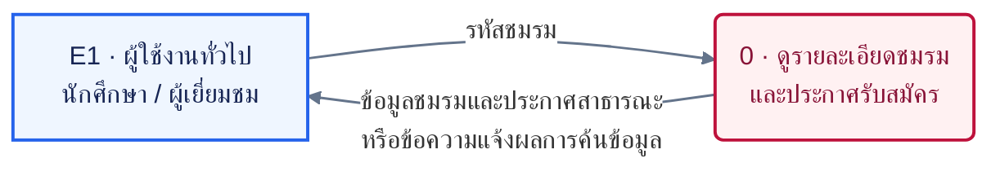
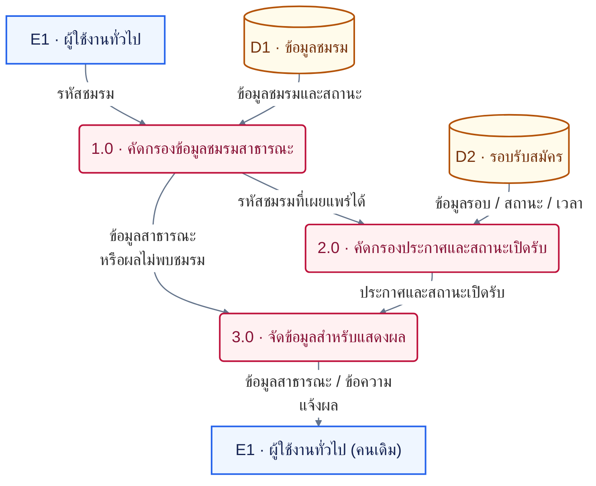

# US-02 · ดูรายละเอียดชมรมและประกาศรับสมัคร

**TU ClubHub — Data Flow Diagram**

สถานะ: Draft สำหรับนำเสนอการออกแบบตาม Requirements

> นักศึกษาสามารถศึกษาข้อมูลชมรมและเงื่อนไขการรับสมัครได้โดยไม่ต้องเข้าสู่ระบบ เพื่อประกอบการตัดสินใจก่อนสมัคร

อ้างอิง: [User Story US-02](../../stories/sprint1/US-02.md) · [UML Sequence Diagram SD-04](../sequence/SD-04-public-club-data.md)

## 1. Context Diagram — ขอบเขตของ US-02

ภาพนี้จำกัดขอบเขตที่งานดูรายละเอียดชมรม ไม่ใช่ Context Diagram ของ TU ClubHub ทั้งระบบ

## 2. DFD — รายละเอียดกระบวนการภายใน US-02

แตกกระบวนการ 0 เป็น 1.0–3.0 โดยคงข้อมูลเข้า–ออกของผู้ใช้เหมือนภาพ Context จัดผังจากบนลงล่างเพื่อให้ตัวอักษรมีขนาดอ่านได้บนสไลด์ ใช้ E1 ซ้ำที่ปลายทางเพื่อหลีกเลี่ยงเส้นตัดกัน โดยเป็นผู้ใช้คนเดียวกัน

**สัญลักษณ์:** สี่เหลี่ยมสีน้ำเงิน = บุคคลภายนอก · มุมมนสีแดง = กระบวนการ · ทรงกระบอกสีทอง = คลังข้อมูล · ลูกศร = การไหลของข้อมูล

ใช้สัญลักษณ์คลังข้อมูลแบบทรงกระบอกที่ Mermaid รองรับ เป็นสัญลักษณ์ประยุกต์ ไม่ใช่ชุดสัญลักษณ์ Gane–Sarson แบบเคร่งครัด D1 และ D2 เป็นกลุ่มข้อมูลเชิงตรรกะใน PostgreSQL เดียวกัน ไม่ได้หมายถึงฐานข้อมูลสองเครื่อง ลูกศรจากคลังข้อมูลหมายถึงการอ่าน ส่วนเงื่อนไขค้นหาย่อไว้ในกระบวนการ ไม่มีการเขียนข้อมูลใน Story นี้

## 3. อธิบายประกอบการนำเสนอ

| กระบวนการ | การออกแบบ | เชื่อมกับเกณฑ์ตรวจรับ |
|---|---|---|
| **1.0 คัดกรองข้อมูลชมรม** | อ่านชื่อ คำอธิบาย กิจกรรม/วัตถุประสงค์ URL รูป ช่องทางติดต่อ หมวดหมู่และแท็ก ส่งต่อเฉพาะข้อมูลสาธารณะ ชมรมที่ไม่มีหรือไม่เผยแพร่ให้ผลไม่พบข้อมูลเหมือนกัน | AC-01, AC-06 |
| **2.0 คัดกรองประกาศ** | อ่านรอบของชมรมที่ผ่านการคัดกรอง ส่งเฉพาะประกาศที่เผยแพร่ ประเมินการเปิดรับตามเวลา Server และกฎ US-07 ไม่ส่ง Draft ออกสู่ผู้ใช้ | AC-02, AC-04 |
| **3.0 จัดข้อมูลแสดงผล** | แสดงข้อมูลชมรมและประกาศ แจ้งเมื่อไม่มีรอบเปิดรับ ใช้รูปสำรองหากรูปโหลดไม่ได้ และแสดงปุ่มไปสมัครเฉพาะรอบที่เปิดรับ | AC-02, AC-03, AC-05 |

**ขอบเขต:** อ่านข้อมูลเท่านั้น ไม่ต้อง Login ไม่มีข้อมูลใบสมัครหรือข้อมูลส่วนตัวผู้สมัคร การค้นหาชมรมอยู่ใน US-01 และการส่งใบสมัครอยู่ใน US-03 ภาพ DFD อธิบายว่าข้อมูลไหลไปที่ใด ส่วน SD-04 อธิบายลำดับการเรียกแต่ละชั้นของระบบ ทั้งสองภาพจึงใช้ประกอบกันได้

**กฎประกอบภาพ:** ชมรมที่ไม่มีหรือไม่เผยแพร่ตอบ 404; ไม่มีรอบเปิดรับให้แสดง “ขณะนี้ไม่มีรอบเปิดรับสมัคร”; Network/Server error ให้แจ้งโหลดไม่สำเร็จและลองใหม่ ไม่แปลว่าไม่มีรอบ การไม่พบชมรมต้องไม่ทำให้เปิดเผยประกาศของชมรมนั้น

## 4. แยกข้อกำหนดออกจากพฤติกรรมปัจจุบัน

ภาพนี้เป็นการออกแบบตาม US-02 ซึ่งระบุให้แสดงประกาศที่เผยแพร่แล้วทั้งก่อนเปิดและหลังปิดรับ แต่ `PublicClubService.getOpenRecruitmentRounds()` เรียก `ClubProfileQueryRepository.findOpenPublicRounds()` ซึ่งคืนเฉพาะรอบที่กำลังเปิดรับ จึงยังไม่ควรอ้างว่าระบบรองรับทุกกรณีในภาพแล้ว

หลักฐานใน Repository:

- [US-02 — Acceptance Criteria, Business Rules และการแสดงผลตามสถานการณ์](../../stories/sprint1/US-02.md)
- [PublicClubService — getClubProfile / getOpenRecruitmentRounds](../../../backend/src/main/java/com/tu/clubhub/club/service/PublicClubService.java)
- [ClubProfileQueryRepository — findOpenPublicRounds](../../../backend/src/main/java/com/tu/clubhub/club/repository/ClubProfileQueryRepository.java)
- [API Specification — Public Club API](../../api/API_v1.md)

## 5. แนวทางที่ใช้ออกแบบภาพ

- [Visual Paradigm — What is a Data Flow Diagram?](https://www.visual-paradigm.com/guide/data-flow-diagram/what-is-data-flow-diagram/): ใช้บุคคลภายนอก กระบวนการ คลังข้อมูล และการไหลของข้อมูล โดย Context แสดงขอบเขตก่อนแตกเป็นรายละเอียด
- [Mermaid — Flowchart Syntax](https://mermaid.js.org/syntax/flowchart.html): ใช้รูปทรง ทิศทาง และ `classDef` ให้สีและรูปแบบสม่ำเสมอ

เมื่อนำไปจัดหน้า PDF ให้ใช้ Context เป็นภาพเกริ่น และ DFD รายละเอียดเป็นภาพหลัก แนะนำหน้ากระดาษแนวนอนพื้นขาว พร้อมคำอธิบายสัญลักษณ์ โดยอ่านเลขกระบวนการเป็นรหัสอ้างอิง ไม่ใช่ลำดับเวลาการทำงาน
