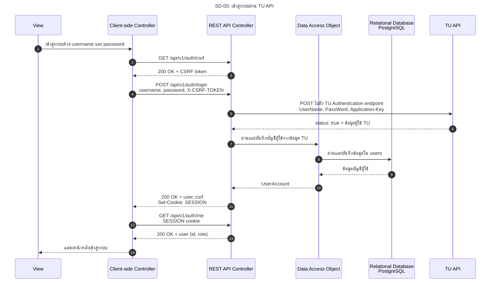

# SD-00: เข้าสู่ระบบผ่าน TU API

อ้างอิง: [API Contract](../../api/API_v1.md)

<!-- ponytail: show successful exchanges between layers only. -->

ภาพ Happy path เมื่อใช้ TU API จริง โดยย่อ Service และ TuAuthClient ไว้ใน REST API Controller; DAO แทน UserAccountRepository

View คือหน้า Login, Client-side Controller คือ AuthContext และ REST API Controller คือ AuthController การเรียก API ที่ต้อง Login หลังจากนี้ใช้ SESSION cookie
