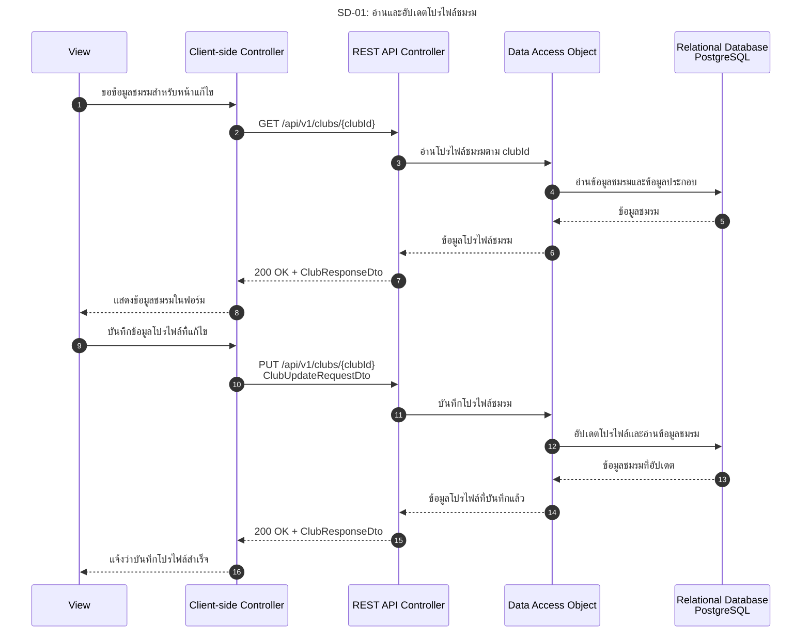

# SD-01: อ่านและอัปเดตโปรไฟล์ชมรม

อ้างอิง: [US-06](../../stories/US-06.md) · [API Contract](../../api/API_v1.md)

<!-- ponytail: show successful exchanges between layers only. -->

สถานะ: ภาพ Happy path ตามแบบ; GET ที่ฟอร์มเรียกยังไม่มี handler; PUT มีแล้ว แต่หน้าฟอร์มยังไม่ได้เชื่อมเข้าหน้าหลักของแอป

ย่อ Service ไว้ใน REST API Controller; DAO แทน ClubRepository และ ClubProfileQueryRepository

กรรมการชมรม Login ตาม [SD-00](SD-00-login-tu-api.md) แล้ว คำขอบันทึกส่ง SESSION cookie และ X-CSRF-TOKEN ส่วน API อ่านโปรไฟล์สาธารณะที่มีอยู่ดู [SD-04](SD-04-public-club-data.md)
