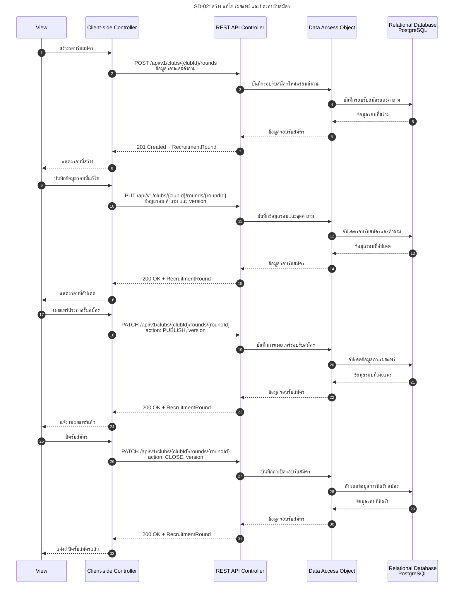

# SD-02: สร้าง แก้ไข เผยแพร่ และปิดรอบรับสมัคร

อ้างอิง: [US-07](../../stories/US-07.md) · [Recruitment API](../../api/rounds.openapi.yaml)

<!-- ponytail: show successful exchanges between layers only. -->

สถานะ: Backend รองรับทั้งสี่รายการแล้ว ส่วนหน้าจอยังต้องเชื่อม API

ย่อ Service ไว้ใน REST API Controller; DAO แทน RecruitmentRoundRepository

กรรมการชมรม Login ตาม [SD-00](SD-00-login-tu-api.md) แล้ว ทุกคำขอส่ง SESSION cookie และ X-CSRF-TOKEN
