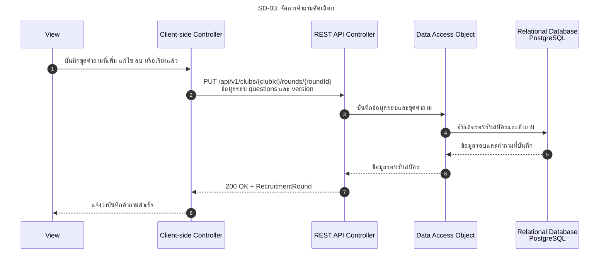

# SD-03: จัดการคำถามคัดเลือก

อ้างอิง: [US-08](../../stories/US-08.md) · [Recruitment API](../../api/rounds.openapi.yaml)

<!-- ponytail: show successful exchanges between layers only. -->

สถานะ: Backend รับคำถามพร้อมข้อมูลรอบผ่าน POST/PUT; ยังไม่มี API แยกรายคำถาม และ Frontend ยังไม่ได้เชื่อม API

ย่อ Service ไว้ใน REST API Controller; DAO แทน RecruitmentRoundRepository

กรรมการชมรม Login ตาม [SD-00](SD-00-login-tu-api.md) แล้ว คำขอส่ง SESSION cookie และ X-CSRF-TOKEN กรณีสร้างรอบใหม่ให้ส่ง `questions` พร้อม POST ตาม [SD-02](SD-02-recruitment-round.md)
