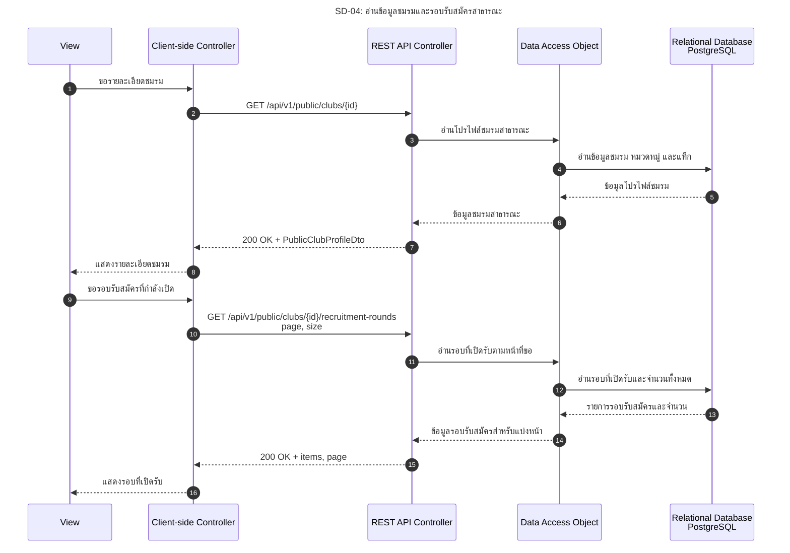

# SD-04: อ่านข้อมูลชมรมและรอบรับสมัครสาธารณะ

อ้างอิง: [US-02](../../stories/sprint1/US-02.md) · [Public Club API](../../api/API_v1.md)

<!-- ponytail: show successful exchanges between layers only. -->

สถานะ 27 ต.ค. 2026: API สองรายการนี้มีแล้วและไม่ต้อง Login; หน้า `/clubs/:clubId` เชื่อมข้อมูลจากทั้งสอง API แล้ว ยังไม่มี API รายการ/ค้นหาชมรม การรับสมัครยังรอ Submission endpoint ไม่ใช่การตรวจรับ Flow ครบทุกขั้นตอน

ย่อ Service ไว้ใน REST API Controller; DAO แทน ClubRepository และ ClubProfileQueryRepository

