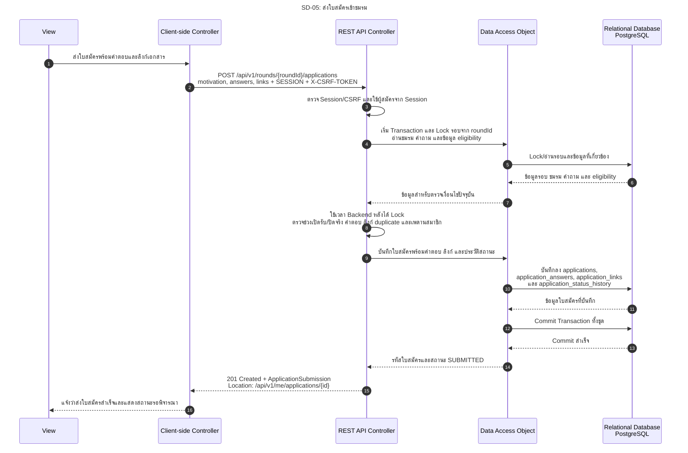

# SD-05: ส่งใบสมัครเข้าชมรม

อ้างอิง: [US-03 งานยกยอด Sprint 1](../../stories/sprint1/US-03.md) · [API Contract §11](../../api/API_v1.md#11-application-submission) · [OpenAPI](../../api/openapi.yaml) · [Task74 Sprint 2 Artefact](../../architecture/task74-sprint2-analysis.md)

<!-- ponytail: show successful exchanges between layers only. -->

สถานะ 27 ต.ค. 2026: **Draft / Pending Review สำหรับการส่งต่องาน Task74** กำหนด API ส่งใบสมัครใน API Contract §11 และ openapi.yaml แล้ว มี DynamicApplicationForm เป็น UI ต้นแบบ แต่ยังไม่เชื่อมเข้าหน้าหลัก ไม่มี Submission API client และ endpoint ใน Backend การแก้ Diagram ไม่ใช่หลักฐานว่า Implement หรือผ่าน Review แล้ว

ย่อ Service ไว้ใน REST API Controller; DAO แทน Repository สำหรับใบสมัครตามแบบ

ตาม Contract การ Lock/ตรวจเงื่อนไขและบันทึกทั้ง 4 ตารางอยู่ใน Transaction เดียว ตอบ 201 หลัง Commit และ Rollback ทั้งชุดเมื่อบันทึกล้มเหลว ลิงก์เอกสารแต่ละรายการเก็บเป็น 1 แถวใน `application_links` โดยใช้คอลัมน์ `label`, `url` และ `display_order` การส่งใบสมัครไม่สร้างสมาชิกภาพ

นักศึกษา Login ผ่าน TU API ตาม [SD-00](SD-00-login-tu-api.md) แล้ว คำขอส่ง SESSION cookie และ X-CSRF-TOKEN

Backend หา `clubId` จากรอบและ `applicant_id` จาก Session ไม่รับสองค่านี้จาก Client เปิดฟอร์มไม่จองสิทธิ์สมัคร ต้องตรวจ `opens_at <= now < closes_at` และ `closed_at IS NULL` ตอนบันทึกตาม Contract หากปิดรับระหว่างกรอกให้ปฏิเสธโดยไม่บันทึกบางส่วน การส่งซ้ำตอบ HTTP `409`, `code: RESOURCE_CONFLICT`, `reason: APPLICATION_ALREADY_EXISTS` ไม่ใช่ replay สำเร็จ

การอ่านประวัติที่ `Location` ยังรอ Contract/Implementation ของ US-04 โดย [T74-D01](../../architecture/system-architecture.md#t74-d01) บันทึกข้อสรุปผู้ใช้แล้วว่า private resource มีอยู่แต่ไม่มีสิทธิ์เป็น 403 และไม่พบจริงเป็น 404 ส่วนการพิจารณา ประกาศผล ยืนยัน และหมดเวลาแยกจาก Diagram นี้ ดู [State Machine](../../architecture/system-architecture.md#s2-application-state-machine), [Business Rules](../../architecture/system-architecture.md#s2-business-rules) และ [Permission Matrix](../../security/permission-matrix.md#s2-permission-matrix)
