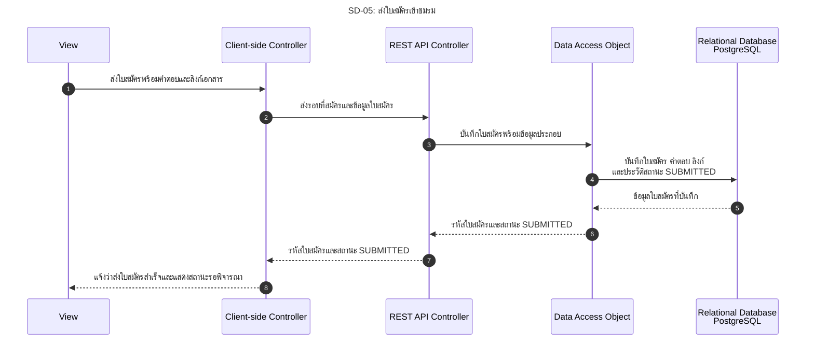

# SD-05: ส่งใบสมัครเข้าชมรม

อ้างอิง: [US-03](../../stories/US-03.md)

<!-- ponytail: show successful exchanges between layers only. -->

สถานะ: ภาพเป้าหมายตาม Story; ยังไม่มีหน้าฟอร์ม API client หรือ endpoint ส่งใบสมัคร

ย่อ Service ไว้ใน REST API Controller; DAO แทน Repository สำหรับใบสมัครตามแบบ

นักศึกษา Login ผ่าน TU API ตาม [SD-00](SD-00-login-tu-api.md) แล้ว คำขอส่ง SESSION cookie และ X-CSRF-TOKEN
