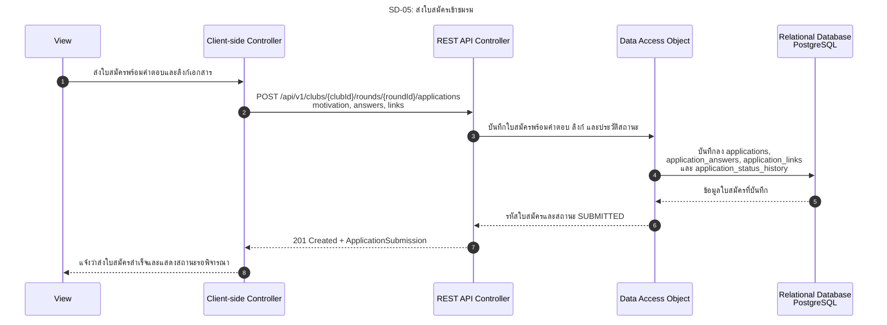

# SD-05: ส่งใบสมัครเข้าชมรม

อ้างอิง: [US-03](../../stories/US-03.md) · [API Contract §11](../../api/API_v1.md#11-application-submission) · [OpenAPI](../../api/openapi.yaml)

<!-- ponytail: show successful exchanges between layers only. -->

สถานะ: กำหนด API ส่งใบสมัครใน API Contract §11 และ openapi.yaml แล้ว มี DynamicApplicationForm เป็น UI ต้นแบบ แต่ยังไม่เชื่อมเข้าหน้าหลัก ไม่มี Submission API client และ endpoint ใน Backend

ย่อ Service ไว้ใน REST API Controller; DAO แทน Repository สำหรับใบสมัครตามแบบ

ตาม Contract บันทึกทั้ง 4 ตารางใน Transaction เดียวและตอบ 201 หลัง Commit ลิงก์เอกสารแต่ละรายการเก็บเป็น 1 แถวใน `application_links` โดยใช้คอลัมน์ `label`, `url` และ `display_order`

นักศึกษา Login ผ่าน TU API ตาม [SD-00](SD-00-login-tu-api.md) แล้ว คำขอส่ง SESSION cookie และ X-CSRF-TOKEN
