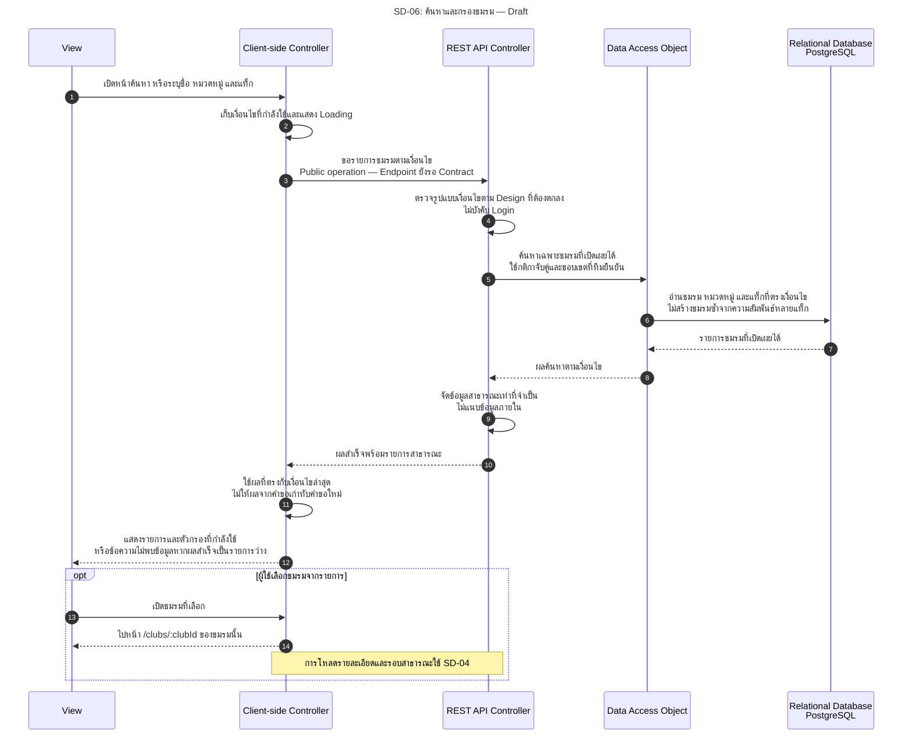

# SD-06: ค้นหาและกรองชมรม — Sprint 2

อ้างอิง: [US-01](../../stories/sprint2/US-01.md) · [US-02](../../stories/sprint1/US-02.md) · [API Contract §8.1](../../api/API_v1.md#81-task74-sprint-2-contract-handoff--draft--pending-review) · [Permission Matrix](../../security/permission-matrix.md#s2-permission-matrix) · [ดัชนี Diagram](../README.md)

**สถานะ 27 ต.ค. 2026: Draft / Pending Review.** API รายการ/ค้นหาชมรมยังไม่มี Implementation และยังไม่มี Endpoint/Response Contract ที่ครบ ภาพเป็นลำดับเชิงตรรกะสำหรับ Design ไม่กำหนด URL, DTO, วิธีจับคู่คำค้น, ANY/ALL ของแท็ก หรือขนาดหน้าแทนทีม

ทบทวนตามคำยืนยันผู้ใช้ 27 ต.ค. 2026: กฎทรัพยากรส่วนตัว “มีอยู่แต่ไม่มีสิทธิ์ `403` / ไม่มีอยู่ `404`” ตาม T74-D01 ไม่เปลี่ยน Public search ให้บังคับ Login ส่วน `INTERVIEW` ออกจาก MVP และ `UNDER_REVIEW` optional แบบ explicit Action เป็นกฎของ Flow ใบสมัคร ไม่ใช่ผลข้างเคียงของการค้นหา ข้อสรุปผู้ใช้ยัง Pending Team Review ตาม [Decision Log](../../architecture/system-architecture.md#s2-decision-log)

<!-- ponytail: show successful exchanges between layers only. -->

ย่อ Service ไว้ใน REST API Controller; DAO หมายถึง Repository ตามแบบ ไม่ใช่ชื่อคลาสที่มีแล้ว Public search ไม่บังคับ Login และไม่ส่งใบสมัครหรือข้อมูลจัดการสิทธิ์ออกมาด้วย

## เงื่อนไขและจุดส่งต่อ Design

| เรื่อง | ข้อกำหนด / ประเด็น Review |
|---|---|
| การเข้าถึงและข้อมูล | US-01.AC-01/02, BR-01/02: ใช้ได้โดยไม่ Login; Backend จำกัด Public scope ใช้เกณฑ์เดียวกับ US-02 ไม่ให้ FE กรองความลับเอง |
| ขอบเขตผลค้นหา | US-01.BR-08: ชมรมไม่ซ้ำเพราะหลายแท็ก; ชมรมที่ไม่ได้เปิดรับยังค้นพบได้หากเปิดเผยได้ ไม่เพิ่มตัวกรองสถานะรับสมัครเอง |
| ล้างตัวกรอง | US-01.AC-04/BR-06: เริ่มคำขอใหม่ด้วยค่าเริ่มต้นของหน้าค้นหาที่ทีมตกลง ไม่แปลว่าอ่านทุกแถวใน DB รวมชมรมที่ซ่อน |
| Empty / Error | ผลสำเร็จว่างแสดงข้อความไม่พบและยังแก้/ล้างตัวกรองได้; คำขอล้มเหลวแสดง Error/Retry ไม่แสดงเหมือนผลว่าง |
| คำขอพร้อมกัน | US-01 Alternative Flows: แสดงผลที่ตรงกับเงื่อนไขล่าสุด ไม่ให้คำขอเก่าที่ช้ากว่าทับผลล่าสุด; วิธีทำเป็นงาน FE Design |
| ยังต้องตัดสิน | US-01 §10: วิธีจับคู่ชื่อ การรวมเงื่อนไข จำนวนหมวดหมู่/แท็ก ค่าเริ่มต้น Pagination และ trigger; ไม่กำหนด AND/ANY/ALL หรือเวลาตอบกลับขึ้นเอง |
| เปิดรายละเอียด | ชมรมที่ถูกซ่อน/หายไประหว่างเลือกให้ใช้ Public error contract ของ US-02; ดู [SD-04](SD-04-public-club-data.md) และ [SD-05](SD-05-submit-application.md) สำหรับขั้นสมัครที่ยกยอด |

ภาพนี้ไม่มีการเขียนข้อมูล ไม่มีการบันทึกประวัติการค้นหา/รายการโปรด และไม่เพิ่มระบบแนะนำชมรม กรณีทดสอบอ้าง [US-01 §11](../../stories/sprint2/US-01.md#11-test-cases-ก่อนส่งงาน); Diagram ไม่ใช่ผล Test หรือหลักฐานอนุมัติ Story
