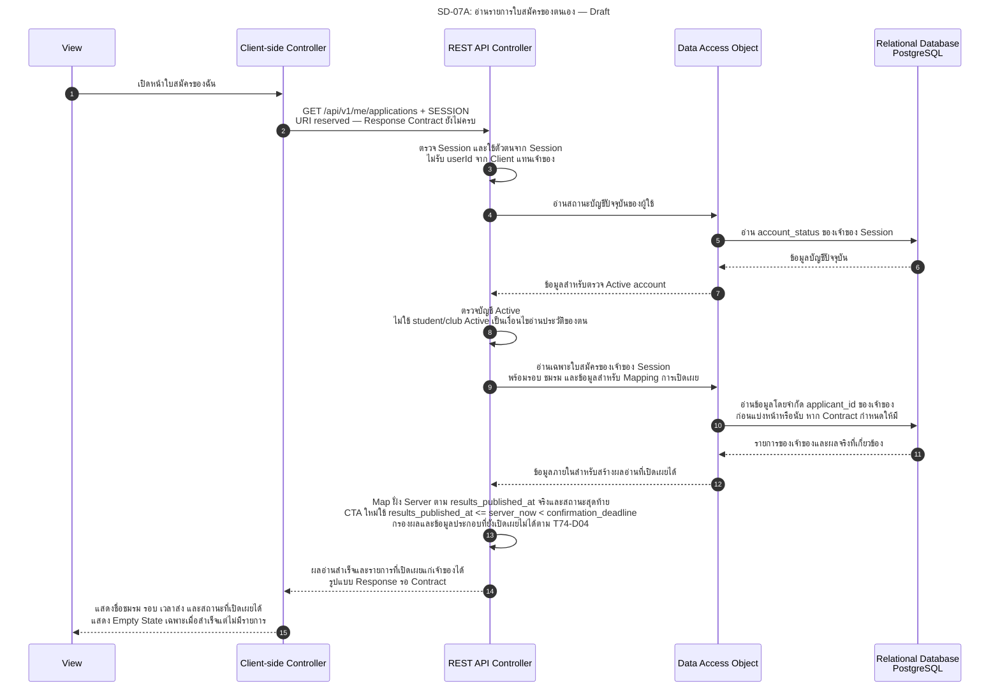
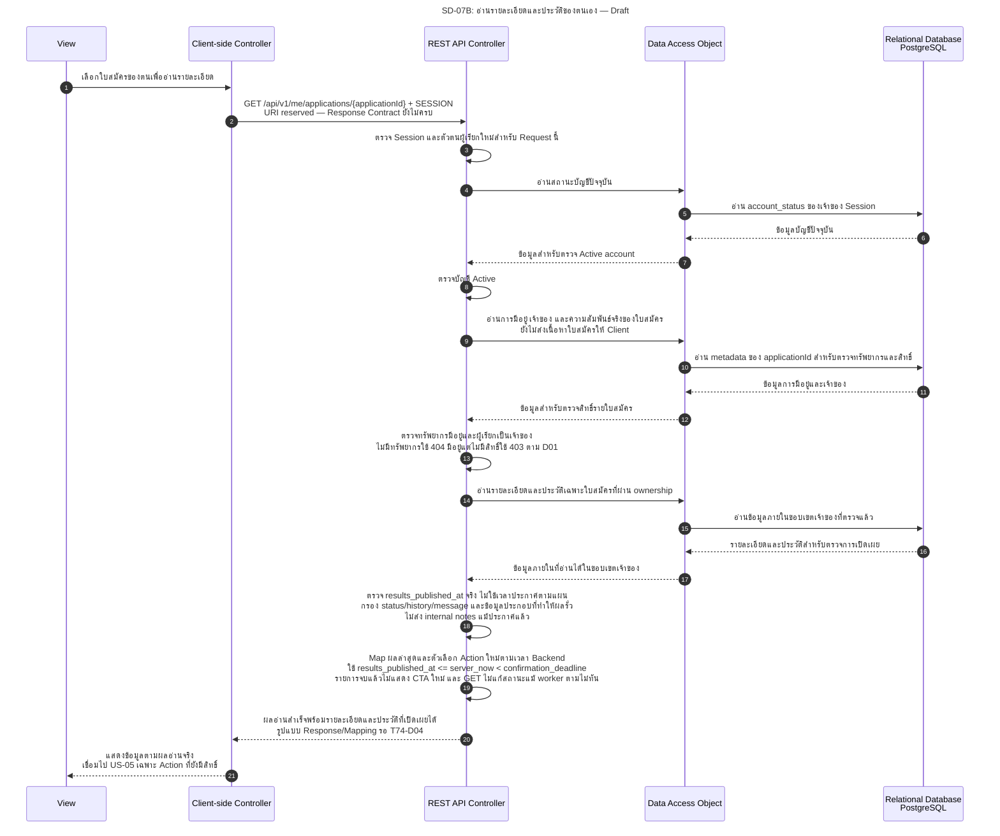

# SD-07: ติดตามสถานะและประวัติใบสมัครของตนเอง

**สถานะ 27 ต.ค. 2026: Draft / Pending Review.** Diagram นี้เป็น Artefact สำหรับ Design ของ US-04 ยังไม่มี Backend handler หรือ Response Contract ที่ครบสำหรับการอ่านใบสมัคร ไม่ใช่หลักฐานว่า Implement, ทดสอบผ่าน หรือได้รับ Approval แล้ว

ปรับตามคำยืนยันผู้ใช้ 27 ต.ค. 2026: ทรัพยากรใบสมัครส่วนตัวที่มีอยู่แต่ไม่มีสิทธิ์ใช้ `403`; ทรัพยากรที่ไม่มีอยู่ใช้ `404` ตาม [T74-D01](../../architecture/system-architecture.md#t74-d01) — **Recorded User Instruction / Pending Team Review** ไม่คงข้อขัดแย้ง HTTP นี้เป็น Blocked และไม่ถือว่าเป็นหลักฐาน Review/Approval ของทีมแล้ว

อ้างอิง: [US-04 AC-01–05 / BR-01–09](../../stories/sprint2/US-04.md) · [API Contract §11: reserved Location และรายการใบสมัคร](../../api/API_v1.md#11-application-submission) · [State Machine](../../architecture/system-architecture.md#s2-application-state-machine) · [Permission Matrix §2–4/§7](../../security/permission-matrix.md#s2-permission-matrix) · [Task74: Traceability และ QA Scenarios](../../architecture/task74-sprint2-analysis.md)

ย่อ Service ไว้ใน REST API Controller และใช้ DAO แทน Repository ตามแบบ Diagram เดิม ชื่อการอ่าน/Mapping ใน Diagram เป็นงานเชิงตรรกะ ไม่ใช่ชื่อ method/class หรือ DTO ที่ Implement แล้ว แสดงเฉพาะ exchanges ของเส้นทางสำเร็จ; เงื่อนไขที่ต้องปฏิเสธอยู่ท้ายเอกสาร

## 1. อ่านรายการใบสมัครของฉัน

`GET /api/v1/me/applications` เป็น URI ที่จองไว้ใน Contract เดิม ยังไม่กำหนด Response schema, การเรียง และ Pagination ครบ Diagram นี้ไม่เพิ่ม Query Parameters หรือกำหนดขนาดหน้าเอง

## 2. อ่านรายละเอียดและประวัติใบสมัคร

`GET /api/v1/me/applications/{applicationId}` เป็น URI สำหรับทรัพยากรที่ Submission Contract จองไว้ผ่าน `Location` ไม่ใช่หลักฐานว่ามี handler แล้ว รูปแบบรายละเอียด ประวัติ และข้อมูลที่เชื่อมไป US-05 ยังต้องตกลงตาม [T74-D04](../../architecture/system-architecture.md#t74-d04)

## 3. เงื่อนไขการมองเห็นและขอบเขตของการอ่าน

- เจ้าของที่มี Session ใช้ได้และบัญชี Active ยังอ่านประวัติเดิมได้เมื่อ student profile หรือชมรมไม่ Active ตาม Matrix ไม่ยกเงื่อนไขสมัครใหม่มาใช้ปิดสิทธิ์อ่าน
- ก่อนประกาศจริงต้องกรองผลภายในและ history/message/ข้อมูลประกอบที่ทำให้อนุมานผลได้ที่ Backend รวม notification ที่อ้างผลหากนำมาส่งประกอบหน้า ไม่ส่งข้อมูลให้ Frontend ซ่อนเอง ส่วน notification endpoint อื่นต้องยึดนโยบายเดียวกัน ไม่ใช่ฟีเจอร์ที่เพิ่มจาก Diagram นี้
- การถึง `results_scheduled_at` ไม่เท่ากับประกาศผล ใช้ `results_published_at` จริง; Mapping ของข้อความสถานะและ history allowlist ยัง Pending Review ตาม T74-D04
- หลังประกาศ ผู้ผ่านที่ยังไม่ตอบจึงเห็นตัวเลือกสร้างผลตอบรับใหม่เมื่อ `results_published_at <= server_now < confirmation_deadline`; การ **ยืนยัน** ต้องผ่าน student/club Active เพิ่ม ส่วนการ **สละสิทธิ์** ใช้บัญชีเจ้าของ Active โดยไม่บังคับ student/club Active ทั้งสอง Action ต้องผ่าน ownership/state/time และรอบไม่ cancelled ตาม Matrix โดยตรวจซ้ำใน Transaction ณ จุดตัดสิน ไม่ใช้เวลาตอนเปิดหน้านี้
- `CONFIRMED`, `DECLINED`, `EXPIRED` ต้องแสดงผลล่าสุด; ผู้ไม่ผ่านไม่มีตัวเลือกยืนยัน หากแถวยัง `ACCEPTED` แต่ถึง `confirmation_deadline` แล้ว ต้องไม่แสดงว่ายังตอบรับใหม่ได้แม้ worker ยังไม่เปลี่ยนแถว; หมดเวลาใช้ `EXPIRED` และ UI “สละสิทธิ์ (หมดเวลาตอบรับ)” ไม่ใช้ `DECLINED` อัตโนมัติ รายละเอียด DTO/history allowlist ยังรอ T74-D04
- Retry การยืนยัน/สละของ Action เดิมที่จบแล้วเป็นการอ่านผลเดิมตาม [SD-10](SD-10-confirm-decline-membership.md) หลังตรวจ Session/บัญชี Active/ownership ไม่ต้องสร้างการตัดสินใหม่หรือเขียนข้อมูลเพราะอยู่นอกช่วงเวลา การไม่มี CTA สำหรับทำรายการใหม่ไม่ทำให้ผลเดิมหายไป
- GET ไม่มีผลเปลี่ยนเป็น `UNDER_REVIEW`, บันทึกผล, ประกาศผล, สร้างสมาชิก หรือทำเครื่องหมายตอบรับ/หมดเวลา การเรียกซ้ำไม่สร้าง status history ของเหตุการณ์ธุรกิจจากการอ่าน

## 4. กรณีสำคัญที่ต้องปฏิเสธหรือแสดงแยกจากผลสำเร็จ

| กรณี | พฤติกรรมตามหลักฐาน / ประเด็นที่ยังเปิด | อ้างอิง QA |
|---|---|---|
| ไม่มี Session หรือหมดอายุ | `401 AUTHENTICATION_REQUIRED`; ไม่คืนข้อมูลส่วนตัว | Matrix §7; T74-QA06 |
| ตรวจพบ account SUSPENDED | `403 ACCOUNT_NOT_ALLOWED` พร้อม invalidate session; Request ถัดไปที่ไม่มี Session ใช้ 401 | Matrix §2.1/§7; T74-QA10 |
| เรียก applicationId ที่มีอยู่แต่เป็นของผู้อื่น หรือทรัพยากรมีอยู่แต่นอกขอบเขตที่มีสิทธิ์ | `403 ACCESS_DENIED` ไม่คืนเนื้อหา ตามคำยืนยันผู้ใช้ใน T74-D01; ไม่คง 403/404 เป็นข้อขัดแย้งที่ยังไม่เลือก | Matrix §7; T74-QA06 |
| ไม่พบทรัพยากรจริง | `404 RESOURCE_NOT_FOUND`; ไม่ปลอมเป็นรายการประวัติว่าง | Matrix §7; T74-QA06 |
| ผลยังไม่ประกาศจริง แต่ response มีผลผ่าน/ไม่ผ่านหรือข้อมูลที่อนุมานผลได้ | ถือว่าผิดเงื่อนไขการเปิดเผย แม้ UI ซ่อนช่อง status; ต้องแก้ Server Mapping ตาม T74-D04 | US-04.AC-03; T74-QA07 |
| ข้อมูลโหลดล้มเหลว | แสดง Error และทางลองใหม่ ไม่ใช้ข้อความ “ยังไม่มีประวัติการสมัคร” แทน API Error | US-04.BR-08; T74-QA06 |
| ผู้ใช้พยายามตอบรับจากข้อมูลหน้าจอเก่า | การทำรายการอยู่นอก Diagram อ่านนี้; API ของ US-05 ต้องตรวจสิทธิ์/สถานะ/เวลาใหม่ ไม่เชื่อ CTA ที่เคยแสดง | T74-QA14/18/20 |

Decision ที่เกี่ยวข้อง: [T74-D01: มีทรัพยากรแต่ไม่มีสิทธิ์ 403 / ไม่มีทรัพยากร 404](../../architecture/system-architecture.md#t74-d01), [T74-D04: DTO/การมองเห็น](../../architecture/system-architecture.md#t74-d04), [T74-D05: Retry ผลเดิม](../../architecture/system-architecture.md#t74-d05), [T74-D06: ขอบเขตเวลาและงานหมดเวลา](../../architecture/system-architecture.md#t74-d06) ข้อสรุปผู้ใช้ยัง Pending Team Review; T74-D04 และรายละเอียด worker ที่ยังเปิดไม่ถูกตัดสินจาก Diagram นี้ กรณี QA อ้าง [Task74 §4](../../architecture/task74-sprint2-analysis.md) และยังเป็น Planned / Not Run
