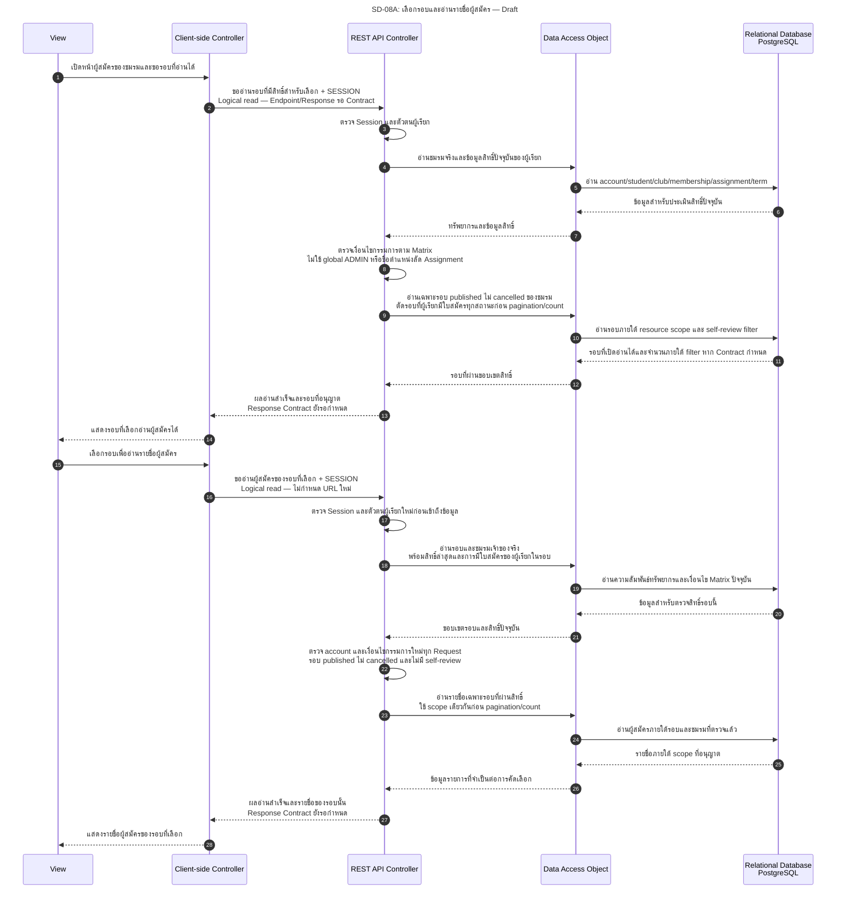
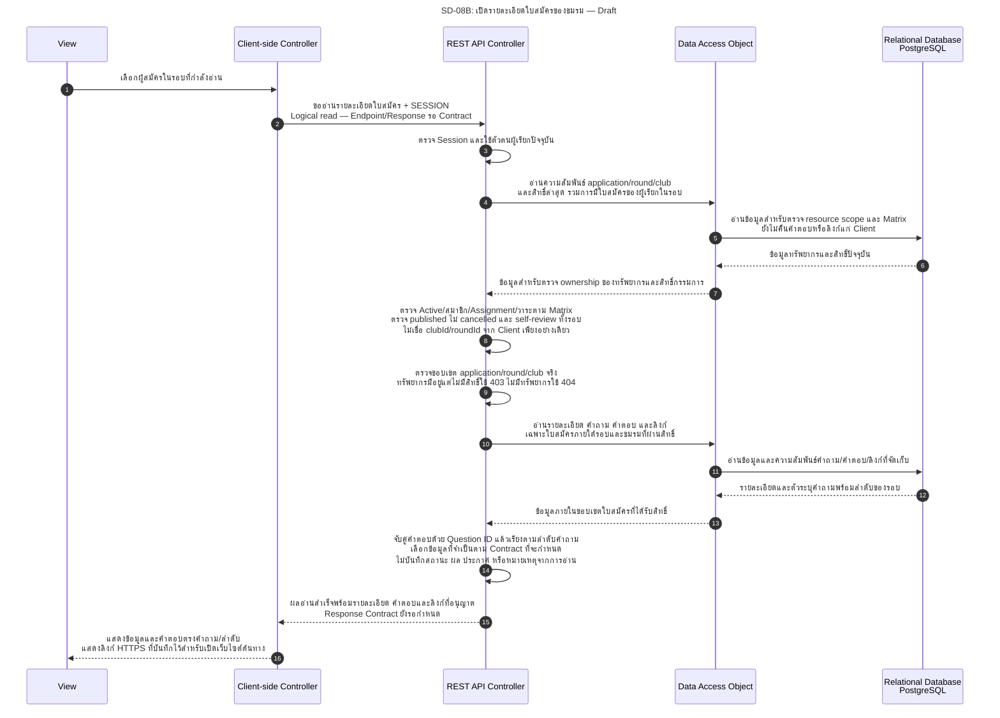

# SD-08: กรรมการเปิดอ่านใบสมัครของชมรม

**สถานะ 27 ต.ค. 2026: Draft / Pending Review.** เป็น Sequence Diagram สำหรับ US-09 ซึ่งเป็น Read-only ยังไม่มี Contract ของ committee application endpoints และ Backend handlers ที่ครบ ไม่ได้ประกาศว่า Implement, ทดสอบผ่าน หรือได้รับ Approval แล้ว

คำยืนยันผู้ใช้ 27 ต.ค. 2026 กำหนดให้ทรัพยากรส่วนตัวที่มีอยู่แต่ไม่มีสิทธิ์ใช้ `403` และทรัพยากรที่ไม่มีอยู่ใช้ `404`; `UNDER_REVIEW` เป็นขั้น optional ผ่าน explicit Action เท่านั้น และตัด `INTERVIEW` ออกจาก MVP ตาม T74-D01/02 — **Recorded User Instruction / Pending Team Review** ไม่ได้เพิ่มงานเขียนเข้า US-09

อ้างอิง: [US-09 AC-01–05 / BR-01–09](../../stories/sprint2/US-09.md) · [Permission Matrix §2–4/§7](../../security/permission-matrix.md#s2-permission-matrix) · [Architecture: Read-only review/State Machine](../../architecture/system-architecture.md#s2-application-state-machine) · [API v1: ขอบเขต Contract ที่ยังขาด](../../api/API_v1.md#8-remaining-product-contracts-and-integration) · [Task74: Traceability และ QA Scenarios](../../architecture/task74-sprint2-analysis.md)

ย่อ Service ไว้ใน REST API Controller และ DAO แทน Repository ตามแบบ Diagram เดิม **ข้อความขออ่านด้านล่างเป็น Logical Interaction ไม่กำหนด HTTP URL, method signature, DTO หรือรูปแบบ Pagination ใหม่** แสดงเฉพาะ exchanges เมื่อผ่านเงื่อนไขสำเร็จ; กรณีปฏิเสธอยู่ท้ายเอกสาร

## 1. เลือกรอบและเปิดรายชื่อผู้สมัคร

การอ่านรอบใน Diagram หมายถึงรอบ published ที่อนุญาตให้อ่านผู้สมัครตาม Matrix ไม่ใช่การขยาย Contract หน้าจัดการรอบ draft ผู้ใช้ต้องไม่มีใบสมัครในรอบนั้นไม่ว่าสถานะใด รวม `WITHDRAWN` ให้กรองรอบที่ติดข้อห้ามก่อน pagination/count หาก Contract ออกแบบให้มี

## 2. เปิดรายละเอียด คำตอบ และลิงก์เอกสาร

การผ่านสิทธิ์จากหน้ารายการไม่ใช้แทนการตรวจรายละเอียด Request ถัดไป ต้องอ่านสิทธิ์ปัจจุบันและตรวจ `application.round_id` / `application.club_id` เทียบกับรอบและชมรมจริงก่อนคืนเนื้อหา

## 3. เงื่อนไขร่วมและขอบเขตการอ่าน

- System Role มีเพียง `USER` / `ADMIN`; สิทธิ์ชมรมมาจาก `club_committee_assignments.permission_role=COMMITTEE/PRESIDENT` ไม่เพิ่ม `CLUB_COMMITTEE` เป็น global role และไม่ใช้ `position_name` เป็นหลักฐานสิทธิ์ PRESIDENT
- ทุก Request ต้องผ่านบัญชี/นักศึกษา/ชมรม Active, สมาชิกภาพ Active ที่ `joined_at <= now` และ `ended_at IS NULL`, Assignment Active ที่ไม่ถูกถอน และช่วง `[starts_at, ends_at)` ตาม Matrix ไม่อาศัยสิทธิ์ที่จำจากตอน Login หรือหน้ารายการ
- PRESIDENT ที่ผ่านเงื่อนไขมีสิทธิ์อ่านเช่นเดียวกับกรรมการทั่วไป การอ่านไม่ต้องใช้สิทธิ์เฉพาะประธาน ส่วน ADMIN ไม่มีสิทธิ์อ่านคำตอบ/เอกสารจาก global role; หากมี Assignment ต้องผ่านเงื่อนไขกรรมการและ self-review เช่นเดียวกัน
- มีใบสมัครในรอบไม่ว่าสถานะใด รวม WITHDRAWN ให้ปฏิเสธทุกงานกรรมการของรอบนั้น ไม่ใช่ซ่อนเฉพาะใบสมัครตนเองหรือกรองหลังนับแล้ว เจ้าของยังใช้ US-04 อ่านใบสมัครตนได้ตามสิทธิ์ทั่วไป
- อ่านผู้สมัครของรอบ published ที่ไม่ cancelled ได้ตาม Matrix; การอ่านไม่ต้องรอปิดรับ เงื่อนไขหลังปิดรับเป็นของการบันทึกผลที่อยู่นอก US-09
- คำตอบจับคู่ด้วย Question ID ก่อนเรียงตามลำดับคำถาม ไม่จับคู่จากตำแหน่ง Array เพียงอย่างเดียว; คำถาม optional ที่ไม่มีคำตอบต้องไม่ทำให้คำตอบถัดไปเลื่อนไปผิดข้อ
- ใช้ HTTPS links ที่ส่งและจัดเก็บตาม Submission Contract แสดงเพื่อเปิดเว็บไซต์ต้นทาง Backend ไม่ Fetch/Download แทนหรือรับประกันสิทธิ์เข้าถึงปลายทาง; ไม่มี participant เว็บไซต์ภายนอกเพราะการเรียกเว็บไซต์นั้นไม่ใช่ Backend exchange ของ Flow นี้
- ไม่มีการเปลี่ยน `SUBMITTED → UNDER_REVIEW`, สร้างผลคัดเลือก, ประกาศผล หรือ persist หมายเหตุจาก GET/การเปิดอ่าน Access log ถ้ามีไม่ใช่ status history หรือเหตุการณ์ตัดสินผล `UNDER_REVIEW` ต้องมาจาก explicit Action แยกและข้ามไปตัดสินตรงจาก `SUBMITTED` ได้หลังปิดรับจริงตาม T74-D02; `INTERVIEW` อยู่นอก MVP

## 4. กรณีสำคัญที่ต้องปฏิเสธหรือแสดงแยกจากผลสำเร็จ

| กรณี | พฤติกรรมตามหลักฐาน | อ้างอิง QA |
|---|---|---|
| ไม่มี/หมด Session หรือบัญชีถูกระงับ | `401 AUTHENTICATION_REQUIRED`; หากพบ SUSPENDED ใน Session ที่ยังยืนยันตัวตนให้ `403 ACCOUNT_NOT_ALLOWED` พร้อม invalidate ตาม Matrix | T74-QA10; US-09.TC-09-13 |
| กรรมการต่างชมรม, USER ไม่มี Assignment หรือ ADMIN ใช้ global role อย่างเดียว | `403 ACCESS_DENIED` ก่อนเปิดเผย child resource หรือเนื้อหาผู้สมัคร | US-09.AC-05; T74-QA09 |
| นักศึกษา/ชมรม/สมาชิก/Assignment ไม่ผ่าน หรือวาระยังไม่เริ่ม/สิ้นสุด/ถูกถอน | `403 ACCESS_DENIED`; เวลาเท่ากับ ends_at ไม่ผ่าน แม้ยังมี Session | Matrix §2/7; T74-QA10 |
| ผู้เรียกมีใบสมัครในรอบ รวม WITHDRAWN | `403 ACCESS_DENIED` สำหรับการอ่านภายในรอบ; รอบต้องถูกตัดจากรายการ/จำนวนก่อน pagination ไม่เปิดช่องกลับมาอ่านโดยถอนใบสมัคร | US-09.BR-09/TC-09-14; T74-QA09 |
| ทรัพยากรมีอยู่แต่ใบสมัครอยู่นอก parent/scope ที่มีสิทธิ์ | `403 ACCESS_DENIED` ไม่คืนเนื้อหา; หากไม่มีสิทธิ์ parent ให้ปฏิเสธ 403 ก่อนอ่านเนื้อหา child | Matrix §7; T74-D01; T74-QA08/09 |
| ไม่พบทรัพยากรจริง | `404 RESOURCE_NOT_FOUND` ตาม T74-D01 ไม่ใช่การซ่อนทรัพยากรที่มีอยู่แต่ไม่มีสิทธิ์ด้วย 404 | Matrix §7; T74-QA08/09 |
| รอบ draft/cancelled หรือเปลี่ยนขอบเขตหลังโหลดรายการ | ตรวจสถานะ/สิทธิ์ใหม่ ไม่คืนเนื้อหา; การเลือก HTTP ของกรณี state/visibility ต้องลง Contract ที่ยังขาดตาม Matrix/API ไม่กำหนดรหัสใหม่ใน Diagram | Matrix §4; T74-QA08/09 |
| เปิดลิงก์แล้วเว็บไซต์ภายนอกเข้าไม่ได้ | ส่วนอื่นของใบสมัครยังอ่านได้ ไม่ทำให้ Backend เปลี่ยนสถานะหรือปลอมว่าตรวจ Portfolio สำเร็จ | US-09.BR-07; TC-09-11/12 |

ขอบเขตงานบันทึก/ประกาศผลแยกตาม [T74-D03](../../architecture/system-architecture.md#t74-d03) และ [Draft Stories ของ Selection Results](../../stories/sprint2/selection-results-draft.md) ไม่รวมเข้า US-09 การตัดสิน `UNDER_REVIEW` optional/explicit และ `INTERVIEW` นอก MVP บันทึกตาม [T74-D02](../../architecture/system-architecture.md#t74-d02) แล้วในระดับคำยืนยันผู้ใช้และยัง Pending Team Review ส่วน API/Response fields, ลำดับ, Pagination และข้อมูลขั้นต่ำต้อง Review ตาม US-09 หัวข้อ 10 โดยไม่เพิ่ม endpoint หรือ field บังคับเอง กรณี QA อ้าง [Task74 §4](../../architecture/task74-sprint2-analysis.md) และยังเป็น Planned / Not Run
