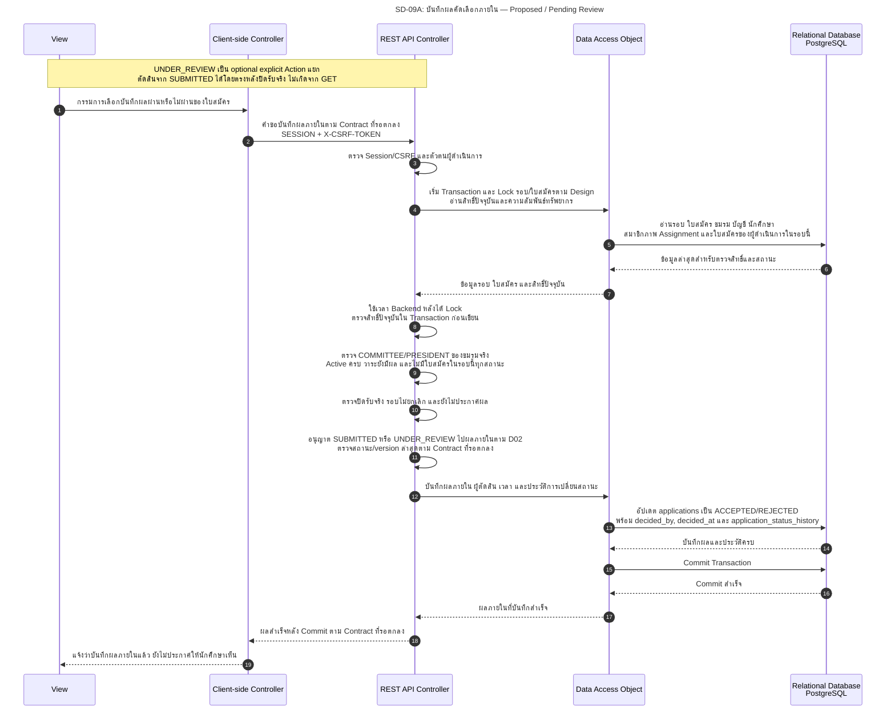
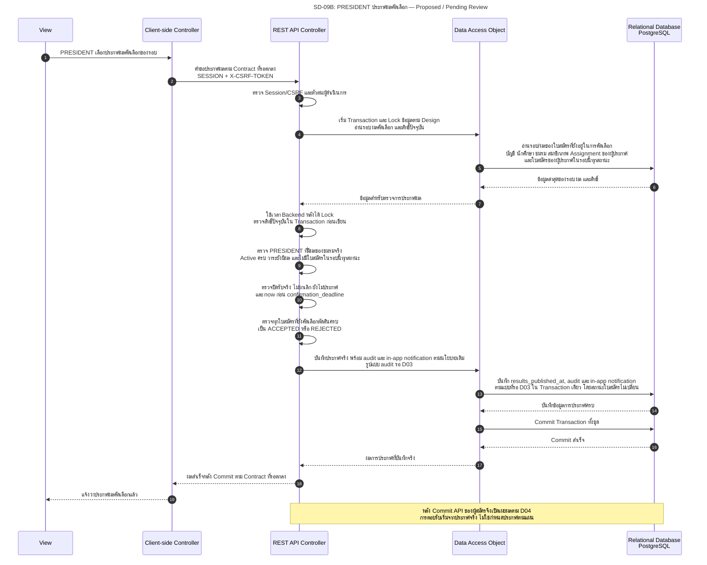

# SD-09: บันทึกผลคัดเลือกภายในและประกาศผลคัดเลือก

อ้างอิง: [Application State Machine / Transition Table](../../architecture/system-architecture.md#s2-application-state-machine) · [Permission Matrix](../../security/permission-matrix.md#s2-permission-matrix) · [API handoff §8.1](../../api/API_v1.md#81-task74-sprint-2-contract-handoff--draft--pending-review) · [Task74 Sprint 2 Artefact](../../architecture/task74-sprint2-analysis.md)

<!-- ponytail: show successful exchanges between layers only. -->

สถานะ 27 ต.ค. 2026: **Proposed Dependency — Draft / Pending Review** นโยบายสิทธิ์มีอยู่ใน Matrix และมี Draft Stories [S2-DECISION-DRAFT](../../stories/sprint2/selection-results-draft.md#s2-decision-draft) / [S2-PUBLICATION-DRAFT](../../stories/sprint2/selection-results-draft.md#s2-publication-draft) โดยผู้ใช้ยืนยัน **ชนิตว์นันท์** เป็น Scope Owner; FE/BE ยังรอมอบหมายชื่อและ API ยังไม่กำหนด การระบุ Owner ไม่ใช่หลักฐาน Scope ผ่าน formal Review/Approval หรือมี Implementation แล้ว [US-09](../../stories/sprint2/US-09.md) ครอบคลุมการเปิดอ่านเท่านั้น การอ่านไม่เริ่มพิจารณาหรือบันทึกผลอัตโนมัติ

คำยืนยันผู้ใช้ 27 ต.ค. 2026: `UNDER_REVIEW` optional ผ่าน explicit Action และตัดสินตรงจาก `SUBMITTED` ได้หลังปิดรับจริง; `INTERVIEW` ออกจาก MVP; ทรัพยากรส่วนตัวที่มีอยู่แต่ไม่มีสิทธิ์ใช้ `403` และไม่มีทรัพยากรใช้ `404` ตาม T74-D01/02 — **Recorded User Instruction / Pending Team Review** ไม่ใช่หลักฐาน PO/Reviewer อนุมัติ Scope งานเขียนแล้ว

ทั้งสองภาพย่อ Service ไว้ใน REST API Controller และใช้ DAO แทน Repository ตามรูปแบบ Diagram เดิม ข้อความคำขอ/ผลตอบกลับเป็นการทำงานเชิงตรรกะ ไม่กำหนด URL, DTO หรือ HTTP success code ใหม่ รูปแบบ Contract และข้อมูล audit ยังรอ [T74-D03](../../architecture/system-architecture.md#t74-d03)

## 1. บันทึกผลคัดเลือกภายใน

ภาพนี้แสดง `SUBMITTED` หรือ `UNDER_REVIEW` → `ACCEPTED` / `REJECTED` หลังปิดรับจริง ตามคำยืนยันผู้ใช้ใน [T74-D02](../../architecture/system-architecture.md#t74-d02) การเริ่ม `UNDER_REVIEW` เป็น explicit Action แยกที่เลือกทำได้ ไม่ใช่ผลจาก GET และไม่ใช่ขั้นบังคับก่อนตัดสินตรง ไม่เพิ่ม `INTERVIEW` หรือระบบสัมภาษณ์จาก Diagram นี้

เวลาปิดจริงคือ `closed_at` หากมี มิฉะนั้นใช้ `closes_at` การปิดก่อนกำหนดคงกำหนดเดิมและไม่ลบใบสมัคร การแก้ผลภายในก่อนประกาศต้องผ่านสิทธิ์/state/version เดียวกันและรักษาผลก่อน–หลัง ส่วนการแก้ผลหลังประกาศถูกห้ามตามนโยบายเดิม

## 2. ประกาศผลคัดเลือกของรอบ

การประกาศนี้แยกจาก `PUBLISH` ใน Recruitment API ซึ่งเผยแพร่ **ประกาศรับสมัคร** เวลาประกาศตามแผน `results_scheduled_at` ไม่ใช่เหตุให้ผลเปิดเผยเอง

การประกาศเป็นเหตุการณ์ของรอบ ไม่ใช่การเปลี่ยนสถานะใบสมัคร [SQL ตาราง application_status_history](../../../backend/src/main/resources/db/migration/V1__init_schema.sql) ห้าม `from_status = to_status` จึงห้ามใช้ `ACCEPTED → ACCEPTED` แทน audit การประกาศ รูปแบบเก็บ audit/ผู้ประกาศต้องออกแบบใน T74-D03 โดยไม่อนุมานตารางหรือ Migration ใหม่ หากส่วนใดของการประกาศ/audit/notification ล้มเหลวต้อง Rollback ทั้งชุด ไม่เปิดเผยผลสำเร็จเพียงบางส่วน

## เงื่อนไขปฏิเสธ การทำงานพร้อมกัน และประเด็น Review

ภาพแสดงเส้นทางสำเร็จเท่านั้น เงื่อนไขที่ต้องตรวจเพิ่มเติมอ้าง [Matrix Error Contract](../../security/permission-matrix.md) และ [QA Scenarios ของ Task74](../../architecture/task74-sprint2-analysis.md#4-acceptance-scenarios-สำหรับ-qa)

| ประเด็น | สิ่งที่ต้องกำหนด/ตรวจ | Trace |
|---|---|---|
| สิทธิ์ปัจจุบันและขอบเขต | ตรวจ account/student/club/member/Assignment Active, membership เริ่มแล้วและไม่สิ้นสุด, assignment ไม่ถูกถอน และ `starts_at <= now < ends_at`; ใช้ชมรม/รอบจากข้อมูลจริง ไม่เชื่อ Client; ADMIN ไม่มี override | Matrix §2/4/6; T74-QA09/10 |
| self-review | มีใบสมัครในรอบนั้นสถานะใดก็ตาม รวม WITHDRAWN ต้องปฏิเสธทุกงานกรรมการของรอบ ไม่ใช่เฉพาะการตัดสินใบสมัครตนเอง; COMMITTEE ทั่วไปประกาศผลไม่ได้ | Matrix §4; T74-QA09/12/13 |
| เวลาและสถานะ | ตัดสินตรงจาก SUBMITTED หรือจาก UNDER_REVIEW ได้หลังปิดรับจริงและก่อนประกาศ; UNDER_REVIEW เป็น explicit Action optional; ประกาศต้องผลครบและก่อน deadline; ตรวจเวลา/สิทธิ์ล่าสุดใน Transaction ก่อนเขียน; การแก้ผลหลังประกาศไม่ได้ | T74-QA11/12/13; T74-D02/03/06 |
| ผลยังไม่เปิดเผย | การบันทึกภายในไม่เผย ACCEPTED/REJECTED ผ่าน status/history/message/notification; internal notes ไม่เปิดแม้ประกาศแล้ว; ไม่คัดลอก notes เป็นข้อความผลโดยอัตโนมัติ | T74-QA07; [T74-D04](../../architecture/system-architecture.md#t74-d04) |
| Race/Retry/การบันทึกล้มเหลว | กำหนดลำดับ Lock/version สำหรับการแก้ผลแข่งประกาศหรือการถอนสิทธิ์ โดยตรวจเวลา/สิทธิ์ล่าสุดใน Transaction ก่อนเขียน; การตรวจผลครบและการประกาศต้องไม่ถูกคั่นด้วยผลที่เปลี่ยน; ไม่สร้าง same-state history เมื่อ Retry; Contract ของการประกาศซ้ำยังต้องตกลงใน T74-D03 ไม่ใช้กฎ Retry การตอบรับแทนทุก Action | T74-QA10/12; [T74-D03](../../architecture/system-architecture.md#t74-d03), [T74-D06](../../architecture/system-architecture.md#t74-d06) |
| Error และ Scope | ไม่มี session `401`; ทรัพยากรส่วนตัวมีอยู่แต่ไม่มีสิทธิ์/self-review/ขาด PRESIDENT/อยู่นอก parent scope ใช้ `403`; ไม่มีสิทธิ์ parent club ปฏิเสธก่อนคืนเนื้อหา child; ทรัพยากรไม่มีอยู่ใช้ `404`; state/time/version conflict หลังผ่านสิทธิ์ `409` | Matrix §7; T74-D01; T74-QA09–13 |

T74-D01/02 บันทึกคำยืนยันผู้ใช้แล้วและยัง Pending Team Review; T74-D03/04 และรายละเอียด API/audit/Lock ที่ยังเปิดต้อง Review ต่อ ไม่มีการเพิ่ม URL/DTO/สถานะ หรือ notification ชนิดใหม่จากภาพนี้ ไม่เพิ่มระบบ email/push งานสัมภาษณ์หรือแก้ผลหลังประกาศ Draft Stories ไม่ใช่หลักฐานอนุมัติ Scope หรือผลการตรวจรับจาก PO/Reviewer
