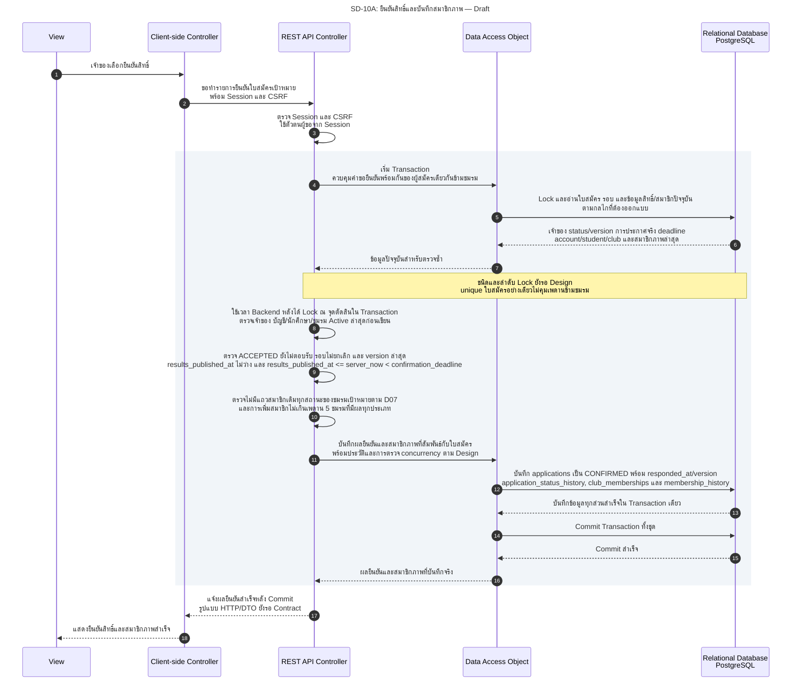
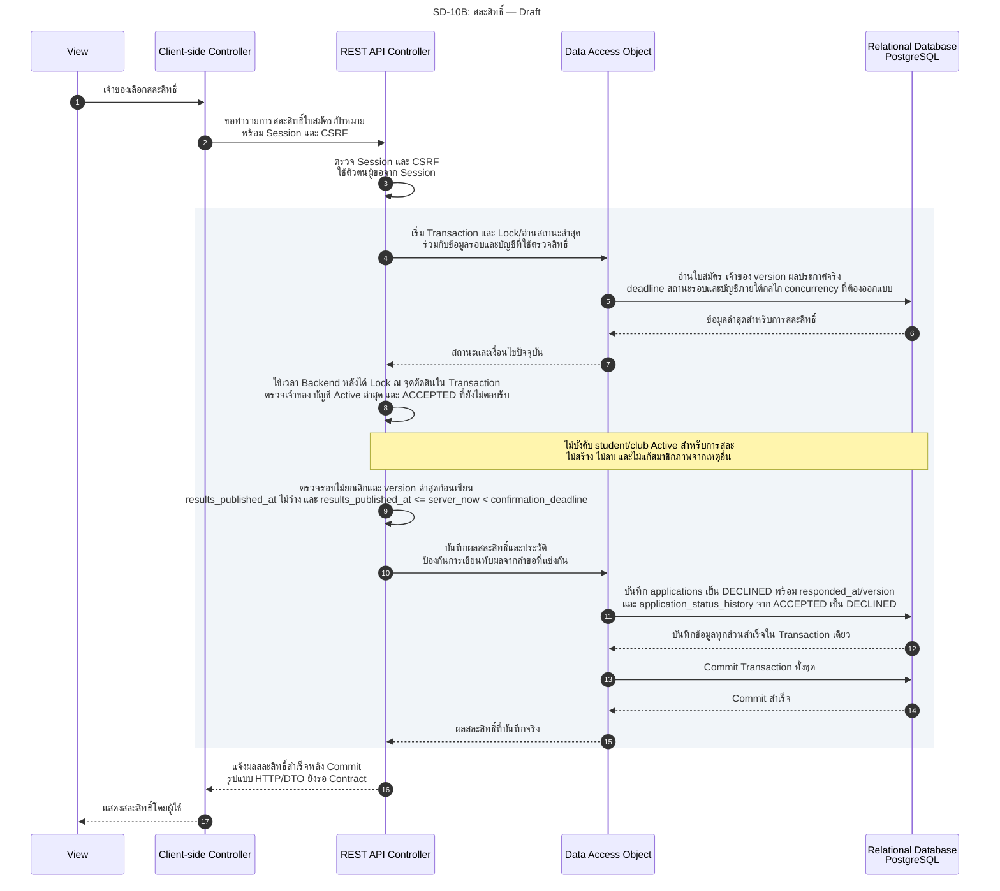
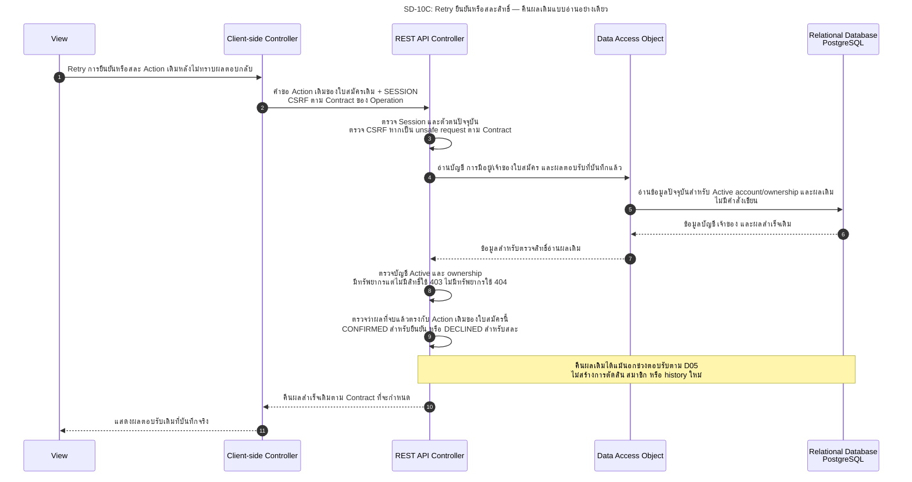

# SD-10: ยืนยันหรือสละสิทธิ์และบันทึกสมาชิกภาพ

**สถานะ 27 ต.ค. 2026: Draft / Pending Review** — Sequence Diagrams สำหรับ Sprint 2 / Task74 ยังไม่มี Handler ของการตอบรับ/สละสิทธิ์ และยังไม่กำหนด HTTP method, endpoint path หรือ Request/Response DTO ในเอกสารนี้ ไม่ใช่หลักฐานว่า Requirement ผ่านการอนุมัติหรือระบบทำงานแล้ว

ปรับตามคำยืนยันผู้ใช้ 27 ต.ค. 2026: Action เดิมที่สำเร็จแล้ว Retry ให้คืนผลเดิมโดยไม่เขียน/สร้างสมาชิก/history ซ้ำ; คำขอสวนทางหลังจบใช้ `409` และไม่เปิดเปลี่ยนใจ; Action ที่สร้างผลใหม่ใช้ `results_published_at <= server_now < confirmation_deadline` ตรวจซ้ำใน Transaction ก่อนเขียน; ทรัพยากรมีอยู่แต่ไม่มีสิทธิ์ `403` ไม่มีทรัพยากร `404`; หากมีแถวสมาชิกภาพเดิมทุกสถานะให้ปฏิเสธการยืนยันใหม่ ไม่คืนสถานะใน MVP ยกเว้น exact Retry ผลสำเร็จเดิมของใบสมัครเดียวกัน ข้อสรุปเหล่านี้เป็น **Recorded User Instruction / Pending Team Review** ตาม T74-D01/05/06/07 ไม่ใช่หลักฐาน PO/Reviewer อนุมัติแล้ว

อ้างอิง: [US-05](../../stories/sprint2/US-05.md), [State Machine / Transition Table](../../architecture/system-architecture.md#s2-application-state-machine), [Permission Matrix](../../security/permission-matrix.md#s2-permission-matrix), [Business Rules](../../architecture/system-architecture.md#s2-business-rules), [API contract handoff §8.1](../../api/API_v1.md#81-task74-sprint-2-contract-handoff--draft--pending-review) และ [Schema ปัจจุบัน](../../../backend/src/main/resources/db/migration/V1__init_schema.sql)

ดู [ดัชนี Diagrams](../README.md) และ [Task74 Sprint 2 review packet](../../architecture/task74-sprint2-analysis.md) สำหรับขอบเขต หลักฐาน และผู้รับผิดชอบ Review

## ขอบเขตและเงื่อนไขร่วม

ภาพที่ 1/2 เป็นเส้นทางสำเร็จของ **การสร้างผลตอบรับใหม่** โดยเจ้าของใบสมัครที่มี Session และบัญชี Active ส่งคำขอพร้อม CSRF ใบสมัครยังเป็น `ACCEPTED` และยังไม่ตอบรับ รอบไม่ `CANCELLED` และ `results_published_at <= server_now < confirmation_deadline` ใช้เวลา Backend ณ จุดตัดสินหลัง Lock และตรวจสิทธิ์ปัจจุบันใน Transaction ก่อนเขียน ไม่ใช้เวลาที่เปิดหน้า/ส่งคำขอหรือ `results_scheduled_at` ส่วนภาพที่ 3 เป็น **Retry ผลเดิม** ซึ่งไม่สร้างผลตอบรับใหม่และไม่ใช้ช่วงเวลาเป็นเหตุเขียนข้อมูลซ้ำ

Service ถูกย่อไว้ใน **REST API Controller** ตามรูปแบบ Diagram เดิม ส่วน **Data Access Object** แทน Repository การระบุ Transaction/lock/version เป็นความต้องการด้านความสอดคล้องของข้อมูล ไม่ใช่ข้ออ้างว่ามีโค้ดหรือกลไก lock ดังกล่าวแล้ว

| Action | เงื่อนไขเพิ่มเติม | ผลทางธุรกิจ |
|---|---|---|
| ยืนยัน | นักศึกษาและชมรม Active; ตรวจสมาชิกภาพปัจจุบันและเพดานเดิม 5 ชมรมที่มีผลทุกประเภทซ้ำใน Transaction | `CONFIRMED`, `responded_at` และประวัติใบสมัคร พร้อมสมาชิกภาพและประวัติสมาชิกครบใน Transaction เดียว |
| สละสิทธิ์ | บัญชีเจ้าของ Active; ไม่บังคับ student/club Active | `DECLINED`, `responded_at` และประวัติใบสมัคร; ไม่สร้างสมาชิกและไม่ลบ/แก้สมาชิกภาพจากเหตุอื่น |

การยืนยันใช้ student profile ที่ยืนยันได้ว่า `ACTIVE` ไม่ถือว่า Login สำเร็จอย่างเดียวเพียงพอ เพดานสมาชิกนับเฉพาะ `ACTIVE`, `joined_at <= now`, `ended_at IS NULL` ตาม US-03.BR-07/08 ไม่นับใบสมัครค้าง การตรวจตอนส่งใบสมัครไม่รับประกันว่าจะยังยืนยันได้ในภายหลัง

การเลือกเส้นทางต้องตรวจ Session/บัญชี Active/ownership ก่อน แล้วแยกผลสำเร็จเดิมของ Action เดิมไปอ่านผลโดยไม่เขียน หรือปฏิเสธคำขอสวนทาง `409` ก่อนใช้ guard ของ Action ใหม่ จึงไม่เอาเงื่อนไข `ACCEPTED`, student/club, quota หรือ deadline ของการสร้างผลใหม่ไปบล็อก exact Retry ที่มีผลเดิมแล้ว ส่วน Transaction ที่จะเขียนต้องอ่านสถานะล่าสุดซ้ำเพื่อจัดการคำขอที่แข่งกัน

## 1. ยืนยันสิทธิ์สำเร็จ

ภาพนี้เลือกกรณีที่ **ยังไม่มีแถวสมาชิกภาพของผู้สมัครในชมรมเป้าหมาย** ตามคำยืนยันผู้ใช้ใน [T74-D07](../../architecture/system-architecture.md#t74-d07) หากมีแถวสมาชิกภาพเดิม `ACTIVE` / `INACTIVE` / `LEFT` / `REMOVED` ให้ปฏิเสธการยืนยันใหม่และคงข้อมูล/ประวัติเดิมทั้งหมด ไม่ insert ซ้ำ ไม่คืนสถานะใน MVP ข้อยกเว้นคือ exact Retry ของการยืนยันเดิมที่สำเร็จแล้วจากใบสมัครเดียวกัน ซึ่งคืนผลเดิมแบบไม่เขียนตามภาพที่ 3 ไม่ใช่การกลับเข้าเป็นสมาชิก

ผลที่ต้องบันทึกตามโมเดลเดิม:

- `applications`: สถานะ `CONFIRMED`, `responded_at` จาก Backend, เวลาแก้ไขและ version ตาม Design โดยรักษาข้อมูลการตัดสินคัดเลือกเดิม
- `application_status_history`: `ACCEPTED → CONFIRMED`, actor เป็นเจ้าของที่ทำรายการ และเวลาที่สอดคล้องกับการตอบรับ
- `club_memberships` และ `membership_history`: สมาชิกที่เชื่อม applicant/club/source application ถูกต้อง พร้อมประวัติตามนโยบาย ไม่สร้างแถวซ้ำ

ทั้งชุดต้อง Commit พร้อมกัน หากเขียนส่วนใดล้มเหลวต้อง Rollback ทั้งชุด ไม่เหลือ `CONFIRMED` โดยไม่มีสมาชิกหรือมีสมาชิกใหม่ทั้งที่ตอบรับล้มเหลว Unique `(round_id, applicant_id)`, `(club_id, user_id)` และ `source_application_id` เป็นด่านสุดท้ายตาม Schema แต่ไม่ทดแทนการควบคุมเพดานข้ามชมรม นโยบาย T74-D07 บันทึกตามคำยืนยันผู้ใช้แล้ว: มีแถวสมาชิกเดิมสถานะใดก็ตามไม่ทำการยืนยันใหม่ ไม่คืนสถานะ ไม่เขียนทับ source/ช่วงสมาชิกหรือประวัติเดิม และยัง Pending Team Review

## 2. สละสิทธิ์สำเร็จ

ภาพนี้เป็นการสละสิทธิ์ใหม่ ใช้สิทธิ์เจ้าของบัญชี Active แต่ **ไม่ต้องให้ student profile หรือชมรมยัง Active** และไม่ตรวจเพดานสมาชิกเพื่อขวางการสละสิทธิ์ เงื่อนไข accepted/ownership/รอบไม่ยกเลิก และ `results_published_at <= server_now < confirmation_deadline` ยังต้องผ่านครบ; การสละสำเร็จเดิมที่ Retry ใช้ภาพที่ 3

สถานะและประวัติต้องสำเร็จพร้อมกัน ใช้เจ้าของเป็น actor และบันทึก `responded_at` โดยไม่แก้ผลคัดเลือกเดิม เมื่อ Commit ล้มเหลวไม่แสดงความสำเร็จและไม่เหลือการเปลี่ยนสถานะบางส่วน การสละสิทธิ์จากใบสมัครนี้ไม่ใช่คำสั่งลาออกจากสมาชิกภาพที่มีอยู่จากแหล่งอื่น

## 3. Retry Action เดิมที่สำเร็จแล้ว — อ่านผลเดิมโดยไม่มีการเขียน

หลังตรวจ Session บัญชี Active และ ownership แล้ว หากใบสมัครมีผลสำเร็จของ Action เดิมอยู่แล้ว ให้คืนผลเดิมแม้อยู่นอกช่วงตอบรับ ไม่ตรวจ student/club Active, quota หรือ deadline ใหม่เพื่อสร้างคำตัดสินซ้ำ ไม่เพิ่มสมาชิก ไม่เพิ่ม history และไม่เขียนสถานะใหม่ รูปแบบ HTTP/DTO และรายละเอียดการอ่านผลเดิมยังเป็นงาน Contract; เงื่อนไข CSRF ใช้ตามชนิด Operation ที่จะตกลง ไม่ตั้ง endpoint ใหม่สำหรับ Retry

คำขอสวนทางหลังผลจบให้ `409` และไม่เปลี่ยนใจ หากสถานะเป็น `EXPIRED` คำขอยืนยัน/สละไม่ใช่ Retry ของ Action ที่เคยสำเร็จ จึงไม่สร้างผลตอบรับใหม่; การอ่านประวัติของตนยังทำได้ตามสิทธิ์ กรณีสมาชิกจากใบสมัครเดียวกันที่ยืนยันสำเร็จแล้วคืนผลเดิมโดยไม่ insert หรือแก้แถวสมาชิก และไม่ตีความว่าเป็นการคืนสถานะสมาชิกที่สิ้นสุดภายหลัง

## 4. กรณีปฏิเสธ คำขอซ้ำ และการทำงานพร้อมกัน

ตารางนี้อ้าง [Error Contract ปัจจุบัน](../../security/permission-matrix.md#7-ผลลัพธ์เมื่อปฏิเสธสิทธิ์) และ [API §6–8](../../api/API_v1.md#6-error-contract) ไม่กำหนด operation-specific response หรือ reason ใหม่ก่อน Design

| กรณี | ผลที่ต้องรักษา / ประเด็นรอตัดสิน |
|---|---|
| ไม่มี/หมด Session, บัญชีถูกระงับ หรือ CSRF ไม่ผ่าน | ใช้สัญญากลาง `401 AUTHENTICATION_REQUIRED`, `403 ACCOUNT_NOT_ALLOWED` พร้อม invalidate หรือ `403 CSRF_INVALID` ตามกรณี; CSRF อาจปฏิเสธก่อน authorization |
| ทรัพยากรมีอยู่แต่ไม่ใช่เจ้าของ/นอก scope ที่มีสิทธิ์ หรือทรัพยากรไม่มีอยู่ | มีทรัพยากรแต่ไม่มีสิทธิ์ใช้ `403`; ไม่มีทรัพยากรใช้ `404` ตาม T74-D01; ADMIN/กรรมการทำแทนไม่ได้และไม่เชื่อตัวตนจาก Client |
| Action ใหม่ยังไม่ประกาศจริง สถานะไม่ใช่ ACCEPTED รอบยกเลิก หรืออยู่นอกช่วงตอบรับ | ปฏิเสธตาม state/time conflict หลังผ่าน authorization; ใช้ `results_published_at <= server_now < confirmation_deadline` ณ จุดตัดสินใน Transaction ก่อนเขียน ไม่มีการยืนยันย้อนหลังเพราะเปิดหน้าไว้ก่อน; ไม่เอาข้อนี้ไปบล็อกการอ่านผลเดิมของ exact Retry |
| student/club ไม่ Active | ปฏิเสธการยืนยันตาม Matrix; ไม่ใช้เป็นเหตุปฏิเสธการสละ หากบัญชี/เจ้าของ/สถานะ/เวลายังผ่าน |
| เพดานเต็ม หรือพบสมาชิกเดิมตอนยืนยัน | ไม่เพิ่มสมาชิกเกินเพดาน; การยืนยันเดิมที่สำเร็จแล้วของใบสมัครเดียวกัน exact Retry คืนผลเดิมแบบไม่เขียน; การยืนยันใหม่ที่มีแถวสมาชิกเดิม `ACTIVE/INACTIVE/LEFT/REMOVED` ปฏิเสธและคงข้อมูล/ประวัติเดิมทั้งหมด ไม่มี MVP reactivation ตาม T74-D07 |
| ยืนยันต่างชมรมพร้อมกัน | ต้องควบคุมการนับและเขียนของผู้สมัครคนเดียวกันร่วมกัน ไม่อาศัย lock เฉพาะใบสมัครคนละแถวหรือ unique constraint เพียงอย่างเดียว กลไก/ลำดับ lock ยังรอ BE Design |
| Confirm/decline/expiry แข่งกัน หรือ version เปลี่ยน | ตรวจสถานะ/เวลา/version และสิทธิ์ล่าสุดภายใน Transaction ก่อนเขียน ณ จุดตัดสินหลัง Lock ให้เกิดผลสุดท้ายทางเดียว; กลไกและลำดับ Lock เป็นงาน BE Design ไม่ใช่ API field ใหม่ |
| Retry Action เดิม หรือคำขอสวนทางหลังจบรายการ | ตามคำยืนยันผู้ใช้ใน [T74-D05](../../architecture/system-architecture.md#t74-d05): Action เดิมคืนผลเดิมแบบไม่เขียนหลังตรวจ Session/Active account/ownership แม้นอกเวลา; คำขอสวนทาง `409` ไม่เปลี่ยนใจ; รูปแบบ response ยังต้องลง Contract |
| ล้มเหลวระหว่างเขียนสถานะ สมาชิก หรือประวัติ | Rollback ทั้ง Transaction และไม่แจ้งสำเร็จ; response หายหลัง Commit แล้ว exact Retry คืนผลเดิมแบบไม่สร้างข้อมูลซ้ำ |

ถึง deadline แล้วต้องปฏิเสธการสร้างผลตอบรับใหม่ทันทีแม้ worker ยังไม่ปรับแถว โดยไม่ปิดการอ่านผลเดิมของ exact Retry การเปลี่ยนเป็น `EXPIRED` เป็นงานระบบแยกใน [SD-11: หมดเวลาตอบรับ](SD-11-expire-offers.md) และ UI แสดง “สละสิทธิ์ (หมดเวลาตอบรับ)” ไม่ใช้ `DECLINED` แทน ไม่ใช้การเปิดหน้า/GET เป็นตัวกระตุ้น รายละเอียด job/ความถี่/ความหน่วงยังเปิดใน [T74-D06](../../architecture/system-architecture.md#t74-d06) ข้อสรุปผู้ใช้ยัง Pending Team Review

## 5. Traceability และ QA ที่ต้องทบทวน

Scenario IDs ด้านล่างมาจาก [Task74 §4 Acceptance Scenarios](../../architecture/task74-sprint2-analysis.md#4-acceptance-scenarios-สำหรับ-qa) เป็นแผนตรวจรับ ไม่ใช่ผล Tests ผ่าน

| QA Scenario | จุดตรวจจาก Diagrams / หลักฐาน |
|---|---|
| [T74-QA15](../../architecture/task74-sprint2-analysis.md#4-acceptance-scenarios-สำหรับ-qa) | ยืนยันสำเร็จหรือจำลอง write failure: status/responded_at/member/history ครบหรือ Rollback ทั้งชุด — US-05.AC-02/05 |
| [T74-QA16](../../architecture/task74-sprint2-analysis.md#4-acceptance-scenarios-สำหรับ-qa) | ยืนยันข้ามชมรมพร้อมกันเมื่อใกล้เพดาน ต้องไม่เกิน 5 สมาชิกภาพที่มีผลทุกประเภท — US-03.BR-07/08, US-05.AC-05 |
| [T74-QA17](../../architecture/task74-sprint2-analysis.md#4-acceptance-scenarios-สำหรับ-qa) | ผลยืนยันเดิมของใบสมัครเดียวกัน exact Retry คืนผลเดิมโดยไม่เขียน; พบแถวสมาชิกเดิม ACTIVE/INACTIVE/LEFT/REMOVED ให้ปฏิเสธการยืนยันใหม่ ไม่คืนสถานะและคงประวัติทั้งหมด; สละสิทธิ์ไม่ลบสมาชิกภาพจากเหตุอื่น — T74-D07/US-05.BR-05 |
| [T74-QA18](../../architecture/task74-sprint2-analysis.md#4-acceptance-scenarios-สำหรับ-qa) | Confirm/decline/expiry แข่งกัน ตรง deadline หรือ worker ล่าช้า ต้องมีผลสุดท้ายทางเดียว — US-05.AC-03–05, T74-D06 |
| [T74-QA19](../../architecture/task74-sprint2-analysis.md#4-acceptance-scenarios-สำหรับ-qa) | งานหมดเวลาต้องทำได้โดยไม่เปิดหน้าและตามเก็บหลัง restart ดู SD-11 แยกจากสอง Action ของผู้ใช้ — US-05.AC-04/05 |
| [T74-QA20](../../architecture/task74-sprint2-analysis.md#4-acceptance-scenarios-สำหรับ-qa) | Exact Retry คืนผลเดิมแม้นอกเวลาโดยไม่มี write/member/history ซ้ำ; คำขอสวนทาง 409 ไม่เปลี่ยนใจ; HTTP/DTO ลงรายละเอียด Contract ต่อ — T74-D05/US-05.AC-05 |

ตรวจสิทธิ์ยืนยันเทียบสละเพิ่มเติมตาม T74-QA14 ในตารางเดียวกัน และตรวจหลักฐาน Review จริงก่อนนำ Diagrams ไปใช้เป็นข้อกำหนดพัฒนา
