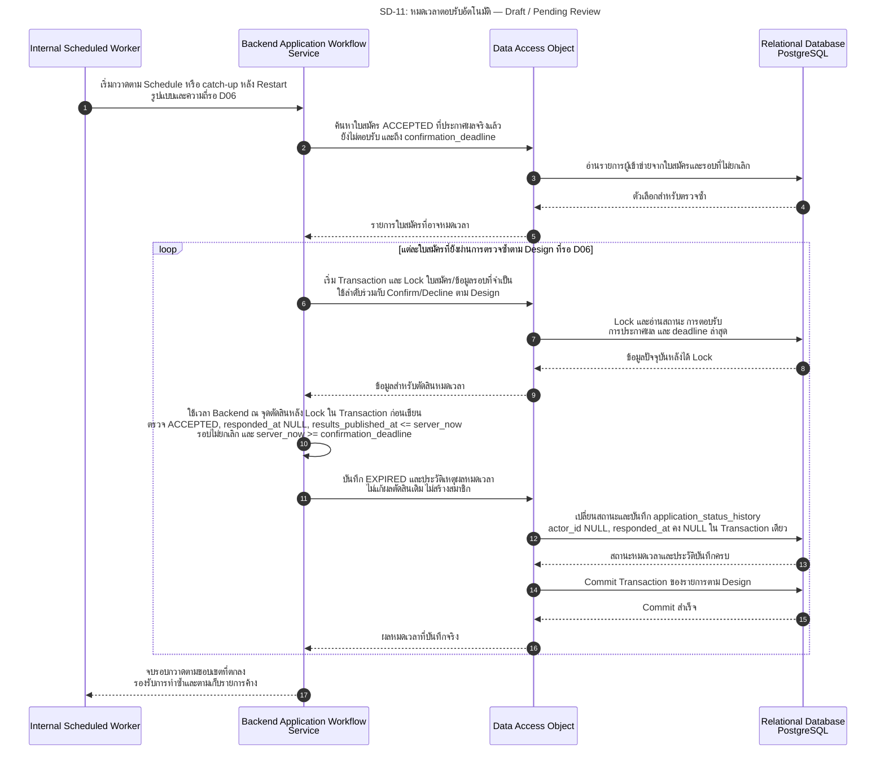

# SD-11: หมดเวลาตอบรับสิทธิ์อัตโนมัติ

อ้างอิง: [US-05.AC-04/05 และ BR-06–09](../../stories/sprint2/US-05.md#6-business-rules) · [Application State Machine](../../architecture/system-architecture.md#s2-application-state-machine) · [T74-D06](../../architecture/system-architecture.md#t74-d06) · [Task74 Sprint 2 Artefact](../../architecture/task74-sprint2-analysis.md)

<!-- ponytail: show successful exchanges between layers only. -->

สถานะ 27 ต.ค. 2026: **Draft / Pending Review — ยังไม่มี Implementation ของงานหมดเวลา** ตามคำยืนยันผู้ใช้ 27 ต.ค. 2026 หมดเวลาอัตโนมัติใช้ `EXPIRED` และ UI “สละสิทธิ์ (หมดเวลาตอบรับ)” โดยตรวจเวลา Backend/สถานะล่าสุดหลัง Lock ใน Transaction ก่อนเขียน — **Recorded User Instruction / Pending Team Review** ส่วน scheduled sweep/catch-up เป็นข้อเสนอใน T74-D06 ที่ยังต้องตกลงความถี่ ความหน่วงที่ยอมรับได้และขอบเขตชุดงาน ไม่กำหนดตัวเลขเอง

ภาพนี้เป็น Internal Worker ไม่ใช่ public endpoint และไม่ใช่ System Role ใหม่ จึงแสดง Worker → Backend Application Workflow (Service) → DAO → PostgreSQL ไม่มี View/Client-side Controller เรียก REST เพื่อกระตุ้นงาน การอ่านสถานะของผู้สมัครเป็น Flow แยกและไม่ทำให้เกิดการเปลี่ยนสถานะจาก GET

Loop แสดงเฉพาะรายการที่ผ่านการตรวจซ้ำ การแบ่งชุดและข้อเสนอ Transaction ต่อใบสมัครในภาพยังต้องยืนยันใน T74-D06 ไม่ใช่การกำหนด batch size หรือวิธี Implement ที่อนุมัติแล้ว คำว่า actor ระบบใช้ `actor_id = NULL` ตามแบบเดิม ไม่สร้างบัญชีหรือ global role `SYSTEM`; `EXPIRED` เป็นสถานะข้อมูล ส่วน “สละสิทธิ์ (หมดเวลาตอบรับ)” เป็นข้อความ UI ไม่ใช้ `DECLINED` แทน

## เงื่อนไขปฏิเสธ การทำงานพร้อมกัน และประเด็น Review

| ประเด็น | สิ่งที่ต้องกำหนด/ตรวจ | Trace |
|---|---|---|
| ใบสมัครที่เปลี่ยนไปแล้ว | รายการที่ค้นพบก่อน Lock อาจถูกยืนยัน/สละระหว่างรอ จึงตรวจล่าสุดและข้ามรายการที่ไม่เข้าเกณฑ์ ไม่ทับ CONFIRMED/DECLINED/REJECTED/EXPIRED/WITHDRAWN หรือสถานะอื่นที่ไม่ใช่ ACCEPTED | US-05.BR-06/09; T74-QA18/19 |
| เงื่อนไขหมดเวลา | เปลี่ยนเฉพาะ ACCEPTED ที่ประกาศผลจริงแล้ว (`results_published_at <= server_now`) ยังไม่ตอบรับ รอบไม่ยกเลิก และ `server_now >= confirmation_deadline`; ตรวจซ้ำหลัง Lock ก่อนเขียน ไม่ใช้ `results_scheduled_at` แทนการประกาศ | US-05.AC-04; T74-QA18/19 |
| สถานะ/ประวัติ/สมาชิก | อัปเดตสถานะกับ history ครบหรือ Rollback ทั้งชุด; เก็บ decided_by/decided_at เดิม, responded_at และ history actor_id เป็น NULL; ไม่เพิ่มสมาชิก ไม่ลบสมาชิกจากเหตุอื่น และไม่เพิ่ม notification หมดเวลาเอง | [Schema เดิม](../../../backend/src/main/resources/db/migration/V1__init_schema.sql); US-05.BR-05/06; T74-QA17–19 |
| Race กับ Confirm/Decline | ใช้สถานะ/version/Lock และตรวจเวลา Backend ณ จุดตัดสินหลัง Lock ใน Transaction ก่อนเขียน ให้ได้ผลสุดท้ายทางเดียว; กลไก/ลำดับ Lock ยังเป็นงาน Design; เกิดสมาชิกได้เฉพาะยืนยันสำเร็จ ไม่ใช่เพราะ Worker เห็น ACCEPTED ในการค้นครั้งแรก | US-05.AC-05/BR-09; T74-QA18; T74-D06 |
| ทำซ้ำ/Restart/ความล้มเหลว | ทำงานซ้ำไม่เพิ่มประวัติผลเดิม; หาก Commit ไปแล้วก่อน Worker หยุด การกวาดครั้งถัดไปไม่ทำรายการเดิมซ้ำ; หากล้มเหลวให้ Rollback และตามเก็บโดยไม่ข้ามค้างตลอดไป ต้องออกแบบขอบเขตชุดงานและ recovery ก่อน Implement | US-05.BR-07; T74-QA19/20; T74-D06 |
| Worker ตามไม่ทัน | API สร้างผลตอบรับใหม่ต้องตรวจ `results_published_at <= server_now < confirmation_deadline` เองและปฏิเสธทันทีเมื่อหมดเวลา; UI ไม่มี CTA สำหรับทำรายการใหม่แม้แถวยัง ACCEPTED; GET ไม่เปลี่ยนข้อมูลเพื่อชดเชย Worker | US-05.BR-08; US-04.BR-07/09; T74-QA18/19 |
| Retry ผลตอบรับเดิม | Exact Retry ของการยืนยัน/สละที่สำเร็จแล้วคืนผลเดิมหลังตรวจ Session/บัญชี Active/ownership โดยไม่เขียน แม้นอกเวลา; Worker ข้ามสถานะจบแล้ว การ Retry ไม่ใช่เหตุสร้าง EXPIRED ทับผลเดิม; คำขอสวนทาง 409 ไม่เปิดเปลี่ยนใจ | [SD-10](SD-10-confirm-decline-membership.md); T74-D05; T74-QA20 |

ดู [Acceptance Scenarios T74-QA18–20](../../architecture/task74-sprint2-analysis.md#4-acceptance-scenarios-สำหรับ-qa) และ [Decision Log T74-D06](../../architecture/system-architecture.md#t74-d06) ขอบเขตเวลา/EXPIRED บันทึกตามคำยืนยันผู้ใช้แล้วและยัง Pending Team Review; ความถี่ ความหน่วงที่ยอมรับได้และรายละเอียด catch-up ยังเปิด ตารางนี้เป็นแผน Review ไม่ใช่ผลทดสอบผ่านหรือการอนุมัติกลไก Worker แล้ว
