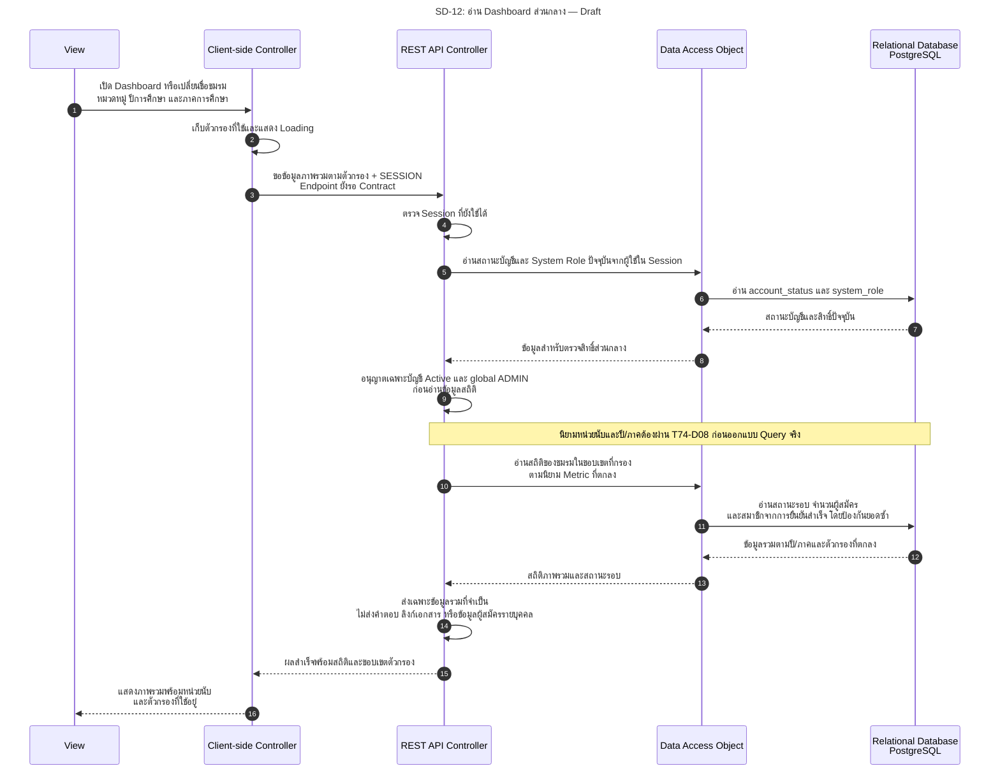

# SD-12: Dashboard ส่วนกลาง — Sprint 2

อ้างอิง: [US-10](../../stories/sprint2/US-10.md) · [Permission Matrix](../../security/permission-matrix.md#s2-permission-matrix) · [API Contract §8.1](../../api/API_v1.md#81-task74-sprint-2-contract-handoff--draft--pending-review) · [T74-D08](../../architecture/system-architecture.md#t74-d08) · [ดัชนี Diagram](../README.md)

**สถานะ 27 ต.ค. 2026: Draft / Pending Review.** Dashboard ยังไม่มี Endpoint/Response Contract และ Implementation ภาพแสดงการอ่านข้อมูลรวมหลังผ่านสิทธิ์ เพื่อให้ทีมตกลง Query/UI ตาม T74-D08 ไม่ใช่การกำหนด Metric หรือ API ใหม่ให้มีผลแล้ว

ทบทวนตามคำยืนยันผู้ใช้ 27 ต.ค. 2026: ทรัพยากรส่วนตัวที่มีอยู่แต่ไม่มีสิทธิ์ใช้ `403` และทรัพยากรที่ไม่มีอยู่ใช้ `404` ตาม T74-D01; สิทธิ์ ADMIN ยังจำกัดข้อมูลรวมและไม่มีสิทธิ์อ่านเนื้อหาใบสมัครจาก global role ส่วน Retry/EXPIRED ของ US-05 ไม่ทำให้การอ่าน Dashboard เขียนผลตอบรับหรือเปลี่ยนสมาชิกเอง T74-D07 กำหนดไม่คืนสถานะสมาชิกเดิมใน MVP และคงประวัติทั้งหมดแล้วในระดับคำยืนยันผู้ใช้/Pending Team Review แต่นิยาม Metric/สมาชิกย้อนหลังใน T74-D08 ยังเปิด ไม่อนุมานว่าการปฏิเสธกลับเข้าทำให้ลบประวัติหรือเปลี่ยนยอดย้อนหลัง

<!-- ponytail: show successful exchanges between layers only. -->

ย่อ Service ไว้ใน REST API Controller; DAO หมายถึง Repository ตามแบบ ผู้ใช้ต้องมีบัญชี Active และ global `users.system_role=ADMIN` จาก DB ปัจจุบัน ชื่อหน่วยงาน Student Affairs หรือ TU employee ไม่ทำให้ได้รับ ADMIN อัตโนมัติ และไม่ต้องมี Assignment กรรมการเพื่ออ่านสถิติส่วนกลาง

## เงื่อนไขและจุดส่งต่อ Design

| เรื่อง | ข้อกำหนด / ประเด็น Review |
|---|---|
| สิทธิ์ | ไม่มี Session ใช้ `401 AUTHENTICATION_REQUIRED`; บัญชีถูกระงับใช้กฎ invalidate/`403 ACCOUNT_NOT_ALLOWED`; USER หรือกรรมการที่ไม่มี ADMIN ใช้ `403 ACCESS_DENIED` ตาม Matrix ห้ามอ่านสถิติก่อนผ่าน guard |
| ขอบเขตชมรม | US-10.AC-01/BR-03: ภาพรวมทุกชมรมตามตัวกรอง ไม่ใช้ Public-club filter ของ US-01 ตัดข้อมูลโดยปริยาย; การแสดงชมรมเลิกดำเนินงานยังต้องระบุใน Design |
| สถานะรับสมัคร | ใช้ publication status, ช่วงเวลา Backend และ `closed_at` จริง ไม่แสดงเปิดรับต่อหลังปิดก่อนกำหนด; กติกาหลายรอบรอ T74-D08 |
| สมาชิกที่นับ | US-10.BR-05: นับเฉพาะการยืนยันที่ลงทะเบียนสมาชิกสำเร็จ ไม่ใช้ ACCEPTED ที่รอยืนยัน/DECLINED/EXPIRED แทนสมาชิก; เลือก cohort ตามรอบหรือ Active ปัจจุบัน รวมผู้สิ้นสุดแล้ว/สมาชิก bootstrap ตาม T74-D08 |
| หน่วยนับ | คนไม่ซ้ำเทียบใบสมัคร ผลรวมรายชมรมเทียบคนไม่ซ้ำทั้งระบบ และการรวมหลายรอบยัง Pending; ป้องกันยอดซ้ำจาก joins ของ answers/tags/history โดยไม่กำหนด SQL แทนทีม |
| ปีการศึกษา/ภาค | [Schema](../../../backend/src/main/resources/db/migration/V1__init_schema.sql) มี `recruitment_rounds.academic_year` และ `semester` แล้ว; ต้องตกลงความสัมพันธ์กับ Metric ไม่เดาจากปฏิทินหรือเพิ่ม Migration เอง |
| ตัวกรอง/สถานะหน้าจอ | ค่าเริ่มต้นและวิธีรวมตัวกรองรอ Contract; แยก Loading/Empty/Error หาก Query ล้มเหลวไม่แสดงศูนย์หรือรายการว่างแทน |
| ผลข้างเคียง | การอ่านไม่เปลี่ยนสถานะรอบ/ใบสมัคร/สมาชิก และ ADMIN ไม่ได้สิทธิ์อ่านใบสมัครหรือข้าม Assignment จากการเข้าหน้านี้ |

ใช้ [T74-QA21](../../architecture/task74-sprint2-analysis.md#4-acceptance-scenarios-สำหรับ-qa) และ US-10.AC-01–05 เป็นฐานทบทวน ภาพไม่เพิ่ม export, KPI ขั้นสูง, การแต่งตั้งกรรมการ หรือการจัดการสมาชิกเข้า Sprint 2
