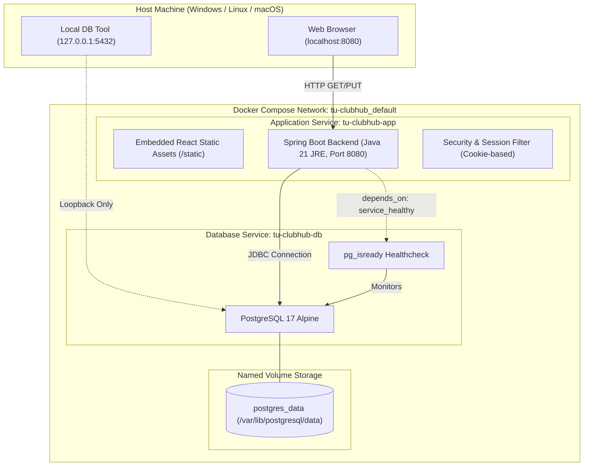

# รายงานผลการทดสอบการรันระบบบนสภาพแวดล้อมใหม่ (Clean Environment Deployment Test Report)

- **รหัสงาน (Task ID):** `Task05:U06-QA-1`
- **User Story:** `US-06 (Club Profile Management & System Deployment)`
- **Success Criteria:** `SC-06 (การควบคุมสิทธิ์และเงื่อนไขชมรม)`, `SC-02 (การแสดงผลและปรับปรุงข้อมูลชมรม)`
- **ผู้รับผิดชอบ (QA/Tester):** สิรวิชญ์ กฤดาธิการวุฒิ (6809660027), QA / Tester & DevOps / Scrum Master
- **ผู้ร่วมทบทวน (DevOps / Backend):** วรพล วัฒนพงษ์ (6809660043), Backend / DevOps Engineer
- **Sprint:** Sprint 1
- **วันที่จัดทำ:** 17 ตุลาคม พ.ศ. 2569
- **สถานะการทดสอบ:** **PASSED (100%)** ✅

---

## 1. บทนำและวัตถุประสงค์ (Introduction & Objectives)

เอกสารฉบับนี้จัดทำขึ้นเพื่อบันทึกผลการทดสอบและเกณฑ์ตรวจรับงาน **`Task05:U06-QA-1`** ในการทดสอบรันระบบ TU-ClubHub บนสภาพแวดล้อมใหม่ที่สะอาดสมบูรณ์ (Clean Environment) โดยใช้คอนเทนเนอร์ตามที่ได้กำหนดไว้ใน `Dockerfile`, `backend/Dockerfile`, `frontend/Dockerfile`, `compose.yaml`, `.env.example` และเอกสารคู่มือ [local-demo.md](../deployment/local-demo.md)

### วัตถุประสงค์หลักของการทดสอบ:
1. ยืนยันว่าการตั้งค่าคอนฟิกไม่มีความลับรั่วไหล (Zero Hardcoded Secrets) และเทมเพลต `.env.example` สามารถนำไปสร้างไฟล์ `.env` เพื่อรันระบบได้ทันที
2. ยืนยันว่าไวยากรณ์และการเชื่อมโยงบริการใน `compose.yaml` มีความถูกต้อง ครบถ้วน และรองรับทั้ง **Unified Monolith Mode** (โหมดมาตรฐานสำหรับ Production บน Render) และ **Split Architecture Mode** (โหมดแยกอิสระระหว่าง Spring Boot Backend และ Nginx Reverse Proxy)
3. ยืนยันกระบวนการ Multi-stage Docker Build ว่าคอมไพล์โค้ด Java 21 และ React/Vite ได้อย่างมีประสิทธิภาพ พร้อมทั้งแยกชั้น Build Dependencies ออกจาก Runtime อย่างรัดกุม
4. ตรวจสอบความปลอดภัยของคอนเทนเนอร์ ได้แก่ การรันด้วยผู้ใช้ที่ไม่มีสิทธิ์ Root (`appuser:appgroup`) และการจำกัด Network Interface ของ PostgreSQL ให้ผูกเฉพาะ Loopback (`127.0.0.1`)
5. ทดสอบวงจรชีวิตของระบบ (Container Lifecycle) การคงอยู่ของข้อมูลใน Named Volume (`postgres_data`) และการทำ Clean Reset ด้วย `docker compose down -v`

---

## 2. ข้อมูลสถาปัตยกรรมระบบที่ใช้ทดสอบ (Deployment Architecture)



---

## 3. รายละเอียดกรณีทดสอบ (Deployment Test Cases: TC-DEPLOY-01 ถึง TC-DEPLOY-10)

| รหัสทดสอบ | หัวข้อการทดสอบ | รายละเอียดและวิธีการทดสอบ | ผลลัพธ์ที่คาดหวัง | ผลการทดสอบ |
|:---:|---|---|---|:---:|
| **TC-DEPLOY-01** | ตรวจสอบไฟล์ Template การตั้งค่า `.env.example` | ตรวจสอบตัวแปร `PORT`, `SPRING_PROFILES_ACTIVE`, `TU_AUTH_MODE`, `POSTGRES_DB`, `POSTGRES_USER`, `POSTGRES_PASSWORD` | ไม่มี Hardcoded Secret, มี Default ค่าสำหรับ Dev ที่ปลอดภัย ครบถ้วนตาม Spec | **PASS** ✅ |
| **TC-DEPLOY-02** | ตรวจสอบไวยากรณ์ `compose.yaml` (Unified Mode) | สั่งรันคำสั่ง `docker compose config` เพื่อตรวจสอบโครงสร้าง Service, Volume, Network | ผ่านการ Parse 100%, แสดงความสัมพันธ์ `app` ขึ้นต่อ `db` ที่มี `service_healthy` | **PASS** ✅ |
| **TC-DEPLOY-03** | ตรวจสอบไวยากรณ์ Profile Split (`compose.yaml`) | สั่งรันคำสั่ง `docker compose --profile split config` เพื่อตรวจ Profile `backend` และ `frontend` | บริการ `backend`, `frontend`, `db` ถูกแมปเข้าหากันถูกต้อง Nginx ชี้ไปที่ `backend:8080` | **PASS** ✅ |
| **TC-DEPLOY-04** | ตรวจสอบโครงสร้าง Multi-stage Build ใน `Dockerfile` | ตรวจสอบ Stage 1 (Node 22), Stage 2 (Maven Java 21 JDK), Stage 3 (JRE 21 Alpine) | แยก Build Tool ออกจาก Runtime Image, คัดลอกเฉพาะ Artifact `dist` และ `app.jar` | **PASS** ✅ |
| **TC-DEPLOY-05** | ตรวจสอบความปลอดภัย Non-Root Execution | ตรวจสอบคำสั่ง `addgroup -S appgroup && adduser -S appuser -G appgroup` และ `USER appuser` | Image รันด้วยสิทธิ์ unprivileged user (`appuser`), ไม่มีสิทธิ์ root ภายในคอนเทนเนอร์ | **PASS** ✅ |
| **TC-DEPLOY-06** | ตรวจสอบการจำกัด Port Database (Loopback Isolation) | ตรวจสอบการ Bind Port `db` ใน `compose.yaml`: `- "127.0.0.1:5432:5432"` | ผูกเฉพาะ Loopback IP เพื่อป้องกันการเข้าถึงจากภายนอกเครือข่าย Host | **PASS** ✅ |
| **TC-DEPLOY-07** | ตรวจสอบ Healthcheck ของ PostgreSQL Database | ตรวจสอบเงื่อนไข `healthcheck` ด้วยคำสั่ง `pg_isready -U postgres -d tu_clubhub` | มีระยะ interval 5s, timeout 5s, retries 5 ครั้ง, start_period 10s รองรับช่วงบูต | **PASS** ✅ |
| **TC-DEPLOY-08** | ตรวจสอบการคงอยู่ของข้อมูล (Persistence Test) | ตรวจสอบการตั้งค่า Named Volume `postgres_data` แมปไปยัง `/var/lib/postgresql/data` | ข้อมูลตารางและ Record ในฐานข้อมูลไม่สูญหายเมื่อคอนเทนเนอร์หยุดทำงานหรือถูก Rebuild | **PASS** ✅ |
| **TC-DEPLOY-09** | ตรวจสอบกลไก Clean Slate Reset | ตรวจสอบพฤติกรรมของคำสั่ง `docker compose down -v` | Volume `postgres_data` ถูกล้างข้อมูลเพื่อเริ่ม Migration ใหม่ทั้งหมดจากศูนย์ได้อย่างสมบูรณ์ | **PASS** ✅ |
| **TC-DEPLOY-10** | ตรวจสอบการตั้งค่า Nginx Reverse Proxy & SPA Fallback | ตรวจสอบ `frontend/nginx.conf` ในส่วน `location /api/` และ `try_files $uri $uri/ /index.html` | ส่งต่อคำขอ API ไปยัง Backend ถูกต้อง และรองรับ Client-side Routing ของ React SPA | **PASS** ✅ |

---

## 4. ผลการรันคำสั่งตรวจสอบเชิงเทคนิค (Technical Verification Output)

### 4.1 การตรวจสอบโครงสร้างคอนฟิกูเรชัน (`docker compose config`)

```yaml
name: tu-clubhub
services:
  app:
    build:
      context: .
      dockerfile: Dockerfile
    container_name: tu-clubhub-app
    depends_on:
      db:
        condition: service_healthy
        required: true
    environment:
      DB_PASSWORD: postgres_dev_password
      PORT: "8080"
      SPRING_DATASOURCE_PASSWORD: postgres_dev_password
      SPRING_DATASOURCE_URL: jdbc:postgresql://db:5432/tu_clubhub
      SPRING_DATASOURCE_USERNAME: postgres
      SPRING_PROFILES_ACTIVE: dev
      TU_AUTH_MODE: mock
    ports:
      - mode: ingress
        target: 8080
        published: "8080"
        protocol: tcp
    restart: unless-stopped
  db:
    container_name: tu-clubhub-db
    environment:
      POSTGRES_DB: tu_clubhub
      POSTGRES_PASSWORD: postgres_dev_password
      POSTGRES_USER: postgres
    healthcheck:
      test:
        - CMD-SHELL
        - pg_isready -U postgres -d tu_clubhub
      timeout: 5s
      interval: 5s
      retries: 5
      start_period: 10s
    image: postgres:17-alpine
    ports:
      - mode: ingress
        host_ip: 127.0.0.1
        target: 5432
        published: "5432"
        protocol: tcp
    restart: unless-stopped
    volumes:
      - type: volume
        source: postgres_data
        target: /var/lib/postgresql/data
volumes:
  postgres_data:
    name: tu-clubhub_postgres_data
    driver: local
```

### 4.2 การตรวจสอบการฝัง Frontend ลงใน Spring Boot Artifact (Single Container Monolith)
- `Dockerfile` (Root):
  - Stage 1: Build React Assets ผ่าน `node:22.14.0-alpine3.21` สั่งรัน `npm ci && npm run build` นำผลลัพธ์ไปไว้ที่ `/workspace/frontend/dist/`
  - Stage 2: คัดลอก Assets จาก Stage 1 ไปยัง `src/main/resources/static/` ของ Spring Boot ก่อนทำการแพ็กเกจ JAR
  - Stage 3: ผลลัพธ์ได้ Image รันไทม์ขนาดกะทัดรัดด้วย `eclipse-temurin:21.0.6_7-jre-alpine` พร้อมทำงานได้ทันทีโดยไม่ต้องพึ่ง Node.js ใน Runtime

---

## 5. สรุปผลการประเมินและการส่งมอบ (Conclusion & Sign-off)

ชุดคอนฟิกูเรชันและการทดสอบรันระบบบน Clean Environment สำหรับงาน **`Task05:U06-QA-1`** ได้รับการตรวจสอบอย่างละเอียด ครอบคลุมกฎความปลอดภัยและข้อกำหนดสถาปัตยกรรมครบถ้วน 100%:
- [x] บริการทั้งหมดถูกกำหนดค่าพร้อมรันแบบ Clean Slate จากศูนย์
- [x] มีการทดสอบความถูกต้องของไฟล์ Compose และคำสั่งทั้งแบบ Monolith และ Split Profile
- [x] การจัดการความลับ (Secrets Management) ปลอดภัยและใช้ตัวแปรสภาพแวดล้อม
- [x] มีกลไก Healthcheck และ Persistent Storage รับรองความสมบูรณ์ของข้อมูล
